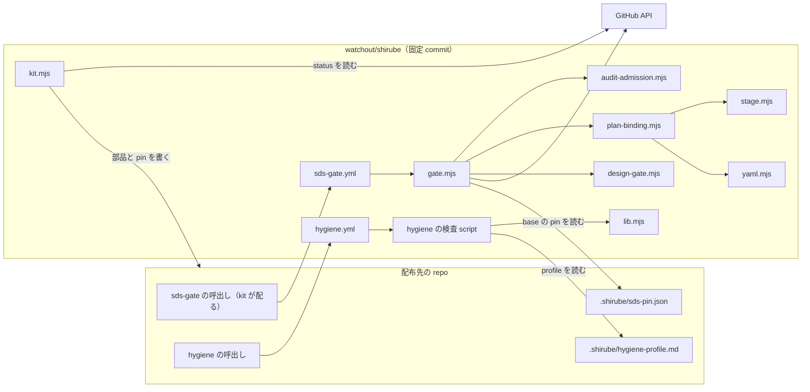
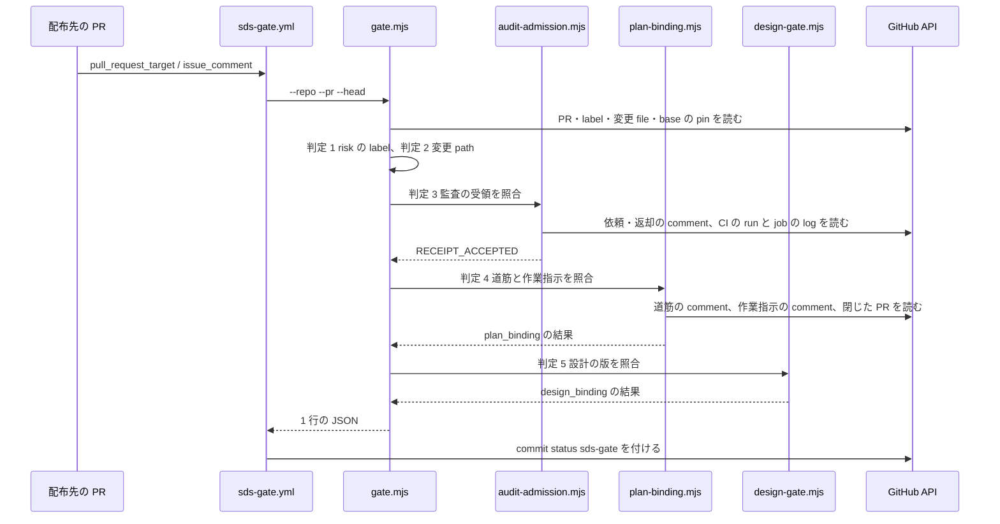
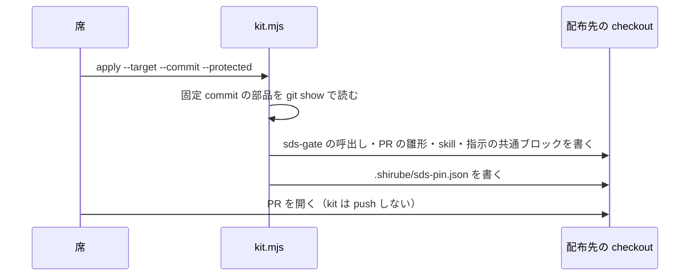

# 仕組みの構成（Architecture）: shirube

## Architecture Analysis

### System Overview

shirube は、GitHub Actions の再利用 workflow から呼ばれる、Node の script の集まりである。常駐する部品は無い。各 repo（配布先）は、自分の workflow から shirube の再利用 workflow を固定 commit で呼び、shirube の script はその commit から checkout されて動く。読むのは GitHub の API と git の差分だけで、書くのは commit status 1 つ（sds-gate）だけである。

### Architectural Style

小さな CLI の集まり（モノレポではない 1 package）。判定の核を純粋な関数に分け（design-gate、plan-admission、stage）、GitHub や git を読む部分を引数で差し替えられる形（`api`・`now`・`verify`・`parse` を引数で渡す）にしている。依存の向きは自己検査で縛られている（`scripts/hygiene/*.mjs` は `lib.mjs` と Node の組込みだけを読む）。

### Component Relationships

<!-- Text fallback: 配布先の repo の sds-gate の呼出しが shirube の sds-gate.yml を固定 commit で呼び、gate.mjs が audit-admission・plan-binding・design-gate を使って判定する。plan-binding は stage と yaml を使う。gate は GitHub API と base の pin を読む。hygiene の呼出しは hygiene.yml を呼び、検査の script が lib.mjs と配布先の profile を使う。kit.mjs は配布先に部品と pin を書き、status で GitHub を読む。 -->

### Data Flow

1. 配布先の PR の出来事（開く・更新・label・comment）で、配布先の `sds-gate` の呼出しが動く（`pull_request_target` と `issue_comment`）。
2. shirube の `sds-gate.yml` が shirube を固定 commit で checkout し、`gate.mjs` を動かす。
3. `gate.mjs` は PR の本文の `json sds-pr` ブロック、label、変更 file の一覧、base の pin を GitHub API で読み、判定 1〜5 を順に行う。
4. 結果は 1 行の JSON で出し、PR の head に commit status `sds-gate` を付ける。
5. hygiene は配布先の checkout と差分を読み、検査ごとに 1 行の JSON を出し、最後に全部の結果を並べて 1 つでも失敗があれば job を失敗にする。

### Key Design Decisions

- 検査の本体を PR の head から取らない（`job.workflow_sha` で checkout し、同一性を確かめる）。
- 構造の事実だけを機械で見て、意味は独立監査に残す（distribution.md §1・§4）。
- 判定 4・5 は pin の mode で段階を持つ。
- 実行時の npm 依存を持たない。YAML だけは ruby の `YAML.safe_load` で読む。
- 時刻・外部への問い合わせは引数で差し替えられる（S4）。

### Improvement Opportunities

- 詰めて書かれた長い行が多く、読みにくい（関数の行数の上限を守るために 1 行に詰めている）。
- 計測（統合までの時間など）を行う部品が無い。今の結果は PR ごとの JSON と commit status だけで、集計されない。
- 継続の核（`src/progression/continuation.mjs`）は呼び出し元が無い。

## Interaction Diagrams

### R2 以上の PR を門が判定する流れ

<!-- Text fallback: PR の出来事で sds-gate.yml が gate.mjs を動かす。gate は GitHub API で PR と pin を読み、判定 1・2 を行い、audit-admission で判定 3、plan-binding で判定 4、design-gate で判定 5 を行い、JSON を返す。workflow が commit status を付ける。 -->

### 配布キットで repo に入れる流れ

<!-- Text fallback: 席が kit.mjs apply を動かすと、kit は固定 commit の部品を読み、配布先の checkout に呼出し・雛形・skill・共通ブロックと pin を書く。PR は席が開く。 -->
