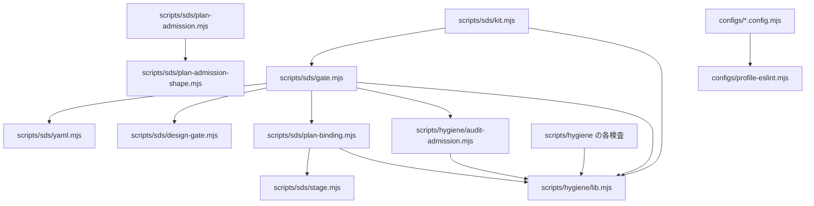

# 依存関係（Dependencies）: shirube

## 外部への依存

| 依存先 | 種類 | 使う所 | 無い・失敗した時 |
|--------|------|--------|------------------|
| GitHub REST API（`gh api`） | 外部サービス | gate、audit-admission、plan-binding、kit の status | 例外になり、門は FAIL、kit は repo ごとに `UNKNOWN` |
| GitHub Actions | 実行基盤 | hygiene.yml、sds-gate.yml、ci.yml | 検査が動かない |
| git | 道具 | lib.mjs（差分・追跡 file）、kit（`git show`） | `UNOBSERVABLE` / エラー |
| ruby | 道具 | yaml.mjs | 「yaml reader unavailable」で判定 4 が FAIL |
| gitleaks 8.30.1 | 道具（固定） | hygiene.yml | sha256 が合わなければ失敗 |
| npm の開発時の依存 6 個 | 道具 | hygiene.yml（配布先の node_modules から）、この repo の lint | 配布先の lockfile に無ければ失敗 |
| ai-dev-framework の固定 commit `561baebe…` | 参照（等価の比較だけ） | tests/plan-admission-equivalence.mjs | 試験を明示的に飛ばす |

## 内部の依存（file 間）

<!-- Text fallback: gate.mjs は lib・audit-admission・plan-binding・design-gate・yaml を読む。audit-admission と plan-binding は lib を読み、plan-binding は stage を読む。kit.mjs は lib と gate（保護面の既定）を読む。plan-admission は plan-admission-shape を読む。衛生の各検査は lib を読む。ESLint の設定は profile-eslint を読む。 -->

## 依存の決まり（自己検査で縛っているもの）

- `scripts/hygiene/*.mjs`（lib 以外）は `lib.mjs` と Node の組込みだけを読む（`.dependency-cruiser.cjs` の `checks-import-only-lib-and-node`）。
- 循環の依存は無し（同じ設定の `no-circular`）。
- `scripts/sds/` は `scripts/hygiene/lib.mjs` と自分の中、Node の組込みだけを読む（distribution.md §2 の決まり。dependency-cruiser では縛っていない）。
- plan-admission は判定 4 にまだつながっていない（distribution.md §2）。
- `src/progression/continuation.mjs` は何も import せず、どこからも import されていない。
