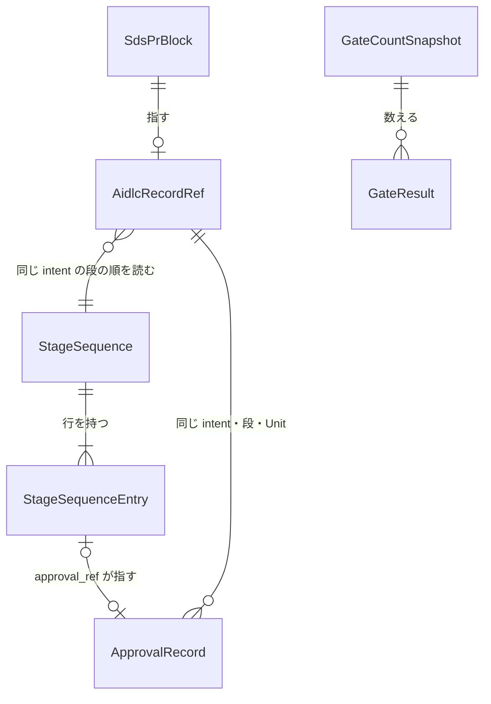

# 振る舞いの仕様（Functional Spec）— U1 u1-skeleton

出典:
- Unit: `inception/units-generation/unit-of-work.md`・`unit-of-work-story-map.md`
- 物語: `inception/user-stories/stories.md`
- 要件: `inception/requirements-analysis/requirements.md`
- 部品: `inception/domain-design/components.md`
- 受け渡しの形: `inception/contract-design/contract-summary.md`（C9 は 2026-10-23 に Contract Design を開き直して足した）
- 作る順番: `inception/delivery-planning/bolt-plan.md` の B1（PR の順）
- データ: `entities.md`、決まり: `rules.md`
- この段の答え: `functional-design-questions.md` の Q1〜Q12
- 2 回目の監査の返却: shirube PR #65 の 6362007900 の BF-07・BF-08、6362354895 の BF-04（Contract Design の Q12・Q13、Units Generation の Q8）
- 独立監査の指摘: shirube PR #65 の sds-audit-review の BF-01〜BF-03

この Unit が受け持つ物語（`stories.md`）:
- US1.2: 計測が 1 行の JSON を出すところまで
- US2.1: block の記録の欄と、門が結果を出すところ
- US2.2: 承認の記録 1 種類の読取り

## 流れ

### W1 承認の記録と段の順の記録を作って main に入れる

1. Owner が AI-DLC の会話で段を承認する。Unit の設計の段では、要約の確認と Unit の完了が audit に残る。
2. 記録を repo に入れる席が、作り手の CLI を動かす（intent・段・Unit・audit の場所を渡す）。
3. 作り手は、承認の記録を、試行ごとに `approvals/<intent>/<段>/<unit>/attempt-<n>.json` として作業場に書く（BR5.1〜BR5.4、Q12）。
   - Inception の段と Code Generation 以降: その段の承認された試行の出来事から作る（BR5.1）。
   - Unit の設計の段: 要約の確認の記録と Unit の完了の記録の両方が、その試行にそろった時だけ作る（BR5.2）。
   - 作る元が無ければ、その file を書かずに失敗で終わる（BR5.3）。
   - 同じ path の file が既にあれば bytes を比べ、同じなら書かず、違えば失敗で終わる。古い試行の file は消さない（BR5.8）。
4. 作り手は、同じ audit から段の順の記録 `approvals/<intent>/_sequence.json` を作り直す。上流の段を開き直した時点より前の下流の行には、無効の印 `superseded: true` を付ける（BR5.5・BR5.6、Q12）。
5. 席は、2 つを含む承認の記録の PR（`bolt-plan.md` の A）を作る。作り手は push せず、audit の file は写さない（BR5.7）。
6. 監査（Owner の作業場の file と bytes が同じか）と統合を通って、記録が main に入る。

### W2 実装の PR を門が判定する

1. 作者の席が、`aidlc_record`（intent・段・Unit）を持つ block と、risk の label を付けて PR を出す。
2. shirube の門の呼出しが、固定 commit の門を動かす（BR7.1）。
3. 門は判定 1〜5 を今までどおり行う。
4. 記録の判定（records）として、次の順に確かめる。
   1. block の `aidlc_record` の形を確かめる（BR1.1・BR1.2）。
   2. main の段の順の記録を読む。無い・壊れている・intent が違う時は FAIL（BR2.2・BR3.1）。
   3. PR が指す段（と Unit）の一番新しい試行の行を探す。その行に無効の印があれば FAIL（BR2.6）。無ければ、印の無い行から前の段の一番新しい試行の行を求める（BR2.1・BR2.3〜BR2.5）。
   4. その行が承認済みで、`approval_ref` が決まりの path かを見る（BR3.2・BR3.3）。
   5. main から承認の記録を読み、決まった形で、試行の番号が行と同じなら PASS（BR3.4・BR3.5）。無い・壊れている・試行が違うなら FAIL で、理由を出す（BR3.5・BR3.6）。
5. 門は判定ごとの結果を 1 行の JSON（`sds-gate-result/1`）にして log に出す（BR4.2）。
6. 門は commit status `sds-gate` を 1 つ付ける。記録の判定は記録だけなので、FAIL でも state を変えない（BR4.1）。
7. GitHub が読めない時は「観測できず」（BR4.3）。

### W3 計測が数える

1. 席か W2 の道具が、repo の一覧・期間・今の時刻を渡して計測を動かす（BR6.1）。
2. 計測は、期間の中に統合された PR ごとに、門の status の state と log の 1 行の JSON を読む（BR6.2）。
3. PASS・FAIL・観測できずに分けて数え、`sds-metrics/1` の最小の欄の 1 行の JSON を標準出力に出す（BR6.3）。
4. 読めない repo があれば、その repo を観測できずとし、`partial: true`、exit code 2 で終わる（BR6.4）。
5. どこにも書かない（BR6.5）。

### W4 細い版の確かめ（済みの条件）

PR の順は `bolt-plan.md` の B1 のとおりです（Delivery Planning の Q10〜Q12。iyasaka-arc#49 6354019047 の 4 の順を改めた）。細かい手順と同梱の範囲は Infrastructure Design の記録に書きます（Q7）。

1. P1: 保護面の 1 本を、Owner の exact-head 1 回で統合する（BR7.1・BR7.2・BR7.5）。中身は次のとおり。
   - AI-DLC の自己適用の file
   - 大きさの数えの除外と、own-code の予算の改め
   - `.gitignore` の audit の除外
   - 門の呼出し・pin・網羅率の CI と計測の job（今の kit では shirube の再利用 workflow を上書きするので、P1 は手で組む）
2. R: 記録の PR で、AI-DLC の記録（audit を除く）を main に入れる。
3. I1: 承認の記録と段の順の記録の作り手を入れる。
4. A: I1 の CLI で作った承認の記録と段の順の記録を、承認の記録の PR（W1）で main に入れる。
5. I2: kit の自己用の書く先（W5）と `budget.mjs` を入れる。
6. I3: 記録の橋と門の記録の判定を入れる。
7. K: kit の版上げの PR で、shirube の pin を I3 の後の main に上げる（W5）。kit が書く 3 つの file もここで入る。
8. I4: K の後の U1 の残りの実装の PR（計測）で、I3 の後の門の W2 が動き、log に `sds-gate-result/1` が出ることを確かめる（Q6）。
9. 計測（W3）が、I4 を数えに入れることを確かめる。

門は base の `sds-gate-self.yml` が固定した commit から動きます。P1 で固定するのは U1 の前の commit なので、I1〜I3 は U1 の前の門で判定されます（記録の判定はまだ無い）。新しい門で判定される最初の U1 の PR は、K の後の I4 です（Delivery Planning の Q11・Q12）。

I1 は、承認の記録の作り手を入れる PR なので、承認の記録（A）より前に出ます（Delivery Planning の Q10）。Q2 の「承認の記録は実装の PR より前に main に入れる」は、I2 からの実装の PR に当たります。

### W5 配布キットが shirube 自身に書く（Q9、BF-03）

1. kit の render・apply・upgrade・check が、target の `.github/workflows/sds-gate.yml` を見る。`on: workflow_call` を持てば、shirube 自身とみなす（BR7.3）。
2. shirube 自身なら、呼出しの書き先と check の比べ先を `.github/workflows/sds-gate-self.yml` にする。再利用 workflow には書かない。書こうとしたら、何も書かずに失敗で終わる（BR7.3）。
3. shirube の pin の版上げは、配布先と同じ kit の版上げの PR で行う（BR7.4）。
4. この書く先は I2 で入る。最初の版上げは I3 の後の K で、shirube の pin を I3 の後の main に上げ、kit が書く 3 つの file（sds-audit の skill・PR の雛形・`AGENTS.md`）もここで入る（Delivery Planning の Q11・Q12）。K は「最初の導入」ではなく「版上げ」として扱う（呼出しと pin は P1 で手で入れてある）。

## 記録の判定の状態の移り変わり

| 今の状態 | 出来事 | 条件 | 次の状態 | すること |
|----------|--------|------|----------|----------|
| 判定の前 | block を読む | `aidlc_record` が無い | FAIL | 理由「aidlc_record が無い」（BR1.1） |
| 判定の前 | block を読む | 欄が足りない | FAIL | 足りない欄の名前（BR1.2） |
| 判定の前 | 段の順の記録を読む | GitHub が読めない・時間切れ | 観測できず | exit code 2（BR4.3） |
| 判定の前 | 段の順の記録を読む | 無い・壊れている・intent が違う | FAIL | 探した path（BR2.2） |
| 判定の前 | 前の段を求める | 指す段の行が無い | FAIL | 理由「その段は段の順の記録に無い」（BR2.3） |
| 判定の前 | 前の段を求める | 指す段の一番新しい試行の行に無効の印がある | FAIL | 理由「上流の段を開き直したので、この段を新しい試行で始め直す」（BR2.6） |
| 判定の前 | 前の段を求める | 前の行が無い | PASS | 理由「最初の段」（BR2.4） |
| 承認を探す | 前の段の行を見る | approved = false | FAIL | 要る試行の番号（BR3.2） |
| 承認を探す | 前の段の行を見る | approval_ref が決まりと違う | FAIL | 決まりの path（BR3.3） |
| 承認を探す | main の承認の記録を読む | 無い・壊れている | FAIL | 探した path（BR3.6） |
| 承認を探す | main の承認の記録を読む | 試行の番号が行と違う | FAIL | 要る試行の番号（BR3.5） |
| 承認を探す | main の承認の記録を読む | 形がそろい、試行が同じ | PASS | —（BR3.4・BR3.5） |

PASS・FAIL・観測できずが終わりの状態で、そこから先には移りません。

## データの関係（`entities.md` から導いた図）



文での説明:
- PR の block は、AI-DLC の記録の場所を 0 か 1 つ指します。
- 記録の場所は、同じ intent の段の順の記録を 1 つ読みます。
- 段の順の記録は、実行した段・Unit・試行の行を 1 つ以上持ちます。
- 承認済みの行は、承認の記録を 1 つ指します。承認の記録は、同じ intent・段・Unit の記録の場所に結び付きます。
- 計測の出力は、門の結果を 0 個以上数えます。
- 配布キットの書く先（KitCallerTarget）は、ほかのデータと結び付きません。

## 決まりの要約（`rules.md` から導いた物）

- 記録の欄が無い・足りない時は FAIL（BR1.1・BR1.2）。
- 前の段は、main の段の順の記録だけから、同じ Unit の行で求める（BR2.1〜BR2.5）。
- 承認は main からだけ読む。前の段の一番新しい試行が承認済みで、承認の記録の試行が同じ時だけ PASS。決まった形のほかは読まない（BR3.1〜BR3.7）。
- 記録の判定は記録だけで、state を変えない。log に 1 行の JSON を出す（BR4.1・BR4.2）。
- 作り手は承認の記録と段の順の記録を同じ bytes で作る。Unit の設計の段は 2 つの記録がそろった時だけ承認。push せず、audit を写さない（BR5.1〜BR5.7）。
- 計測は数えて出すだけで、書かない（BR6.1〜BR6.5）。
- shirube 自身の門の呼出し・pin・網羅率の床と、保護面の同梱の file は、Owner の exact-head を通す。kit は shirube 自身の再利用 workflow を書き換えない（BR7.1〜BR7.5）。

## この Unit が変えてよい置き場

受け渡しの形 C7 の block です。門の判定 5 は、U4 からこの block を読みます。

```json sds-design-locations
{
  "schema": "sds-design-locations/1",
  "unit": "u1-skeleton",
  "paths": [
    "scripts/sds/gate.mjs",
    "scripts/sds/record-bridge.mjs",
    "scripts/sds/approval-record.mjs",
    "scripts/sds/budget.mjs",
    "scripts/sds/kit.mjs",
    "scripts/sds/metrics/**",
    ".github/workflows/sds-gate-self.yml",
    ".github/workflows/ci.yml",
    ".shirube/sds-pin.json",
    ".shirube/hygiene-profile.md",
    ".aidlc-version",
    "aidlc.settings.json",
    ".claude/settings.json",
    ".claude/skills/sds-audit/SKILL.md",
    ".github/pull_request_template.md",
    "AGENTS.md",
    ".gitignore",
    "docs/sds/distribution.md",
    "tests/**"
  ]
}
```

- 保護面の 1 本の PR に同梱する file は、すべてこの中にあります（Q7、BF-01）。
  - AI-DLC の自己適用: `.aidlc-version`・`aidlc.settings.json`・`.claude/settings.json`・`.gitignore`・`.shirube/hygiene-profile.md`・`tests/self-aidlc-settings.test.mjs`（`docs/design/aidlc-include.md` §6 の 3）
  - `.gitignore` の audit の除外（iyasaka-arc#49 6354411741 の 2）
  - U1 の保護面: `.github/workflows/sds-gate-self.yml`・`.github/workflows/ci.yml`・`.shirube/sds-pin.json`
- `scripts/sds/kit.mjs` は、kit の自己用の書く先のために入れました（Q9、BF-03）。
- kit を shirube に当てると、kit は呼出しと pin のほかに `.claude/skills/sds-audit/SKILL.md`・`.github/pull_request_template.md`・`AGENTS.md`（説明文の block）も書くので、3 つを入れました（Q11）。P1 は今の kit では作れず手で組むので、3 つは P1 には入りません（U1 の NFR Requirements の Q8）。3 つは、I3（門の判定）の後の kit の版上げの PR（K）で入ります（Delivery Planning の Q11・Q12）。
- `docs/sds/distribution.md` は、kit の説明を実装に合わせて直すために入れました（設計と実装を食い違わせない）。
- 段の順の記録の作り手は、承認の記録の作り手と同じ `scripts/sds/approval-record.mjs` に置きます（C9 の作り手は ApprovalRecordWriter）。
- `.github/workflows/**` と `.shirube/**` は保護面です。`.claude/settings.json` も R4 です（`docs/design/aidlc-include.md` §8）。これらと同梱の file は、保護面の 1 本の PR（R4）に入れて、Owner の exact-head を 1 回通します。
- その intent の AI-DLC の記録の置き場（`aidlc/spaces/default/intents/261021-dev-speedup-automation/**`）と承認の記録の置き場（`approvals/**`）は、どの Unit でも変えてよい置き場として扱います（C7）。
