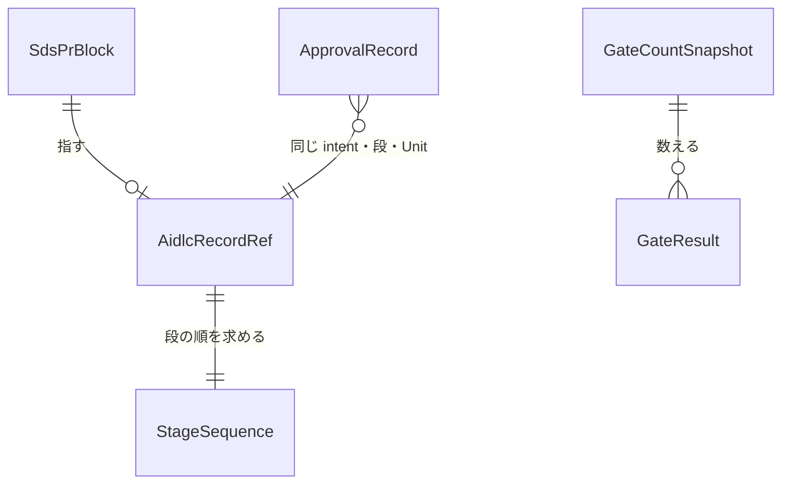

# 振る舞いの仕様（Functional Spec）— U1 u1-skeleton

出典: Unit（`inception/units-generation/unit-of-work.md`・`unit-of-work-story-map.md`）、物語（`inception/user-stories/stories.md`）、要件（`inception/requirements-analysis/requirements.md`）、部品（`inception/domain-design/components.md`）、受け渡しの形（`inception/contract-design/contract-summary.md`）、データ（`entities.md`）、決まり（`rules.md`）、この段の答え（`functional-design-questions.md`）。

この Unit が受け持つ物語（`stories.md`）:
- US1.2: 計測が 1 行の JSON を出すところまで
- US2.1: block の記録の欄と、門が結果を出すところ
- US2.2: 承認の記録 1 種類の読取り

## 流れ

### W1 承認の記録を作って main に入れる

1. Owner が AI-DLC の会話で段を承認する（audit に承認の出来事が残る）。
2. 記録を repo に入れる席が、作り手の CLI を動かす（intent・段・Unit・audit の path を渡す）。
3. 作り手は、その段の一番新しい試行の承認の出来事を探し、`approvals/<intent>/<段>/<unit>.json` を作業場に書く（BR5.1・BR5.3）。出来事が無ければ何も書かずに失敗で終わる（BR5.2）。
4. 席は、その file を含む記録を入れる PR を作る。作り手は push しない（BR5.4）。
5. 監査と統合を通って、記録が main に入る。

### W2 実装の PR を門が判定する

1. 作者の席が、`aidlc_record`（intent・段・Unit）を持つ block と、risk の label を付けて PR を出す。
2. shirube の門の呼出しが、固定 commit の門を動かす（BR7.1）。
3. 門は判定 1〜5 を今までどおり行う。
4. 記録の判定（records）として、次の順に確かめる。
   1. block の `aidlc_record` の形を確かめる（BR1.1・BR1.2）。
   2. main の状態の記録から段の実行の順を作り、PR が指す段の直前の段を求める（BR2.1〜BR2.3）。
   3. main から、その段の承認の記録を読む（BR3.1）。
   4. 決まった形で、一番新しい試行の記録なら承認済み（BR3.2・BR3.3）。無い・壊れている・古い試行なら FAIL で、理由を出す（BR3.3・BR3.4）。
5. 門は判定ごとの結果を 1 行の JSON（`sds-gate-result/1`）にして log に出す（BR4.2）。
6. 門は commit status `sds-gate` を 1 つ付ける。記録の判定は記録だけなので、FAIL でも state を変えない（BR4.1）。
7. GitHub が読めない時は「観測できず」（BR4.3）。

### W3 計測が数える

1. 席か W2 の道具が、repo の一覧・期間・今の時刻を渡して計測を動かす（BR6.1）。
2. 計測は、期間の中に統合された PR ごとに、門の status の state と log の 1 行の JSON を読む（BR6.2）。
3. PASS・FAIL・観測できずに分けて数え、`sds-metrics/1` の最小の欄の 1 行の JSON を標準出力に出す（BR6.3）。
4. 読めない repo があれば、その repo を観測できずとし、`partial: true`、exit code 2 で終わる（BR6.4）。
5. どこにも書かない（BR6.5）。

### W4 細い版の確かめ（済みの条件）

1. shirube の門の呼出しと pin（記録だけ）と網羅率の CI を入れる PR（保護面）を、Owner の exact-head 1 回で統合する（BR7.1・BR7.2）。
2. その後の U1 の残りの実装の PR で、W2 が動き、log に `sds-gate-result/1` が出ることを確かめる。
3. 計測（W3）が、その PR を数えに入れることを確かめる。

## 記録の判定の状態の移り変わり

| 今の状態 | 出来事 | 条件 | 次の状態 | すること |
|----------|--------|------|----------|----------|
| 判定の前 | block を読む | `aidlc_record` が無い | FAIL | 理由「aidlc_record が無い」（BR1.1） |
| 判定の前 | block を読む | 欄が足りない | FAIL | 足りない欄の名前（BR1.2） |
| 判定の前 | 段の順を作る | main の状態の記録が読めない | 観測できず | exit code 2（BR4.3） |
| 判定の前 | 段の順を作る | 指す段が無い | FAIL | 理由「その段は状態の記録に無い」（BR2.2） |
| 判定の前 | 段の順を作る | 前の段が無い | PASS | 理由「最初の段」（BR2.3） |
| 承認を探す | main の記録を読む | 無い・壊れている | FAIL | 探した path（BR3.4） |
| 承認を探す | main の記録を読む | 試行が古い | FAIL | 要る試行の番号（BR3.3） |
| 承認を探す | main の記録を読む | 形がそろい、一番新しい試行 | PASS | —（BR3.2） |

PASS・FAIL・観測できずが終わりの状態で、そこから先には移りません。

## データの関係（`entities.md` から導いた図）



文での説明:
- PR の block は、AI-DLC の記録の場所を 0 か 1 つ指します。
- 記録の場所から、段の順を 1 つ求めます。
- 承認の記録は、同じ intent・段・Unit の記録の場所に結び付きます。
- 計測の出力は、門の結果を 0 個以上数えます。

## 決まりの要約（`rules.md` から導いた物）

- 記録の欄が無い・足りない時は FAIL（BR1.1・BR1.2）。
- 確かめるのは、直前に実行された段の承認（BR2.1）。
- 承認の記録は main からだけ読み、決まった形で、一番新しい試行の物だけを受け入れる（BR3.1〜BR3.5）。
- 記録の判定は記録だけで、state を変えない。log に 1 行の JSON を出す（BR4.1・BR4.2）。
- 作り手は同じ bytes を作り、push しない（BR5.1〜BR5.4）。
- 計測は数えて出すだけで、書かない（BR6.1〜BR6.5）。
- shirube 自身の門の呼出しと網羅率の床は、保護面として Owner の exact-head を通す（BR7.1・BR7.2）。

## この Unit が変えてよい置き場

受け渡しの形 C7 の block です。門の判定 5 は、U4 からこの block を読みます。

```json sds-design-locations
{
  "schema": "sds-design-locations/1",
  "unit": "u1-skeleton",
  "paths": [
    "scripts/sds/gate.mjs",
    "scripts/sds/record-bridge.mjs",
    "scripts/sds/approval-record.mjs",
    "scripts/sds/budget.mjs",
    "scripts/sds/metrics/**",
    ".github/workflows/sds-gate-self.yml",
    ".github/workflows/ci.yml",
    ".shirube/sds-pin.json",
    "tests/**"
  ]
}
```

- `.github/workflows/**` と `.shirube/**` は保護面です。U1 の保護面の PR は R4 で、Owner の exact-head を 1 回通します。
- その intent の AI-DLC の記録の置き場（`aidlc/spaces/default/intents/261021-dev-speedup-automation/**`）と承認の記録の置き場（`approvals/**`）は、どの Unit でも変えてよい置き場として扱います（C7）。
