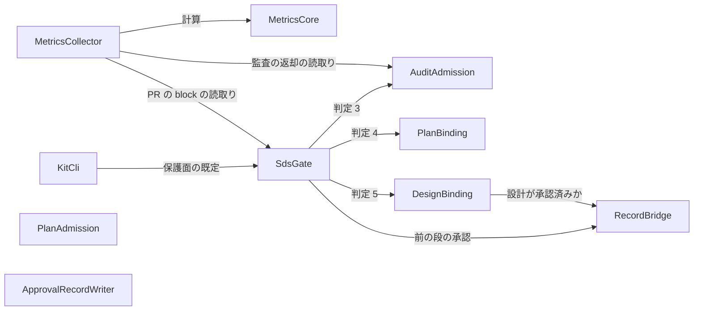

# 部品の一覧（Components）: 開発の高効率化・自動化による高速開発化

出典:
- 要件: `inception/requirements-analysis/requirements.md`
- 物語: `inception/user-stories/stories.md`
- 今の構成: `aidlc/spaces/default/codekb/shirube/architecture.md`・`component-inventory.md`
- チームの進め方: `inception/practices-discovery/team-practices.md`
- この段の答え: `domain-design-questions.md`（Q1〜Q8、arc の設計を Owner が確認）

部品は「書くコードのまとまり」です。GitHub・W2 の道具・AI-DLC の記録の file は、部品が使う外のもので、部品ではありません。どこに置いて動かすかは Units Generation 以降で決めます。

## 部品の目録（機械で読む形）

```yaml
components:
  - name: SdsGate
    summary: PR ごとに判定を順に行い、commit status を 1 つ付ける門（既存の gate.mjs を広げる）
    behaviour: >
      判定 1（risk の label）・判定 2（変更 path）を行い、判定 3〜5 と、前の段の承認の判定を呼んでまとめる。
      読めない・壊れている・形が違う時は FAIL か「観測できず」にし、PASS にしない。
      PR の head のコードではなく、固定した shirube の commit から動く。
      判定ごとの段階（記録だけ・止める）は pin の mode に従い、自分では切り替えない。
      判定を返すだけで、段や作業を自分から始めない。書くのは commit status 1 つだけ。
    responsibilities:
      - PR の機械向けの block（sds-pr/1）の読取りと形の検査（直す元の PR の欄を含む）
      - 判定 1・2 と、全部の判定のまとめ
      - commit status の 1 つへの集約
    depends_on:
      - component: AuditAdmission
        interaction: 判定 3（R2 以上の監査の受領）を確かめる
        style: sync
      - component: PlanBinding
        interaction: 判定 4（道筋の Unit と触ってよい範囲）を確かめる
        style: sync
      - component: DesignBinding
        interaction: 判定 5（設計の版と、変更 path が設計の置き場の中か）を確かめる
        style: sync
      - component: RecordBridge
        interaction: PR が指す AI-DLC の段の、前の段が承認済みかを確かめる
        style: sync
    dependents:
      - component: KitCli
        interaction: 保護面の path の既定を使う
      - component: MetricsCollector
        interaction: PR の block の読取り（直す元の PR の欄）を同じ読み方で使う
    external_dependencies:
      - name: GitHub API
        kind: third-party-api
        purpose: PR・label・変更 file・base の pin を読み、commit status を 1 つ書く
    entities:
      - name: SdsPrBlock
        identifier: repo と PR 番号と head の commit
        attributes: [riskClass, changedPaths, auditRequestRef, aidlcRecord, fixesPr]
      - name: GateResult
        identifier: repo と head の commit
        attributes: [verdict, judgementResults, modes, reasons]

  - name: AuditAdmission
    summary: 監査の依頼と返却の受領を、今の head と CI の結果に照らして確かめる（既存）
    behaviour: >
      依頼の digest、作る人と確かめる人の分離、PR の head と base、CI の run、証拠の行、項目の全部 PASS を見る。
      統合の許可は示さない。GitHub が応答しない時は時間の上限で打ち切り、「観測できず」を返す。
    responsibilities:
      - 監査の返却（sds-audit-review/1）の読取りと照合
    depends_on: []
    dependents:
      - component: SdsGate
        interaction: 判定 3 として呼ばれる
      - component: MetricsCollector
        interaction: 監査の返却の BLOCK を、同じ読み方で数える
    external_dependencies:
      - name: GitHub API
        kind: third-party-api
        purpose: 依頼と返却の comment、CI の run と job の log を読む
    entities:
      - name: AuditReceipt
        identifier: repo と PR 番号と head の commit
        attributes: [requestDigest, reviewVerdict, authorSeat, auditorSeat]

  - name: PlanBinding
    summary: PR が道筋の Unit を指し、作業指示の触ってよい範囲の中だけを変えているかを確かめる（既存の判定 4）
    behaviour: >
      受け付けられた道筋の記録、Unit の依存の完了、作業指示の digest と marker、許可 path、今の段の外を変えないこと（4.18）を照合する。
      範囲の外の path があれば、その path を理由に出す。
    responsibilities:
      - 判定 4 と、今の段の算出
    depends_on: []
    dependents:
      - component: SdsGate
        interaction: 判定 4 として呼ばれる
    external_dependencies:
      - name: GitHub API
        kind: third-party-api
        purpose: 道筋の comment、作業指示の comment、閉じた PR を読む
    entities:
      - name: WorkInstructionBinding
        identifier: 作業指示の comment の URL
        attributes: [unitId, allowedPaths, digest]
        references:
          - entity: DeliveryPlan
            owned_by: PlanAdmission
            relationship: 作業指示は、受け付けられた 1 つの道筋の Unit を指す

  - name: PlanAdmission
    summary: 道筋の記録の形と意味を検査し、今の段の採択の参照の無い道筋を拒む（既存を広げる）
    behaviour: >
      道筋の記録（shirube-delivery-plan/v1）の形と意味を検査し、PASS / BLOCK と理由を返す。
      新しく、今の段の済みの条件を Owner が採択した記録への参照が無い道筋を BLOCK にする（Inception が先）。
    responsibilities:
      - 道筋の受付の判定
      - 今の段の採択の参照の検査
    depends_on: []
    dependents: []
    external_dependencies: []
    entities:
      - name: DeliveryPlan
        identifier: 道筋の id と世代
        attributes: [stageAdoptionRef, units, admissionVerdict]

  - name: DesignBinding
    summary: PR が承認済みの設計の版を指し、変更 path が設計に書いた置き場の中かを確かめる（既存の判定 5 を広げる）
    behaviour: >
      設計の版の型・未決の答え・承認の digest と marker を形で見る（既存）。
      新しく、PR の変更 path が、設計の記録に書いた置き場の中かを見て、外れた path を理由に出す。
      設計が承認済みかは、記録の橋に確かめる。
      意味のずれ（設計どおりの振る舞いか）は判定しない。それは独立監査の項目 I7 で見る。止める判定に LLM を使わない。
    responsibilities:
      - 判定 5 と、設計の置き場の検査
    depends_on:
      - component: RecordBridge
        interaction: PR が指す設計の記録が AI-DLC で承認済みかを確かめる
        style: sync
    dependents:
      - component: SdsGate
        interaction: 判定 5 として呼ばれる
    external_dependencies: []
    entities:
      - name: DesignRecordRef
        identifier: 設計の記録の id と版
        attributes: [declaredLocations, approvalDigest]
        references:
          - entity: AidlcStageRef
            owned_by: RecordBridge
            relationship: 設計の記録は、AI-DLC の 1 つの段の出力である

  - name: RecordBridge
    summary: PR が指す AI-DLC の記録を読み、前の段の承認の記録があるかを形で確かめる（新規）
    behaviour: >
      PR の block の aidlc_record（intent と段）から、repo の中の AI-DLC の記録を読む。
      前の段の承認として受け入れるのは、Shirube が公開する承認の記録の 1 種類だけ。S1 は「本人確認: なし」の印も受け入れる。
      ほかの形の「承認」（コメントの文など）は読まない。
      無い・読めない・壊れている時は FAIL にし、足りない記録の名前を出す。
      機械が見るのは形と在りかまでで、本人の承認かは見ない。
    responsibilities:
      - AI-DLC の記録の在りかと段の状態の読取り
      - 前の段の承認の記録の照合
    depends_on: []
    dependents:
      - component: SdsGate
        interaction: 前の段の承認の判定として呼ばれる
      - component: DesignBinding
        interaction: 設計の記録が承認済みかを答える
    external_dependencies:
      - name: AI-DLC の記録（repo の aidlc/ の下）
        kind: other
        purpose: 段の状態と出力の在りかを読む
    entities:
      - name: AidlcStageRef
        identifier: intent と段
        attributes: [statePath, stageStatus, outputs]
        references:
          - entity: ApprovalRecord
            owned_by: ApprovalRecordWriter
            relationship: 段は、承認の記録を 0 か 1 つ持つ

  - name: ApprovalRecordWriter
    summary: Owner の AI-DLC の会話の承認から、決まった形の承認の記録を作る CLI（新規）
    behaviour: >
      AI-DLC の audit の承認の出来事を読み、決まった形の承認の記録を作る。S1 では「本人確認: なし」の印を付ける。
      作った記録は、記録を repo に入れる PR に含める（CLI は push しない）。
      後から「本人確認: 済み」に書き換えない。同じ承認から 2 回作っても、同じ記録になる。
    responsibilities:
      - 承認の記録の形の持ち主
      - 承認の記録の生成
    depends_on: []
    dependents: []
    external_dependencies:
      - name: AI-DLC の audit の file
        kind: other
        purpose: 承認の出来事を読む
    entities:
      - name: ApprovalRecord
        identifier: intent と段と試行
        attributes: [approvedAt, approverRole, identityCheck, sourceEventDigest]

  - name: MetricsCore
    summary: 4 つの指標と判定を計算する純粋な関数の集まり（新規）
    behaviour: >
      PR の一覧・時刻・分類・Owner の手の一覧を引数で受け、自分では時計も GitHub も読まない。
      時間は「PR を開いてから統合まで」の中央値と 90 パーセンタイル（判定は中央値）。意図の記録からの時間は別に出す。
      手戻りは、監査の BLOCK・門の FAIL の後の直しの push・統合の後の fix / revert の PR の 3 種類を数え、回数と率を出す（判定は率）。
      PR が 0 件なら「n/a」、未分類の FAIL は「未分類」と出し、0 にしない。
      半分の判定は、S1 の後の 30 日の値が今の値の 50% 以下かで出す。30 日が終わる前は「判定の前」。
      切り替えの目安は、記録だけの期間に PR が 10 件以上通り、門の不備が 0 の repo に「伺える」と出す。
      同じ入力からは同じ bytes を出す。期間の境目は日本時間の日。
    responsibilities:
      - 指標の計算
      - 半分の判定
      - 切り替えの目安の判定
      - #53 に載せる文の組立て
    depends_on: []
    dependents:
      - component: MetricsCollector
        interaction: 集めた入力を渡し、結果を受け取る
    external_dependencies: []
    entities:
      - name: Baseline
        identifier: 今の値の id
        attributes: [periodStart, periodEnd, repos, prNumbers, medianTime, p90Time, reworkCount, reworkRate]
      - name: MetricsSnapshot
        identifier: 測った時刻
        attributes: [timeStats, reworkStats, ownerTouches, aiDlcApprovals, misStops, unclassified, partialRepos, switchReadyRepos, halfJudgement]
        references:
          - entity: Baseline
            owned_by: MetricsCore
            relationship: 各回の値は、1 つの今の値と比べる

  - name: MetricsCollector
    summary: GitHub から計測の入力を集めて計算の核に渡し、結果を出す（新規）
    behaviour: >
      3 repo の統合された PR、門の status、監査の返却、分類の記録、#49 の Owner の決定（この intent か道筋 DP-SHIRUBE-001 を指す物）を読む。
      GitHub への問い合わせは 1 回ごとの時間の上限と全体の予算を持ち、使い切ったら、その repo を「観測できず」として渡す。
      結果は 1 行の JSON と #53 に載せる文として出すだけで、どこにも書かない（#53 の置き換えは W2 の道具が行う）。
      読むのは開発の記録だけで、製品のデータは読まない。
    responsibilities:
      - 計測の入力の収集
      - 「誤って止めた」分類の記録（sds-gate-fail-classification/1）の形の持ち主と読取り
      - Owner の手の一覧の収集
    depends_on:
      - component: MetricsCore
        interaction: 入力を渡して指標と判定を計算させる
        style: sync
      - component: AuditAdmission
        interaction: 監査の返却の BLOCK を、門と同じ読み方で読む
        style: sync
      - component: SdsGate
        interaction: PR の block の直す元の PR の欄を、門と同じ読み方で読む
        style: sync
    dependents: []
    external_dependencies:
      - name: GitHub API
        kind: third-party-api
        purpose: PR・status・comment・#49 の決定を読む（書込みはしない）
      - name: W2 の道具（iyasaka-arc 側、この Mac で 04:30・18:00）
        kind: other
        purpose: 計測を呼び、出力を #53 に載せる
    entities:
      - name: FailClassification
        identifier: repo と PR 番号と head の commit
        attributes: [classification, auditorSeat, reason]
        references:
          - entity: GateResult
            owned_by: SdsGate
            relationship: 分類は、門の 1 つの FAIL について書く
      - name: OwnerTouch
        identifier: 元の記録の URL
        attributes: [kind, occurredAt, intentRef]

  - name: KitCli
    summary: 配布キット（apply・upgrade・check・status）。3 repo への版の配布と、配布先の一覧を持つ（既存）
    behaviour: >
      固定した shirube の commit の部品と pin を配布先に書く。push と統合はしない。
      check は、配った file と pin のずれを出す。
      配布先の一覧に shirube・aun・onza を足す。PR の雛形に、AI-DLC の記録と直す元の PR の欄を加える。
    responsibilities:
      - 部品と pin の配布
      - 配布先の一覧
    depends_on:
      - component: SdsGate
        interaction: 保護面の path の既定を使う
        style: sync
    dependents: []
    external_dependencies:
      - name: GitHub API
        kind: third-party-api
        purpose: 配布先の状態を読む
      - name: git
        kind: other
        purpose: 固定 commit の部品を読む
    entities:
      - name: Pin
        identifier: 配布先の repo
        attributes: [sdsCommit, kitVersion, fileDigests, planBindingMode, designBindingMode, protectedPaths]
      - name: ConsumerEntry
        identifier: 配布先の repo
        attributes: [adopter, adoptionRecord, profileKind, state]
```

## 部品の図



文での説明:
- SdsGate は AuditAdmission・PlanBinding・DesignBinding・RecordBridge を呼ぶ。DesignBinding は RecordBridge を呼ぶ。
- MetricsCollector は MetricsCore・AuditAdmission・SdsGate を呼ぶ。KitCli は SdsGate を使う。
- PlanAdmission と ApprovalRecordWriter は、ほかの部品を呼ばない独立の CLI。PlanAdmission が受け付けた道筋は PlanBinding が読み、ApprovalRecordWriter が作った記録は RecordBridge が読む。

## 部品の一覧（表）

| 部品 | 目的 | 呼ぶ相手 | 呼ばれる相手 | 持つデータ |
|------|------|----------|--------------|------------|
| SdsGate | 判定のまとめと commit status | AuditAdmission、PlanBinding、DesignBinding、RecordBridge | KitCli、MetricsCollector | SdsPrBlock、GateResult |
| AuditAdmission | 監査の受領の照合（既存） | — | SdsGate、MetricsCollector | AuditReceipt |
| PlanBinding | 判定 4（既存） | — | SdsGate | WorkInstructionBinding |
| PlanAdmission | 道筋の受付と採択の参照の検査 | — | — | DeliveryPlan |
| DesignBinding | 判定 5 と設計の置き場の検査 | RecordBridge | SdsGate | DesignRecordRef |
| RecordBridge | AI-DLC の記録と承認の記録の照合（新規） | — | SdsGate、DesignBinding | AidlcStageRef |
| ApprovalRecordWriter | 承認の記録の生成（新規） | — | — | ApprovalRecord |
| MetricsCore | 指標と判定の計算（新規） | — | MetricsCollector | Baseline、MetricsSnapshot |
| MetricsCollector | 計測の入力の収集と出力（新規） | MetricsCore、AuditAdmission、SdsGate | — | FailClassification、OwnerTouch |
| KitCli | 配布（既存） | SdsGate | — | Pin、ConsumerEntry |

## データの持ち主

| データ | 持ち主の部品 | 見分ける物 | 項目 | 参照 |
|--------|--------------|------------|------|------|
| SdsPrBlock | SdsGate | repo と PR 番号と head | riskClass、changedPaths、auditRequestRef、aidlcRecord、fixesPr | — |
| GateResult | SdsGate | repo と head | verdict、judgementResults、modes、reasons | — |
| AuditReceipt | AuditAdmission | repo と PR 番号と head | requestDigest、reviewVerdict、authorSeat、auditorSeat | — |
| WorkInstructionBinding | PlanBinding | 作業指示の URL | unitId、allowedPaths、digest | DeliveryPlan（PlanAdmission） |
| DeliveryPlan | PlanAdmission | 道筋の id と世代 | stageAdoptionRef、units、admissionVerdict | — |
| DesignRecordRef | DesignBinding | 設計の記録の id と版 | declaredLocations、approvalDigest | AidlcStageRef（RecordBridge） |
| AidlcStageRef | RecordBridge | intent と段 | statePath、stageStatus、outputs | ApprovalRecord（ApprovalRecordWriter） |
| ApprovalRecord | ApprovalRecordWriter | intent と段と試行 | approvedAt、approverRole、identityCheck、sourceEventDigest | — |
| Baseline | MetricsCore | 今の値の id | periodStart、periodEnd、repos、prNumbers、medianTime、p90Time、reworkCount、reworkRate | — |
| MetricsSnapshot | MetricsCore | 測った時刻 | timeStats、reworkStats、ownerTouches、aiDlcApprovals、misStops、unclassified、partialRepos、switchReadyRepos、halfJudgement | Baseline（MetricsCore） |
| FailClassification | MetricsCollector | repo と PR 番号と head | classification、auditorSeat、reason | GateResult（SdsGate） |
| OwnerTouch | MetricsCollector | 元の記録の URL | kind、occurredAt、intentRef | — |
| Pin | KitCli | 配布先の repo | sdsCommit、kitVersion、fileDigests、planBindingMode、designBindingMode、protectedPaths | — |
| ConsumerEntry | KitCli | 配布先の repo | adopter、adoptionRecord、profileKind、state | — |

## 外のもの

| 部品 | 外のもの | 種類 | 使い道 |
|------|----------|------|--------|
| SdsGate | GitHub API | third-party-api | PR を読み、commit status を 1 つ書く |
| AuditAdmission | GitHub API | third-party-api | 監査の comment と CI の記録を読む |
| PlanBinding | GitHub API | third-party-api | 道筋と作業指示を読む |
| RecordBridge | AI-DLC の記録（repo の aidlc/） | other | 段の状態と出力を読む |
| ApprovalRecordWriter | AI-DLC の audit の file | other | 承認の出来事を読む |
| MetricsCollector | GitHub API | third-party-api | PR・status・comment・#49 を読む（書かない） |
| MetricsCollector | W2 の道具 | other | 計測を呼び、出力を #53 に載せる |
| KitCli | GitHub API、git | third-party-api、other | 配布先の状態と固定 commit の部品を読む |

## 分けた理由

| 部品 | 分けた理由 |
|------|------------|
| SdsGate | commit status を 1 つに保つまとめ役。必須の検査と Owner の決定が 1 つで済む（Q1、ADR-001） |
| AuditAdmission・PlanBinding | 既存の判定で、それぞれ別の記録（監査の comment、道筋と作業指示）を読む。変える理由も別 |
| PlanAdmission | 道筋を受け付ける時に動き、PR の時には動かない。動く時が違う（Q7、ADR-007） |
| DesignBinding | 設計の版を見る既存の判定。置き場の検査も設計の持ち物なのでここに足す（Q1、ADR-001） |
| RecordBridge | AI-DLC の記録の形は AI-DLC の版で変わる。その変化をここで受け止め、ほかの判定に広げない（Q1、ADR-001） |
| ApprovalRecordWriter | 承認の記録の形の持ち主。S1 から DB の段へ移る時に、作る側だけを替える（Q5、ADR-005） |
| MetricsCore | 純粋な計算で、同じ入力から同じ値が出ることを試験で示せる（Q2、ADR-002） |
| MetricsCollector | GitHub を読む部分。時間の上限や予算、「観測できず」をここに閉じ込める（Q2、ADR-002） |
| KitCli | 既存の配布。配布先の一覧と雛形の欄を足す |

ほかの分け方と、採らなかった理由:
- 新しい門を別の commit status として作る（Q1 の B）: 必須の検査と Owner の決定が 2 つになり、Owner の手が増える。
- 記録の橋を判定 5 の中に入れる（Q1 の C）: 前の段の承認の判定まで、設計の判定に混ざる。
- 計測を 1 本の script にまとめる（Q2 の B）: 計算を試験で切り離せない。
- 計測を指標ごとに 4 本に分ける（Q2 の C）: GitHub の読取りが 4 か所に分かれ、同じ読み方が重なる。

いま残っている形（設計の時点の事実）: 計画の受付（PlanAdmission）は、判定 4 にまだつながっていません（`component-inventory.md`）。PlanBinding は、受け付けられた道筋の記録を読みます。受付を判定 4 から呼ぶかは、この段では変えません。
