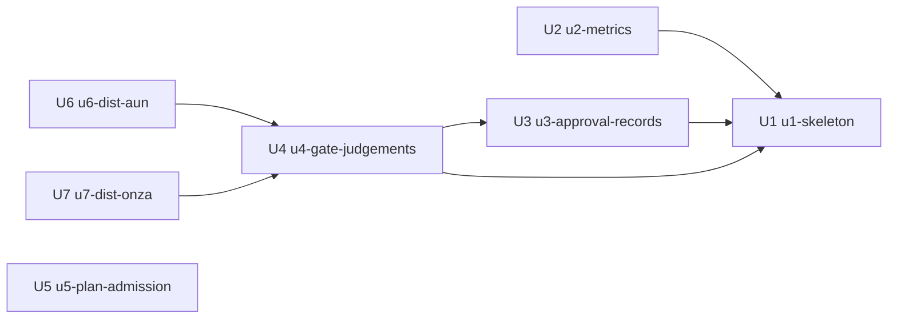

# Unit の依存（Unit of Work Dependency）

出典: `unit-of-work.md`、部品の一覧（`inception/domain-design/components.md`）、要件（`inception/requirements-analysis/requirements.md`）、この段の答え（`units-generation-questions.md`）。

この記録は、何が何を待つかだけを書きます。どの順で作るか、何を先に出すかは、次の Delivery Planning で決めます。

## 依存の一覧（機械で読む形）

```yaml
units:
  - name: u1-skeleton
    kind: service
    depends_on: []
  - name: u2-metrics
    kind: service
    depends_on: [u1-skeleton]
  - name: u3-approval-records
    kind: service
    depends_on: [u1-skeleton]
  - name: u4-gate-judgements
    kind: service
    depends_on: [u1-skeleton, u3-approval-records]
  - name: u5-plan-admission
    kind: service
    depends_on: []
  - name: u6-dist-aun
    kind: packaging
    depends_on: [u4-gate-judgements]
  - name: u7-dist-onza
    kind: packaging
    depends_on: [u4-gate-judgements]
```

## 依存の図



文での説明（矢印は「待つ」）:
- U2 と U3 は U1 を待つ。
- U4 は U1 と U3 を待つ。
- U6 と U7 は U4 を待つ。
- U5 はどれも待たない。
- 依存の輪はない。

## Unit の間のつながり

| 待つ Unit | 待たれる Unit | つながり |
|-----------|---------------|----------|
| U2 | U1 | U1 の計測の最小の形（MetricsCollector・MetricsCore）を広げる。門の status を読む形を U1 で決める |
| U3 | U1 | U1 の記録の橋と承認の記録の最小の形を、確定した形に広げる |
| U4 | U1 | U1 で門に足した記録の欄と判定の上に、判定 5 の置き場の検査と段階を足す |
| U4 | U3 | 判定 5 が「設計の記録が承認済みか」を記録の橋に確かめる（ADR-001） |
| U6 | U4 | 配る版は、U4 で門の判定・PR の雛形の欄・配布先の一覧がそろった shirube の commit |
| U7 | U4 | U6 と同じ |

共有するデータの持ち主は、部品の一覧のとおり 1 つの部品に決まっています。Unit の間では、PR の block・commit status・承認の記録・計測の出力（1 行の JSON）の形でつながります。形の細部は Contract Design で決めます。

## 並べて進められる組

依存の無い Unit どうしは、別の席なら並べて進められます（Q4）。ただし、同じ席に 2 つの Unit を同時に渡しません。shirube の Unit（U1〜U5）は同じ shirube の実装の席が作るので、順に進めます。

- U1 と U5（どちらもどれも待たない。作る席は同じ）
- U2 と U3（どちらも U1 だけを待つ。作る席は同じ）
- U6 と U7（どちらも U4 だけを待つ。作る席が別なので、並べて進められる）

## 端から端まで通る細い版

- 細い版は U1 です。U1 はどの Unit も待たないので、ほかの Unit より前に動かせます。
- U1 だけで、次の流れが最後まで動きます。
  1. PR の block の AI-DLC の記録の欄
  2. 記録の橋
  3. 門の status（記録だけ）
  4. 計測が status を数えて出す
- 後の Unit（U2〜U4）は、この流れの各所を広げるだけで、流れ自体は変えません。
- 実際に通る確かめ方（何を動かして何が出れば通ったとするか）は、Delivery Planning で決めます。
