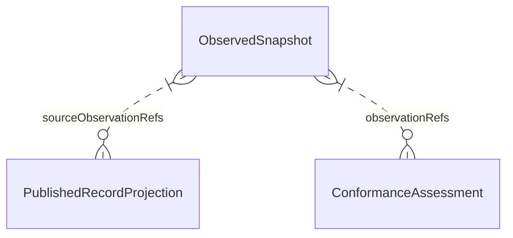

# U1 — Functional Specification

## Sources and Scope

対象は `261105-shirube-lifecycle-qualit / u1-ci-record-admission`。本書は**workflowと状態遷移の正本**である。[entities.md](entities.md)のYAMLを形状/所有、[rules.md](rules.md)のYAMLを判定の正本とし、本書のER図/規則表は派生viewとする。[確認済み計画](functional-design-questions.md)の内容を正式化し、製品コード・試験・CIの実行結果は含めない。

正式入力:

- [unit-of-work.md](../../../inception/units-generation/unit-of-work.md)
- [unit-of-work-story-map.md](../../../inception/units-generation/unit-of-work-story-map.md)
- [stories.md](../../../inception/user-stories/stories.md)
- [requirements.md](../../../inception/requirements-analysis/requirements.md)
- [components.md](../../../inception/domain-design/components.md)
- [contract-summary.md](../../../inception/contract-design/contract-summary.md)

補完は[bolt-plan](../../../inception/delivery-planning/bolt-plan.md)、[team-allocation](../../../inception/delivery-planning/team-allocation.md)、[external-dependency-map](../../../inception/delivery-planning/external-dependency-map.md)、[risk-and-sequencing-rationale](../../../inception/delivery-planning/risk-and-sequencing-rationale.md)、[Delivery回答](../../../inception/delivery-planning/delivery-planning-questions.md)。US2.1、US2.2、US3.2、US4.1、US4.2、US4.3の全30ACを[traceability.json](traceability.json)に宣言する。OKは自単位設計への対応であり、共有story全体の実装済みを意味しない。

## Current Decisions and Assurance Boundary

U1はU2の対話/U3の開始機能を待たず、実PR取得→必要記録/承認・適用READY・現在内容digest・該当する同PR設計監査の**4条件**→結果出力→CI停止までを単位内で実現する。U4の信頼版traceability/upstream-coverage再実行は別責務であり、この4条件へ混ぜない。

**門が保証しないこと:** engineが記録を発行した真正性、Owner本人性、見直しの実実行、実CodeGen開始時刻、完全な非公開履歴、未公開の取消しは自動証明しない。完全に整合した作者生成記録の真正性までCIが検知したとしない。既存devauditorがPR独立監査で記録を読み、作者受領/別担当統合/必要な公開Owner決定・exact-headを別条件として保持する。独立監査が暗号的本人性を証明するとも言わない。PASSは進行命令・merge許可・保護対象変更の許可ではない。

上流の発行元真正性必須/3条件/方式採択前の真正性実CI実証という旧記載は、承認済みContract Designの変更対応表で置換済み。新host/producer/原本供給サービス/別取り組み/RFC/追加認証を再導入しない。必須集合の決定にも私的原本のCI供給を要求しない。

## Workflows — Source of Truth

### W01 — 一回のPR評価

1. 呼出側が既存門entryへ対象、信頼する検査版、現在checkpoint、明示now/ID/有限予算を渡す。PR記録がcheckpointや必須集合を選ぶ形は受けない。
2. EvidenceCollectionのI/O側が実repo/PR/head/baseを取得する。PR files全ページ、固定headのtree/blob、必要な公開監査原文を読み、取得完全性をObservedSnapshotへ付す。宣言head/digestやローカルcacheを実観測に写さない。
3. W02で必要集合を独立に定める。公開projectionの版/型/重複/対象/path/公開除外を検査する。壊れた必須1件をskipしてPASSにしない。
4. W03で承認kind/choiceとREADY適用を、W04で全集合とstage subsetの現在digestを照合する。必要ならW05の設計監査を照合する。
5. ConformanceGateの純粋核へ全観測/固定policy/時刻/IDを明示入力し、規則に従う4条件と全体結果を一度だけ作る。核はI/O/時計/乱数を取得せず、adapterは意味を再定義しない。
6. 取得前後の実head/baseを照合し、評価中の変更なら古い結果を出力へ使わない。W06で完全assessment/非保証/残件/対象を検査して出す。部分出力や構造拒否を有効なassessmentとして消費させない。
7. 既存entryはPASSならJSONとexit0、FAIL/UNKNOWNなら理由付きJSONとexit1を返す。引数エラー等の既存契約は維持し、新CLI/新進行機構を作らない。純粋核はprocess終了を行わない。

予算はrulesのpolicy.budgetを参照する。欠ページ/拒否/404だけ/timeout/cancel/上限/途中変更は観測不能。read-only metadata経路だけを使い、PR側scriptを実行しない。実評価を確定する入力が作れなければ構造拒否/UNKNOWNを返し、欠けた実digestやassessmentを架空値で補わない。成功用の完全envelopeを作れないエラー応答は下流にPASS用envelopeとして渡さない。

**前処理失敗と有効なassessmentを区別する。** 実blob未取得でartifactSetDigestが算出できない、head/base自体が未観測、公開viewが不正な場合は、既存entryの失敗境界で診断を返してexit1とする。これは閉門の診断であってConformanceAssessment/AdmissionEnvelopeではなく、配布・下流の判定消費へ渡せない。宣言digest、架空hash、空集合hashを観測の代用にせず、契約のSha256やhead/baseをnullableへ変えない。完全assessmentは、その全必須fieldを観測に基づいて安全に構成できる場合だけ出す。実digestが得られていて設計監査原文だけが取得不能等なら、他の必須fieldも満たした完全assessmentで当該条件UNKNOWNを返せる。

前処理診断でも判定不能の対象/段階/理由と既知の非保証を明示し、既に確認できた残件は保持する。残件を判定していなければ「残件は未評価」と説明し、`knownRemaining: []`を「残件なし確認済」として合成しない。既存entryの失敗JSON契約を保持し、新しい成功schemaや診断専用サービスは追加しない。下流は診断を有効な完全envelopeへ変換・default補完せず停止する。

### W02 — 必須集合と現在checkpoint

1. 信頼版stage graph/出力一覧、有効計画の参照/版、単位種別と対象を別入力として照合する。不明/矛盾はUNKNOWN。
2. 最初のU1では適用Inceptionを含め、現PRで必要な成果物とstage slotsの非空集合を作る。計画の適用段を作者のstages空配列/skip/excludeで減らせない。
3. すでに人が完了承認した適用段には、そのstage-completionを含む必要checkpoint記録を要求する。進行中段は提出成果物と実施済みplan/summary等を区別する。
4. 現CodeGenの未来完了承認、未開始Build and Test/CIの承認は要求しない。gate:falseのsummaryをstage-completionへ読み替えない。後のcheckpointでは新たな完了承認を必要集合へ加える。
5. required stage/unit/attemptごとの固定artifact subsetと必要approval kindを照合する。欠落ならFAIL、適用/現attemptを確定できなければUNKNOWN。過去6段/5不足へhardcodeしない。

これは正式AI-DLCの進行を複製せず、固定契約と掲載された適用計画の**機械整合**を検査する。計画自体の真正性は非保証と独立監査の対象である。

### W03 — 掲載変換・承認値・READY

掲載前の変換とCIでの検査を別の処理とする。以下のnative fieldはinstalled native 2.11.1を読んだ変換元の仕様/値出典であり、CIへ私的raw log/receipt本体を渡す要件ではない。

| checkpoint | 掲載前の既存権限内での変換 | CIの公開view検査 |
|---|---|---|
| plan（Code Generation） | PLAN_APPROVAL_RECORDED.Detailsと当該対象version1 receipt.choiceの対応からcanonical `Approve Plan`を載せる | kind=plan、固定肯定値、対象/attempt/論理recordRef/内容対応 |
| plan（分割計画等） | 固定stage契約の計画質問/選択肢/現計画へ対応する回答だけを載せる。一般QUESTION_ANSWEREDでは代用しない | 必要な計画slot/参照とcanonical `Approve Plan`の整合 |
| summary | Checkpoint=summary-confirmationのSUMMARY_CONFIRMATION_RECORDED.Detailsとauthorization.choiceから`Looks correct`を載せる | kind=summary、固定肯定値、対象/attempt/ref/現在成果物の対応 |
| stage-completion | GATE_APPROVED.User Inputのcanonical `Approve`または正式提示の`Accept as-is`を載せる | kindと選択肢根拠/対象/承認日/attemptの整合 |

出典は`.codex/tools/aidlc-log.ts:2051–2075,2308–2357,2470–2505`、`aidlc-lib.ts:5049–5158,12789–12800,14027–14053,14131–14174`、`aidlc-testing-posture.ts:4085–4202`、`aidlc-reply-reader.ts:164`、`aidlc-state.ts:7230–7325,7632–7660`。段内計画の値は準備時の正規read-only `aidlc engine log answers --stage units-generation`で計画質問/選択肢との対応を確認した。これらの内部関数を新しい公開APIとしない。

1. 掲載処理は元参照との対応を既存権限内に保持し、公開kind/choice/target/unit/attempt/recordRef/現在digest等をallowlistで取り出す。private fields全部を公開必須にせず、recordRefへ私的path/bodyを写さない。
2. CIは公開PublishedRecordProjectionと実PR観測だけで種類別の充足を検査する。元receiptの存在/発行/本人/完全履歴の認証は行わない。変換の単体試験と公開viewの検査は別に行う。
3. `Request Changes`、`Request changes`、`Revise Plan`、空/空白/未知/他kindの肯定は必要承認に数えない。source kind/checkpoint/対象が不明ならUNKNOWN。自由文/番号/大小文字/日本語から肯定を推測しない。
4. plan off/skipped、一般質問、Autonomous:true/人User InputなしGATE_APPROVED、STAGE_COMPLETED単独から人承認を作らない。正式適用外の根拠は固定契約で照合し、任意免除flagを受けない。
5. stage-completionのapprovedAt/format/approvalRecordRefを照合する。READYの日付境界はrulesの固定policy。UTCでは2026-11-05T15:00:00Zを含む。dateはAsia/Tokyo暦日、offset付きtimestampは同zoneへ変換する。plan/summary/掲載日を代用しない。
6. 閾値以後の完了承認/再承認と、再開後の実施済み適用見直しは正式役名/READY/対象/attempt/requestRef/現在stage subset digestを要求する。未知日/参照矛盾/日付だけの旧日変更はUNKNOWN。
7. 閾値前の不足だけはready PASSにできるが、KnownRemainingの対象/承認ref/日付/revisitOnReopenを保持する。必要READYが0件でも全承認日を確認し、stages/artifacts非空条件は残す。再開/再承認を最初の古い日へ畳み込まない。

旧観測ではfeasibilityの原承認は閾値前、scope-definitionは閾値前原承認と閾値後再承認、team-formation/approval-handoff/reverse-engineering/practices-discoveryは閾値後だった。この6段のうち閾値後5段は、actual PRで必要READYが無ければ失敗する。これは当時の観測範囲であり、以後のDelivery Planning等を含む現在の不足数/解消を断定しない。既存承認は撤回/捏造せず、legacyだけnonblockingとする。

### W04 — 現在内容のdigest

1. W02の必要pathと実変更集合を照合し、通常fileの固定head raw bytesからbyte数/SHA-256を計算する。改行/空白/BOM/Unicodeを正規化しない。
2. pathはGit treeと同じUTF-8 bytesを保持する。危険な別表記/重複/境界外参照を拒否し、rename/追加/欠落を分類する。未分類追加を黙って除外しない。
3. UTF-8 byte順にsortし、`JSON.stringify([path,bytes,sha256]) + LF`のUTF-8連結のSHA-256を計算する。global digestは全必要集合、review digestはstage固定subsetへ比較する。native fingerprintは別形式として区別する。
4. 掲載記録自身/監査comment/CI結果の自己参照除外は信頼版の固定分類だけを適用し、除外記録にも版/対象/充足を検査する。掲載記録commit自身のSHA事前埋込みは要求しない。
5. current headは実観測の結果へ返す。内容一致で過去参照を扱う際もdesignHeadは実在する履歴commitとして別に厳密照合する。

### W05 — 同PR設計監査

1. 設計と実差分からDB構造/権限/契約/securityの各分類の該当・非該当・不明と根拠pathを定める。全部が根拠付き非該当の場合だけdesignAudit NOT_APPLICABLE。不明はUNKNOWN。
2. 該当時は既存監査規約の公開request/review原文を読み、同repo/PR/unit、design-only snapshot、実在designHead/祖先/base、本文SHA/request_digest/指定投稿者/全必須PASS/blockingなしを照合する。URL存在/名前/READY_FOR_REVIEWだけでは通さない。
3. 現在設計内容とdesignHead以後の設計/契約変更を確認する。途中変更は戻しても旧PASSを自動復活させず失効扱い。取得不能なcommit/ancestor/原文を成功にしない。
4. 掲載された設計監査受領→実装の参照順との整合を検査する。公開commit日時だけでCodeGen実開始時刻やengine実イベントまで証明しない。実装前の設計監査という運用条件は既存PR独立監査で記録を読んで補う。
5. 未監査design-only headではU1は閉門するが、設計監査受付の既存必須CIは未取得U1 PASSに依存させない。既存mandatory削除/checks空/条件を減らす設計モードPASSは作らない。具体workflowの配置は後続の正規設計/計画事項とする。
6. 実装追加後には新headのCI/独立実装監査/作者受領/必要公開Owner判断/別担当統合を別に保つ。U1評価はこれらを実行・付与しない。

### W06 — R-01 完全結果の受渡し

1. 判定結果と同じTarget/rulesetVersion/artifactSetDigest/四条件/理由/参照/knownRemaining/非保証固定fieldを持つ完全ConformanceAssessmentを作る。供給者はEvidenceCollection/ConformanceGateの既存所有内とする。
2. E03は既存head/outcome/reasons/authorizationにassessment/evaluationScope/observationsを持つinline envelopeを出す。observationsは公開可能なObservedSnapshot metadataだけで、生bodyを含めない。
3. 元結果とserialize/decode後を同じ共有検査で比較する。各observationRefは同梱observationIdへ一意に解決し、対象/版/観測scopeも一致させる。欠落/固定値変更/残件の空化/別対象/参照だけの省略を拒否する。元結果不能はUNKNOWNであり既定値で復元しない。
4. C01ではU3へ、C03ではU4へ同じ結果を供給する。U4のSensorResultはU4が生成し、C05でU5へ元assessmentと共に渡す。C07でU5はU7へ配布結果/戻し方と元assessmentを保持して渡す。下流はPASSを発行元認証/許可へ読み替えない。
5. sourceのShirube評価対象をAUN targetへ書き換えない。配布先は別参照とし、AUN実PRの評価はその実対象で別途行う。U1の境界試験だけでU5/U7の実配布/受入が済んだとはしない。

固定値はentitiesの定義を参照する。knownRemainingは常にarrayで、正当に0件の場合も存在を保つ。輸送hash一致だけでは発行元認証にならない。E01 GitHub読取/E02既存権限内の掲載変換/E03 CI結果をU1の外部境界とし、E04正規native効果/E05独立監査・公開Owner/E06後続AUN運用は既存契約どおり外部所有を維持する。

### W07 — 停止と再評価

1. 失敗/観測不能は対象・理由・不足・正当な次操作をテキストで区別する。色/生stacktraceだけに頼らず、秘密や人返信を原因文へ写さない。
2. 人判断が必要なら一回通知して停止し、watcher/後継記録を生成しない。状態変化なし自動再試行は行わない。
3. 正当な再評価時はPR/head/base/有効計画/対象/証拠を新たに読む。以前のsnapshotやmemoryを現在値へ昇格しない。正式stage stateや承認をU1が書き換えない。

## Evaluation State Machine — Source of Truth

以下は一回の処理上の状態であり、正式AI-DLCのunit/stage状態や永続entityを追加するものではない。

| 現状態 | 条件/操作 | 次状態 | 出力/制限 |
|---|---|---|---|
| 受付 | 呼出側target/profile/明示入力が揃う | 対象観測 | 新しい実観測を開始 |
| 受付 | 必須形式不正 | 停止 | 構造拒否、非zero、PASSなし |
| 対象観測 | 全必要取得完了/固定head | 構造検査 | snapshotと独立required set |
| 対象観測 | 部分取得/拒否/予算超過/中断 | 停止 | UNKNOWN、exit1 |
| 構造検査 | 公開view/版/対象/重複等が適合 | 再計算 | 実bytesを使用 |
| 構造検査 | 不正/競合/公開除外混入 | 停止 | FAILまたは構造拒否、exit1 |
| 再計算 | 全集合集合/subset計算可能 | 四条件評価 | mismatchを条件結果へ渡す |
| 再計算 | 必要実物なし | 停止 | UNKNOWN、架空digestを出さない |
| 四条件評価 | 4結果が確定 | 出力検査 | 失敗優先/不明次点で集約 |
| 出力検査 | 対象不変/完全envelope/元結果一致 | 終了 | outcome相応のJSONとexit |
| 出力検査 | head変更/欠落/改変/解決不能 | 停止 | 古いPASSを出さず原因を返す |
| 停止/終了 | 正当な再評価の入力 | 新しい受付 | 以前の結果を更新してPASSにしない |

ObservedSnapshotは一回の取得結果、PublishedRecordProjectionは当該版のview、ConformanceAssessmentは明示入力の結果として扱う。後のhead/attempt変更では前の値を履歴参照として保持できるが、現評価へ再利用しない。取消し/変更が公開観測されなかったことまで「無かった」と証明しない。

## Derived Entity Relationship View

YAMLのreferencesだけを図示する。矢印は所有移転ではなく参照である。作成前にER記法のentity名・関連演算子・labelを構文確認した。専用Mermaid parser/rendererはこの作業場で利用できず、描画検証は未実施。

Text fallback: 各PublishedRecordProjectionは1件以上のObservedSnapshotをsourceObservationRefsで参照し、各ConformanceAssessmentも1件以上をobservationRefsで参照する。1件のsnapshotは0件以上のprojection/assessmentから参照され得る。所有は前2entityがEvidenceCollection、assessmentがConformanceGate。図は既存7部品/10entityの全体所有を変更しない。

## Derived Rules Summary

| 判定/処理 | 正本の規則 | 主なworkflow |
|---|---|---|
| 対象・必須集合・現在checkpoint・重複 | BR1.1–BR1.4 | W01/W02 |
| kind別肯定/掲載変換/自動承認の除外 | BR2.1–BR2.3 | W03 |
| READY日付/現subset/legacy/再承認 | BR3.1–BR3.4 | W03 |
| 実bytes/集合/循環除外 | BR4.1–BR4.2 | W04 |
| 4分類/同PR設計監査/失効/受付循環 | BR5.1–BR5.3 | W05 |
| 公開除外・版・型・path | BR6.1–BR6.2 | W01/W03/W06 |
| 集約・完全inline・参照解決 | BR7.1–BR7.3 | W01/W06 |
| 有限I/O・決定性 | BR8.1–BR8.2 | W01/W07 |
| 権限/進行の分離・初回/追加/AUN範囲 | BR9.1–BR9.2 | W05/W06/W07 |

## Acceptance and Test Design — Not Executed

以下は後続の試験設計IDである。Node組込みnode:test/assertのTDDで核/adapter/既存entryの失敗伝播を検証する。架空public fixtureと許可された変換の架空単体入力だけを使い、原本・私的log・人返信をCIへコピーしない。試験runnerの成功と、負例の門processがexit1で拒否されたことを区別する。

| ID | 入力/変形とassert | 規則 / workflow |
|---|---|---|
| FD-T01 | 四条件の正例。PASS/完全assessment/非保証/対象/authorizationをassert。既存entryでJSON/exit0 | BR7.1, BR7.2, BR9.1, BR9.2 / W01/W06 |
| FD-T02 | 固定必須集合から成果物または承認を1件削除。REQUIRED_RECORD_MISSING/FAIL/exit1。空stageでも失敗 | BR1.2, BR4.2, BR7.1 / W02 |
| FD-T03 | 閾値後の必要READYを削除/NOT-READY。READY_MISSING/FAIL/exit1。別段で代用しない | BR3.2, BR7.1 / W03 |
| FD-T04 | 記録固定で実blobを同byte数の1byte変更。ARTIFACT_DIGEST_MISMATCH/FAIL/exit1 | BR4.1, BR7.1 / W04 |
| FD-T05 | 4分類該当のまま設計監査を削除。DESIGN_AUDIT_MISSING/FAIL/exit1。全非該当例だけdesignAudit非該当 | BR5.1, BR5.2, BR7.1 / W05 |
| FD-T06 | legacy不足を持つ正当PASSをE03/C03/C05/C07の境界viewへ輸送/復元。全非保証field/knownRemaining/scope保持 | BR3.3, BR7.2, BR7.3 / W06 |
| FD-T07 | 結果の必須field削除/固定値改変/元残件を空化/別target-head。拒否、元結果不能ならUNKNOWN | BR1.1, BR7.2, BR7.3 / W06 |
| FD-T08 | observationRef dangling/重複/別scope/参照だけの省略。解決不能または構造拒否。私的取得への迂回0 | BR1.1, BR7.3 / W06 |
| FD-T09 | 各canonical kind/choiceの架空public viewと、掲載変換用の架空単体入力を別に試す。種類だけ充足。raw logをCI入力にしない | BR2.1, BR2.2, BR3.2, BR6.1 / W03 |
| FD-T10 | 否定/空/空白/未知/他kind肯定。必要承認未充足、FAILか文脈不明UNKNOWN、推測0 | BR2.1, BR2.3, BR3.2 / W03 |
| FD-T11 | 架空変換入力の一般質問/plan off/skipped/自動完了から人承認を作らない。public viewの旧attempt/取消し/不明refを拒否 | BR1.1, BR1.3, BR1.4, BR2.2, BR2.3, BR3.4, BR6.1, BR6.2 / W02/W03 |
| FD-T12 | UTC境界14:59:59Zと15:00:00Z、date/timestamp、配布先TZ変更。前者legacy/後者READY必須 | BR3.1, BR3.3 / W03 |
| FD-T13 | 旧原承認/閾値後再承認/再開/日付不明/offsetなし/参照矛盾/日付だけ旧日変更。新対象READY必須、不明はUNKNOWN | BR3.1, BR3.2, BR3.4 / W03 |
| FD-T14 | 全承認日が閾値前と確認済みで必要READY0件、必要記録は非空。ready PASS+残件保持。空stageは拒否 | BR1.2, BR3.1, BR3.3 / W02/W03 |
| FD-T15 | 新たに完了承認したDelivery Planning等を必要集合へ追加。未来段/単位summaryを完了承認としない。過去5不足に固定しない | BR1.1, BR1.2, BR1.3, BR2.3, BR3.2, BR3.4, BR4.2, BR9.1 / W02/W03 |
| FD-T16 | 別PR/unit/head/実装入りsnapshot/監査body変更/工程参照矛盾/設計変更後差戻し。監査binding不整合/失効を拒否 | BR4.1, BR5.1, BR5.2, BR5.3 / W05 |
| FD-T17 | 欠ページ/権限拒否/予算超過/head変更/不正JSON/未知major/critical/重複/path境界/秘密混入。有限停止、境界外読書き/秘密出力0。blob/head未取得ではexit1診断のみで有効assessmentなし、代用hash/nullable化/未評価残件の空化0。必要実fieldが揃うUNKNOWN例とは区別 | BR1.4, BR4.2, BR6.1, BR6.2, BR8.1, BR8.2 / W01/W07 |
| FD-T18 | 同義adapter/同純粋入力/manifest順変更は同じ意味と集合digest。観測bytes変更は不一致。核の環境取得0 | BR4.1, BR4.2, BR8.2 / W04 |
| FD-T19 | design-only未監査時はU1閉門。監査受付既存CIを未取得U1 PASSへ依存させずmandatory維持。設計モードPASS0 | BR1.3, BR5.2, BR5.3, BR7.1, BR8.1, BR9.1 / W05 |
| FD-T20 | source評価と配布先/AUN評価を別scopeで保持。AUN同じcutoff/非保証を適用。U1だけで後続完了としない | BR1.1, BR3.3, BR7.2, BR7.3, BR9.1, BR9.2 / W06 |

上記を未実施のまま実測済み/CI合格/AUN適用済みとしない。U1の作る段では実PR読取→核→結果→CI停止の統合経路も必要で、mockだけの完成を拒否する。U4の信頼版2センサー実CI、U5初回実ゴール、U7実配布/実PR正負/drift、U6実追加は各単位で実証する。

## Traceability and Shared Story Boundaries

機械正本はtraceability.json。AC4.1.1/3、AC4.3.3/4、AC2.2.2等の元の真正性表現は契約変更後の機械整合と既存独立監査補完へ対応させる。OKはその変更後の設計寄与であり、元の自動真正性証明を満たしたという意味ではない。

| Story | 自単位の設計対応 | 他単位/後段に残る実受入 |
|---|---|---|
| US2.1 | 現対象条件、四条件/監査/受領/統合権限の分離、退役条件を戻さない | U3の前単位統合後進行、U4実CI、別担当の実監査/受領/統合 |
| US2.2 | 記録/版/実bytes/不一致/不能、完全結果と範囲/残件 | U2の対話表示、U4実センサー結果の接続 |
| US3.2 | 最小門の実経路、fixture/exit0を全体完成としない | U2設定/安全案内、U3開始、U4実検証、U5導入/初回実完成。実測は後段 |
| US4.1 | 固定日付/現対象/内容/attempt/役名/READY、非保証、未知役へ自動委任しない | 実reviewer起動の権限遵守は正規AI-DLC。門は実起動/本人性を証明しない |
| US4.2 | 4分類・同PR設計head・監査binding・失効・受付循環回避 | CodeGen前監査と実装headのCI/独立監査/受領/別担当統合という実運用 |
| US4.3 | 必須集合/Inception/種別承認/公開除外/現在digest/不完全拒否 | 私的原本との実対応の読取りは既存権限下の掲載と独立監査 |

## Standards and Delivery Constraints

S1–S9の既定/例外/report-onlyを保持し、判定/閾値/理由の核を重複させない。Node組込みTDD、scriptsと適用srcを含む実分母100%、SEC-T、依存追加前の脆弱性確認、実行時npm依存なし、最小権限、秘密出力0、公開架空データ、既存ESM/JSON/exit契約を維持する。ここでは言語実装/配置/コマンドを先行採択せず、DB固有intent/担当/保留も維持する。

1単位1PR、該当4分類の設計だけ同PR独立監査PASS後にCodeGen、実装headの新CI/監査/作者受領/必要公開判断/別担当統合、前単位統合後に次CodeGenを保つ。Owner指定順U1→U4→U2→U3→U5→U7→U6、7依存辺は変更しない。現runtimeの階層/辞書順へ指定順を反映する正式経路は未成立で、U1が済む頃に席が確認し、無理ならU4前にOwnerへ相談する既存残件である。偽依存/改名/state/cache/jump/engine変更で迂回しない。

## Assumptions & Open Questions

None.

新たなOwner仕様判断はない。既知残件は、現在の必要READY不足のactual PRでの受入、U1後の正式順序確認、U5/U7の実受渡し/適用、後段の実装/試験/CI/独立監査である。本段の設計を新道具や別取り組み待ちにはしない。
