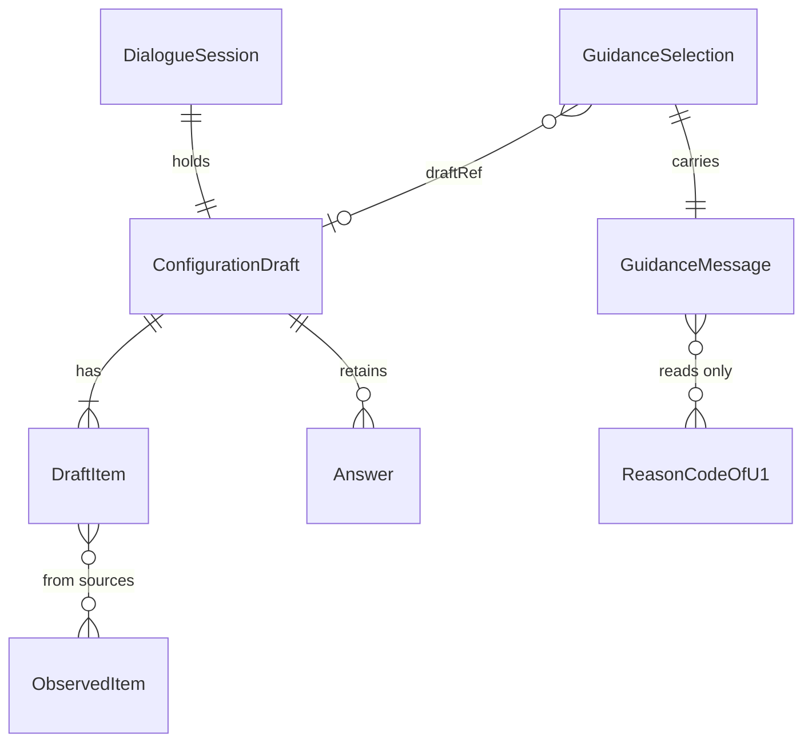

# U2 — Functional Specification

## Sources and Scope

対象は `261105-shirube-lifecycle-qualit / u2-working-state-dialogue`。本書は **workflow と状態遷移の正本**である。[entities.md](entities.md) の YAML を形・所有、[rules.md](rules.md) の YAML を判定の正本とし、本書の ER 図・規則表は派生 view とする。確認済みの問いと答えは [functional-design-questions.md](functional-design-questions.md)（Q1 = A、Q2 = A、要約確認 Looks correct と Owner の条件）。

正式入力: [unit-of-work](../../../inception/units-generation/unit-of-work.md)、[story-map](../../../inception/units-generation/unit-of-work-story-map.md)、[stories](../../../inception/user-stories/stories.md)、[requirements](../../../inception/requirements-analysis/requirements.md)、[components](../../../inception/domain-design/components.md)、[contract-summary](../../../inception/contract-design/contract-summary.md)、[interaction-spec](../../../inception/refined-mockups/interaction-spec.md)。

製品コード・試験・fixture・CI・外部投稿・他単位には着手しない。本書の試験設計は未実行で、実装・試験・独立監査の合格を意味しない。

## Current Decisions and Assurance Boundary

- U2 は、LLM との対話で、実際の checkout・版・道具・設定出典を観測し、確認済み・不足・食い違い・観測不能を区別して示し、不足と食い違いだけを質問する。
- 出典が食い違った時は順位を決めず、全出典と値を示して利用者に選んでもらう（Q1 = A、契約の改訂なし）。
- 回答は対話の間だけ保持する（Q2 = A）。U2 は何も永続化しない。観測が変われば回答は無効になる。
- 読取り専用の案内は U1 の門の成功も U3 の開始接続も前提にしない。設定の提案と実適用は分ける。選択・回答は開始・適用の許可を作らない。
- **U2 が保証しないこと:** 観測できなかった物の存在・値、適用の成否（U5）、開始の可否（U3）、CI の実検査（U4）、初回ゴール全体の完了。

## Carry-over to later units

Owner の条件（要約確認の答え）に従い、次を落とさず記録する。

| 項目 | 持ち越し先 | 理由 | U2 が渡す物 |
|---|---|---|---|
| 対話をまたぐ回答の保存と、中断後に有効な回答・履歴を保持して未完了箇所から進む再開（AC3.1.3、US3.1） | 後の単位。story map の割当（US3.1 = u3-native-operation-control と u5-safe-versioned-distribution）に従い、正規の再開入力は U3、実適用側の回復は U5。保存の置き場・形式の設計はその単位の機能設計で決める | Q2 を A（その対話の間だけ）にしたため、U2 では回答を永続化しない | 回答と観測 digest の結びつけ規則（BR6.2）、ConfigurationDraft の形（C02）、無効になった回答を不足へ戻す規則 |
| 保存した回答と実際の設定の照合 | 同上（保存が無ければ照合の対象が無い） | Q2 = A | 再観測で実際の設定と回答を照合する規則（BR6.4） |
| 履歴・体制の継続利用（AC3.2.5 の履歴の部分） | 保存した履歴を使う部分は AC3.1.3 と同じ単位（U3 が主、U5 が実適用側）。実追加は U6、全体受入は U7 | Q2 = A（U2 は履歴を保存しない）。U2 は再観測で実際の設定を確かめる寄与（BR6.4）と完了範囲の限定（BR9.4）だけを持つ | 実際の設定の再観測と照合、完了範囲の限定の表示 |

割当の変更（例: 保存を U2 へ戻す）は Owner の判断で、U2 は黙って広げない。FR2.4 の「同じ設定の継続利用を確認できる」は、適用済みの実際の設定を再観測して確かめる形で満たす（BR6.4）。

## Workflows — Source of Truth

### W01 — 対象の受付と観測

1. 呼出側が `targetRef`・時刻・識別子（`sessionId` など）を渡す。渡されなければ観測せず、対象が要ると示して止まる（BR1.1・BR9.1）。
2. 項目の一覧（entities の initialCatalog）の各出典を、対象の根の中だけで読む。path は根の外へ出ない形に解決し、同じ実体は 1 つとして数える（BR1.5）。
3. 読取りごとに時間・応答の大きさ・全体の回数の予算を数える。超えたら止めて観測不能（BR1.4）。読取りの前後で内容が変わったら changed_during_read（BR1.6）。
4. 結果は `shirube-contracts/1` の Observation（observed / unavailable）で出す。宣言・cache・既定値は写さない（BR1.2）。unavailable は原因を持ち、成功へ読み替えない（BR1.3）。

### W02 — 不在と道具の区別

1. 遠隔の読取りが 404 だけ、権限拒否、取得失敗、予算超過のとき、未導入とは確定せず観測不能（not_found_unconfirmed / permission_denied / fetch_failed / budget_exceeded）にする。親が読めてその中に無いと確認できた時だけ「未導入」（missing）（BR2.1）。
2. 道具は、時間の上限つきで起動し、機械可読な出力と終了コードだけで判断する。ある・無い・非対応の版・起動できない・応答しないを区別する（BR2.2）。必要な版は対象の pin・契約から読み、観測した版と比べる（BR2.3）。
3. 足りない道具・必要な版・次の操作を案内に載せ、「依存する開始が止まる理由」を示す。止める処理自体は U3。

### W03 — 項目状態の決定（draft の構成）

1. 各項目について、出典ごとの観測を value / absent / unavailable / wrong_target / invalid の 5 つに分け、BR3.1 の 4 つの場合（wrong_target → invalid → 値あり → 値なし）で項目状態を 1 つ決める。「一部の出典にだけ値がある」（例: sds_pin に値、workflow_caller は読めて項目なし）は conflict として両方を示す。
2. 食い違い（conflict）は読めた全出典を candidates に載せる（値のある出典は値つき、項目の無い出典は presence = absent の「この出典には無い」で値を持たない）。順位はつけない（BR3.2）。対象違いの値は使わず、別の出典の有効な値は「参考（採用していない）」として分けて示す（BR3.3）。不正・破損は既定値で埋めず、読めた分を使う（BR3.4）。
3. 「適用中の規格」として示すのは観測できた出典と版の識別だけ（BR3.5）。
4. 結果を ConfigurationDraft として組み立てる。draftDigest は items・answers・observationRefs から計算する。

### W04 — 質問と案内の生成

1. 質問は、利用者が答えられる項目（userAnswerable）の「不足」と「食い違い」（と利用者が直せる不正）だけ。確認済みと、現在の観測に結びつく有効な回答がある項目は聞かない（BR4.1・BR4.3）。利用者が答えられない項目の不足・食い違いは質問にせず、出典の持ち主へ直しを頼む操作（fix-source。道具の項目は install-or-upgrade-tool）を次の操作として示し、食い違いは全出典と値を並べる（BR4.2、Q3 = A）。
2. 観測不能は質問にせず、確認のしかた（権限・道具・場所）を案内する（BR4.2）。対象違い（wrong_target）は対象の指定の見直し（review-target）、利用者が直せない不正（invalid）は出典の持ち主への直しの依頼（fix-source）を次の操作として示し、行き止まりにしない。値の推測・Owner の回答は作らない（BR4.4）。
3. 案内（GuidanceMessage、E05）は「結論と対象 → 次の操作 → 原因・未確認 → 証拠の参照」の順（BR7.1）。平文で、色や配置・偽の進捗に頼らない（BR7.2）。同じ入力は LLM が変わっても同じ内容（BR7.3）。
4. 設定 A 不足・権限 B 観測不能の入力では、A と B を区別して、原因・安全な次の操作・開始できない理由を必ず示す（BR7.7）。
5. 確認できていない物を確認済みと示さない（BR7.5）。ConformanceGate の理由コードは入力の結果を読んで示すだけで、新しいコードを作らない（BR7.6）。人待ちは 1 回示して止まる（BR7.4）。

### W05 — 回答の受付と保持

1. 回答はデータとして受け、型・長さ・文字・path の境界を検査する。不正・過大は rejected で理由を返し、無言で切り捨てない（BR5.1）。外から来た文字列は命令として評価しない（BR8.2）。
2. 秘密らしい入力（BR5.2 の最小の集合に当たる、または項目の許される形式に当たらない長い連なり）は rejected とし、値も digest も保持せず、理由・案内・記録に入力を写さない。有無と参照名だけを求める（BR5.2）。
3. 有効な回答は、回答した時点の項目の観測 digest と結んで保持する（BR6.2）。保持は対話の間だけ（BR6.1）。同じ (itemKey, valueDigest) の再送は 1 件のまま。同じ項目の別の値は呼出側が渡す answeredAt が新しい方が有効で、遅れて届いた古い回答は保持しない（BR5.4）。1 件の rejected が他の回答を失わせない（BR5.3）。
4. 回答済みは「回答済み・未適用」と示す。「設定完了」とは示さない（BR6.3）。

### W06 — 再観測と無効化

1. 再観測は呼出側の要求で起こり、U2 は自分で契機を作らない（BR8.3）。項目の観測 digest が回答に結んだ値と異なれば、その回答を invalidated にし、BR3.1 で項目を再評価して不足・食い違いへ戻し、利用者に示す。他の回答は保持（BR6.2）。同じ項目の観測が複数届いたら observedAt が最も新しい結果だけを使う（BR9.1）。
2. draft の observationDigest が変わったら、古い draft・selection を使った開始の入力は無効（BR8.3）。回答を足しただけでは無効にならない。
3. 採用した回答と実際の設定は、再観測で照合して一致・不一致を示す（BR6.4）。読めなければ観測できず。

### W07 — 選択と引渡し

1. 利用者が答えられる項目の出典の食い違い（choose-source）で、候補（candidates の 1 つ。「無いまま」＝ absent を含む）を選ぶと、GuidanceSelection を作る。選べるのは candidates の 1 つに限る（Q1 = A）。次の操作（nextAction）は GuidanceMessage だけが持ち、選択は作り直さない。C02 の draft / selection として U3 へ渡せる形にするだけで、開始・適用の許可、公開の Owner 決定は作らない（BR8.1）。
2. 案内の「次の操作」は表示するだけで、その候補を選ぶこと、選択を契機にした再照合と案内の切替（AC3.3.2）は U6 の持ち物（BR9.2）。U2 は外部への効果を出さない（BR8.4）。U3・U5・U6 の仕事（正規開始・実適用・選択→再確認→切替）を完成させない（BR9.2）。
3. 対話が閉じたら、回答・draft・選択は消える（BR6.1）。

## Item State Machine — Source of Truth

```text
(未観測) --観測--> unobservable | missing | confirmed | conflict | invalid | wrong_target
unobservable --再観測で読めた--> missing | confirmed | conflict | invalid | wrong_target
missing --有効な回答--> (回答済み・未適用)  # 項目状態は missing のまま。回答の状態は answered
conflict --利用者が出典を選ぶ--> (回答済み・未適用)  # 項目状態は conflict のまま。選択は回答として保持
answered --再観測で digest が変わる--> invalidated --BR3.1 で再評価--> missing | conflict | ...
answered --再観測で実際の設定が回答と一致--> (一致を確認)  # 適用は U5。U2 は一致を示すだけ
どの状態でも --対話が閉じる--> (消える)
```

回答の状態: `answered`（保持中）、`invalidated`（観測が変わり無効）、`rejected`（検査で不合格。値は残さない）。項目状態の決め方は BR3.1 が唯一の正本で、本図は派生。

## Derived Entity Relationship View



文字の代替: 対話（DialogueSession）が 1 つの draft を持ち、draft は項目（DraftItem）と回答（Answer）を持つ。項目は出典ごとの観測（ObservedItem）から作る。選択（GuidanceSelection）は案内（GuidanceMessage）と draft を参照する。案内は U1 の理由コードを読むだけ。

## Derived Rules Summary

| グループ | 規則 | 要点 |
|---|---|---|
| 観測 | BR1.1〜BR1.6 | 対象は渡される。実際の読取りだけ。3 値。予算。根の中。変化と書込み途中 |
| 不在と道具 | BR2.1〜BR2.3 | 404 だけで未導入にしない。道具の 5 区別。版は 3 値 |
| 項目状態 | BR3.1〜BR3.5 | 1 項目 1 状態、決める順。順位なしで全出典を示す。対象違い。不正・破損。適用規格は観測した物だけ |
| 質問 | BR4.1〜BR4.4 | 不足と食い違いだけ。観測不能は案内。再質問しない。値を作らない |
| 回答の受付 | BR5.1〜BR5.4 | データとして検査。秘密は保持しない。独立に扱う。二重送信で重複しない |
| 保持 | BR6.1〜BR6.5 | 対話の間だけ。観測 digest と結ぶ。回答済み≠適用。再観測で照合。持ち越しを記録 |
| 案内 | BR7.1〜BR7.7 | 順序。平文。同じ意味。1 回で停止。未確認を確認済みとしない。理由コードは読むだけ。A/B 区別 |
| 選択と引渡し | BR8.1〜BR8.4 | 許可を作らない。命令にしない。古い draft は無効。効果 0 |
| 境界 | BR9.1〜BR9.4 | 明示入力。U3・U5・U6 を完成させない。架空 fixture。完了を実証で示す |

## Acceptance and Test Design — Not Executed

方針: TDD（先に失敗する試験）、`node:test` と `assert`、核は明示入力で決定的、Node の組込みだけ（実行時の npm 依存なし）。正例（`T<x.y>+`）と負例（`T<x.y>-`）を全 42 規則に最低 1 つずつ置く。fixture は架空の対象（sample-work）だけ。行の網羅率 100% は、対象の file の集合と分母を NFR 要件で特定し、機械可読な記録で確かめる（未計測は成功に数えない）。以下は試験の設計であり、実行していない。

| 規則群 | 正例の例 | 負例の例（必須） |
|---|---|---|
| BR1 観測 | 実ファイルの値が observed になり、宣言値は写されない | 対象未指定、別対象の出典、宣言値だけ・cache だけ、読めない file、予算超過、読取り中に変化、`..`・symlink・循環・別綴りの同一 path、特殊文字名 |
| BR2 不在と道具 | 親が読めて項目が無い→未導入。道具 present | 404 だけ・権限拒否・取得失敗・予算超過は未導入にしない。道具の欠落・非対応の版・起動不能・応答なし |
| BR3 項目状態 | 5 種の状態が各 1 つ。出典 2 つの食い違いで全出典を提示。必須 2 出典の全組み合わせ（value・absent・unavailable・wrong_target・invalid の各組）が 1 状態に決まる。T3.1x: sds_commit の出典の組み合わせ（両方 value で一致 → confirmed、値が異なる → conflict、片方 absent → conflict（confirmed にならない）、両方 absent → missing、片方 unavailable → unobservable）と、requiredForConfirmed の記載が無い出典が必須として扱われること。T3.2k: 架空の試験用の項目一覧（利用者が答えられる 2 出典の項目）で、choose-source の選択（値のある候補と absent の候補）が Answer（kind = value / keep-absent）として保持され、初期の項目一覧では choose-source が起きないこと | 判定の順の境界（wrong_target と conflict の同時など）、一部の出典にだけ値がある（他は読めて項目なし）→ conflict、値あり + 他が unavailable → unobservable（confirmed にならない）、非必須の出典の absent は無視、順位をつけない、対象違いの値を使わず参考として分ける、破損 1 件で全体を捨てない、読めない規格を適用中と示さない |
| BR4 質問 | 利用者が答えられる項目の不足・食い違いだけが質問になる。wrong_target は review-target、直せない invalid は fix-source を示す。答えられない項目の不足・食い違いは fix-source（道具は install-or-upgrade-tool）で、食い違いは全出典と値を並べる | confirmed・観測不能・有効な回答済みの項目は聞かない、wrong_target・直せない invalid・答えられない項目の不足・食い違いを質問にしない、値を作らない、答えられない項目の食い違いで利用者に出典を選ばせない |
| BR5 回答 | valueType ごとの許される形式の正例・負例（commit-oid・version・list の境界）、rejectionReason が固定の分類だけ、choose-source の選択が Answer（kind = value / keep-absent、selectedCandidateRef）として保持され keep-absent の再送が 1 件のまま、型・長さが正しい回答の受付、二重送信は 1 件、answeredAt が新しい別の値が有効になる | 不正な型・過大・制御文字・Unicode の境界、秘密らしい入力（BR5.2 の集合の各形と、集合にない形で項目の形式に当たらない長い連なり。保持も出力もされず、rejected は value も valueDigest も持たず、理由・案内・ログに入力が写らない）、遅れて届いた古い回答は保持しない、同時刻で値が違うと新しい方が rejected、他の回答が残る |
| BR6 保持 | 対話の間だけ保持。観測 digest の結び | 閉じたら消える、観測が変わると invalidated、回答済みを「設定完了」と示さない、AC3.1.3 は U2 で実行されない |
| BR7 案内 | 順序、平文、A 不足・B 観測不能の区別 | 未確認を確認済みと示さない、色だけの表現、同じ入力で違う意味、人待ちを 2 回示さない、新しい理由コードを作らない |
| BR8 選択 | 答えられる項目の食い違い（choose-source）で、candidates の 1 つ（absent を含む）を選ぶと draft / selection を渡せる | 許可を作らない、命令として評価しない、観測が変わった draft を拒否、回答を足しただけでは draft・selection が無効にならない、外部への効果 0 |
| BR9 境界 | 時刻・ID を引数で受ける。最も新しい observedAt の観測だけを使う | 核が時計・乱数・UUID を取得しない、遅れて届いた古い観測を使わない、U3・U5・U6 の仕事の混入（特に「次の操作」の候補の選択を契機にした再照合・案内の切替を U2 が行わない）、実 repo の非公開本文の混入 |

追加の正負の入力（AC 由来）: 設定済み／不足 1 件／観測不能の 3 入力が異なる説明を返す（AC1.3.1）。設定 A 不足・権限 B 観測不能の架空入力で A と B を区別（AC3.2.2）。「desired や申告 digest は同じで観測した実物だけを変えた」入力が不一致になる（AC2.2.4）。

## Traceability and Shared Story Boundaries

U2 は 4 ストーリーの全 20 AC を追う（US1.1・US1.3・US2.2・US3.2）。他単位・外部接続の条件は U2 の寄与と分けて [traceability.json](traceability.json) に書く。`OK` は単位設計への割当であり、実装・試験・独立監査・AUN 受入が合格済みという意味ではない（story map）。

| AC 群 | U2 の寄与 | U2 の外にある条件 |
|---|---|---|
| US1.1（AC1.1.1〜1.1.5） | 実対象・版・道具の観測、404 等の区別、path 境界、有界読取（BR1・BR2） | 開始を止める処理は U3。実導入は U5 |
| US1.3（AC1.3.1〜1.3.5） | 不足だけの対話、出典の競合、対話の間の回答保持、安全な入出力（BR3〜BR6） | 設定案の実適用・再読・競合の区別は U5 |
| US2.2（AC2.2.1〜2.2.5） | 確認済み・未達・観測不能の平易な表示（BR7） | 原本・対象・内容からの証拠照合は U1、CI の実結果の接続は U4 |
| US3.2（AC3.2.1〜3.2.5） | 初回の確認表示への寄与（BR7.7・BR9.4） | 実コード差分・実検証・監査・統合までの初回ゴールは複数単位（U3・U4・U5）。U2 だけでは完成しない |
| AC3.1.3（US3.1、U2 の割当外） | 持ち越しの記録（BR6.5） | 上の Carry-over のとおり |

## Standards and Delivery Constraints

- S1〜S9: S1（削除ではなく状態）— 保存する表が無いため該当せず。S2（抽象は 3 例目）— adapter は輸送と表示だけ。S3（知識は 1 箇所）— 項目状態は BR3.1、理由コードは U1。S4（時刻・ID は明示入力）— BR9.1。S5（宣言は証拠でない・3 値）— BR1。S6（schema の同居）— 永続化が無いため該当せず。S7（外部効果は冪等）— U2 は効果を出さず（BR8.4）、回答の二重送信は 1 件（BR5.4）。S8（失敗を隠さない）— BR1.3・BR7.5。S9（資格情報は最小）— 読取りに書ける資格情報を要求しない（BR1.4）。
- DB の基準: 表・migration・DB の設計記録を作らないため適用外。
- 保護対象・R3/R4: 本設計は workflow・必須検査・DB 構造・資格情報・本番・料金・契約 `.v2` を変更しない。契約の改訂（出典の順位）は Q1 = A により含めない。
- team.md の「守る物に触れる単位は設計記録だけの PR を先に出す」の適用は、置き場の設計を終えた後に確認する（契約・セキュリティの面に触れる入力検査・秘密の扱いを含むため、触れるものとして扱う方針で進め、不要と分かれば理由を記録する）。

## Assumptions & Open Questions

None。未決の問いは無い。仮定 A-01〜A-06（[questions](functional-design-questions.md)）を採った。保存の置き場・形式、観測の予算の具体の数値、確認コマンドの対象集合は、後続の NFR 要件・置き場の設計で決める。

開き直しでの変更（置き場の設計で見つかった食い違い FD-GAP-1〜4）: Q3 = A により、利用者が答えられない項目の不足・食い違いは質問にせず fix-source などの次の操作を示す（BR3.2・BR4.1・BR4.2）。項目一覧の各項目に valueType を付け、candidates に presence（value / absent）を持たせ、GuidanceSelection の候補は candidates の 1 つを指す（FD-GAP-2・3）。required_checks は U2 で扱わない項目として項目一覧から外した（Q5 = A、entities の notHandledByU2、FD-GAP-4）。U2 は必須検査名を確認済みと示さない。

仮定 A-07（レビュー 1 回目の指摘 R-08 による追加）: 項目の出典の割当（[entities](entities.md) の initialCatalog。例: protected_paths = sds_pin）は設計時点の想定で、実物の位置・形式との突き合わせは NFR 要件・置き場の設計で行って確定する。突き合わせるまでは「確認できず」として扱い、確認済みと示さない。

仮定 A-08（開き直しでの追加）: userAnswerable が真の項目（今は aidlc_settings = list）の要素の細かい形は、設定の実物を読む Code Generation で確定する。確定までは正当な値の範囲を狭く取り（entities の ItemCatalogEntry.note と同じ）、迷えば rejected（失敗側）。確定した時は同じ PR で entities・rules にも足し、設計と実装を黙って食い違わせない（Owner の追加の条件）。

初期の項目一覧では choose-source は起きない（利用者が答えられる項目 aidlc_settings の出典は 1 つで conflict にならず、conflict になりうる sds_commit は答えられない項目）。規則と型は将来の項目のために残し、試験は架空の試験用の項目一覧で確かめる。
