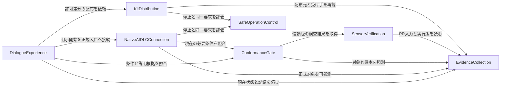

# Shirube — 論理部品の設計

## Component Catalogue

次のYAMLを部品・呼出依存・所有データの正本とする。後続の図と表はこの内容を表す。7部品はコード責任の境界であり、新しい権限・工程・役職や配置単位ではない。属性は名前までとし、型・制約・値域・多重度・保存方式は定めない。

```yaml
components:
  - name: DialogueExperience
    summary: 観測根拠を使い不足だけを尋ねて設定と安全な次操作を説明する
    behaviour: >
      LLMとの対話を入口に、確認済み・不足・矛盾・観測不能を区別する。
      読めない値やOwner回答を作らず、秘密の値を貼らせない。
      設定案と実適用を分け、選択した案内の現対象と前提を読み直して案内を更新する。
      初回の必須説明と未選択の回答を保持する。選択や設定回答を開始許可にしない。
      LLM別adapterは輸送と表示を変え、判定規則や理由の意味を再定義しない。
    responsibilities:
      - 観測済み情報から不足と競合だけを質問し有効な回答を保持する
      - 対象と原因と必要判断と次の正当な操作を平易なテキストで示す
      - 初回の確認表示と追加後の選択と再照合と案内切替を区別する
      - 明示開始や配布依頼を必要条件付きで担当部品へ渡す
    depends_on:
      - component: EvidenceCollection
        interaction: 現対象と設定と正式記録の観測を取得する
        style: sync
      - component: ConformanceGate
        interaction: 現在の必要条件と表示する判定根拠を取得する
        style: sync
      - component: NativeAIDLCConnection
        interaction: 明示開始等の正規操作への接続を依頼する
        style: sync
      - component: KitDistribution
        interaction: 必要な判断が揃った対象差分の配布を依頼する
        style: sync
    dependents: []
    external_dependencies:
      - name: LLM対話環境
        kind: other
        purpose: 共通の意味を保つ対話入出力の輸送と表示
    entities:
      - name: ConfigurationDraft
        identifier: draftId
        attributes: [draftId, targetRef, answers, missingItems, conflicts]
        references:
          - entity: ObservedSnapshot
            owned_by: EvidenceCollection
            relationship: 設定案の対象と不足を裏付ける観測を参照する
      - name: GuidanceSelection
        identifier: selectionId
        attributes: [selectionId, draftRef, candidateRef, targetRef, guidance, observationRef]
        references:
          - entity: ObservedSnapshot
            owned_by: EvidenceCollection
            relationship: 選んだ候補の現在の対象と前提の観測を参照する
  - name: NativeAIDLCConnection
    summary: 明示された操作を現在の正式AI-DLCの対象と入口へ接続する
    behaviour: >
      現在の作業場とspaceとintentとunitと段とengine版と正式選択肢を照合する。
      準備と開始を区別し、必要な正式条件が揃った操作だけを既存の正規入口へ渡す。
      設定回答や前ゴールの完了から別intentや次段の許可を推定しない。
      実行直前と再開時に対象と根拠を再確認し、結果不明時は同一要求の照会へ戻す。
      段順や単位順や承認の正本を所有せず、正式AI-DLCの進行を再実装しない。
    responsibilities:
      - 正式AI-DLCの対象と版と利用可能な正規操作を現在の観測へ結ぶ
      - 必要条件の判定と停止制御を受けて正規入口への操作を運ぶ
      - 実行結果と未完了箇所を観測に結び設定と履歴を引き継ぐ
    depends_on:
      - component: EvidenceCollection
        interaction: 現在の正式対象と原本と操作結果を再観測する
        style: sync
      - component: ConformanceGate
        interaction: 対象操作の現在の必要条件を照合する
        style: sync
      - component: SafeOperationControl
        interaction: 停止と同一要求と結果照会の扱いを評価する
        style: sync
    dependents:
      - component: DialogueExperience
        interaction: 明示開始等の正規操作への接続を依頼する
    external_dependencies:
      - name: 正式AI-DLC
        kind: other
        purpose: 段と単位と承認と正規操作の唯一の進行元
      - name: 許可されたローカル実行環境
        kind: other
        purpose: 正規入口の実行と結果照会を有界に運ぶ
    entities:
      - name: NativeOperation
        identifier: operationId
        attributes: [operationId, targetRef, nativeOperationRef, startRequestRef, attemptRef, observedOutcomeRef]
        references:
          - entity: OperationAttempt
            owned_by: SafeOperationControl
            relationship: 正規操作を送る要求の停止と結果照会の扱いを参照する
          - entity: ObservedSnapshot
            owned_by: EvidenceCollection
            relationship: 操作対象と正式選択肢と実結果の観測を参照する
  - name: EvidenceCollection
    summary: 実対象と外部原本を観測し公開用の必要記録を取り出す
    behaviour: >
      設定と実ファイルと正式記録とGitHubの原本から、発行元の観測と対象と版と内容を採取する。
      desired値やLLMの宣言や古いmapを観測欄へ写さず、digestは取得した内容から計算する。
      正式原本と原本由来の公開用記録とPRに実在する記録を分けて読む。
      audit/と.aidlc-engine/と秘密と他repo非公開記録を公開用記録へ含めない。
      原本が読めたことと発行元の真正性が証明できたことを混同せず、権限を発行しない。
    responsibilities:
      - 許可範囲内の実対象と原本と実行結果を有界に観測する
      - 発行元と出典と内容と取得不能を区別したsnapshotを保持する
      - 原本から必要な公開記録を取り出しPR実内容を独立に観測する
      - 入力の破損と途中状態と競合と境界外参照を依存判定へ渡さない
    depends_on: []
    dependents:
      - component: DialogueExperience
        interaction: 現対象と設定と正式記録の観測を取得する
      - component: NativeAIDLCConnection
        interaction: 現在の正式対象と原本と操作結果を再観測する
      - component: ConformanceGate
        interaction: 対象と原本とPR実内容の観測を取得する
      - component: SensorVerification
        interaction: 対象PRの入力と信頼版と実行元を観測する
      - component: KitDistribution
        interaction: 配布元の固定版と受け手の実内容と現在条件を読む
    external_dependencies:
      - name: 対象repoのGitと許可ファイル
        kind: other
        purpose: 実差分と設定と版と記録を権限内で読む
      - name: GitHub読取API
        kind: third-party-api
        purpose: 公開Owner決定とPRと監査と受領とCI等の実原本を読む
      - name: 正式AI-DLC原本の既存取得経路
        kind: other
        purpose: 正式レビューと承認の原本と実発行元を観測する接続であり適合は未検証
    entities:
      - name: ObservedSnapshot
        identifier: observationId
        attributes: [observationId, sourceRef, issuerObservation, targetRef, versionRef, observedContentRef, observedDigest, availability, observedAt]
        references: []
      - name: PublishedRecordProjection
        identifier: projectionId
        attributes: [projectionId, sourceObservationRefs, targetRef, includedArtifactRefs, excludedArtifactRefs, projectedContentRef]
        references: []
  - name: ConformanceGate
    summary: 現対象の必要条件と証拠を一つの判定核で照合する
    behaviour: >
      周辺処理は観測とセンサー実行を集め、純粋核へ現在の条件と観測と結果と時刻と識別子を明示入力する。
      核は対象と内容と版と発行元、READY、設計監査の4分類と順序、PR記録と承認、CIと監査と受領と統合を照合する。
      必須の欠落と不一致と観測不能を成功にせず、真正な原本を欠く一致も成功にしない。
      初回と実追加とAUNの結果を分け、全Mustと適用規格の実結果が揃った範囲だけを完成とする。
      結果は必要条件の判定であってOwner権限の付与でも正式AI-DLCの進行命令でもない。
    responsibilities:
      - 同一対象と現成果物に結び付く正式レビューと承認を照合する
      - 設計と実差分に基づく4分類と設計だけのheadの独立監査と実装前の順序を照合する
      - 単位PRの記録集合と内部記録の除外と原本からの再生成内容を照合する
      - 信頼版の必須CI結果と独立監査と作者受領と別担当統合と必要な公開判断を照合する
      - 規格の出典と版と適用と実結果および初回と実追加とAUNの完了範囲を照合する
    depends_on:
      - component: EvidenceCollection
        interaction: 対象と原本とPR実内容の観測を取得する
        style: sync
      - component: SensorVerification
        interaction: 信頼版の2センサーの実行と結果を取得する
        style: sync
    dependents:
      - component: DialogueExperience
        interaction: 現在の必要条件と表示する判定根拠を取得する
      - component: NativeAIDLCConnection
        interaction: 対象操作の現在の必要条件を照合する
    external_dependencies:
      - name: 採択済み規格と現行門の固定版
        kind: other
        purpose: 適用する条件と例外と既存判定1から3の正本を参照する
    entities:
      - name: ConformanceAssessment
        identifier: assessmentId
        attributes: [assessmentId, targetRef, observationRefs, sensorResultRefs, applicableConditions, outcomes, reasons]
        references:
          - entity: ObservedSnapshot
            owned_by: EvidenceCollection
            relationship: 判定の実対象と正式原本とPR実内容の観測を参照する
          - entity: SensorResult
            owned_by: SensorVerification
            relationship: 同じ対象と版と入力の必須検査の実結果を参照する
  - name: SensorVerification
    summary: 信頼する固定版でCIのPR記録検査を実行して結果を結び付ける
    behaviour: >
      traceabilityとupstream-coverageの正本を使い、実行元と版と対象PR/headと入力と実結果を対応付ける。
      checkerと必須集合とseverityと対象pathは検査対象PRの設定を正本にしない。
      PR内容はデータとして検査し、そこから検査正本や命令を実行しない。
      片方未実行と古い結果と失敗とskipと利用不能を成功に変換しない。
      検査意味や理由を別実装せず、実行の周辺処理も有限予算と最小権限を守る。
    responsibilities:
      - 信頼する固定版の検査と適用条件をPRから分離して解決する
      - CIでPR記録に2センサーを再実行し実結果を観測する
      - 実行元と対象と版と入力の対応と必須実行の欠落を区別して返す
    depends_on:
      - component: EvidenceCollection
        interaction: 対象PRの入力と信頼版と実行元を観測する
        style: sync
    dependents:
      - component: ConformanceGate
        interaction: 信頼版の2センサーの実行と結果を取得する
    external_dependencies:
      - name: 信頼する固定版AI-DLCセンサー
        kind: other
        purpose: traceabilityとupstream-coverageの検査意味と必須条件の正本
      - name: GitHub Actions実行環境
        kind: other
        purpose: 初回社内環境でのCI再検査と実行結果の取得
    entities:
      - name: SensorResult
        identifier: sensorResultId
        attributes: [sensorResultId, targetRef, trustedVersionRef, inputObservationRefs, executionRef, outcome, reasons]
        references:
          - entity: ObservedSnapshot
            owned_by: EvidenceCollection
            relationship: 検査したPR入力と実行版と実行元の観測を参照する
  - name: KitDistribution
    summary: 固定版を安全に配布し受け手の実設定とのdriftを確かめる
    behaviour: >
      対象版の配布内容と許可差分と戻し方を扱い、必要判断と既存担当の受領と保留を適用前に確認する。
      現在の必要条件を示す観測付き入力と停止制御を満たした差分だけを対象へ適用する。
      自身のworkflow_callと対象外ファイルと履歴を保持し、部分状態を有効にしない。
      受け手の実ファイルから再計算して配布版と比較し、宣言digestやregistryを適用証拠にしない。
      欠落とadvisory化と別版と対象範囲変更を区別し、ずれを無許可に自動修正しない。
    responsibilities:
      - 固定版の配布内容と対象の許可差分と復旧参照を用意する
      - 必要な条件と停止制御を保って安全な適用と再導入を行う
      - 対応する配置の実設定を読み配布版とのdriftを照合する
      - AUNの既存担当と対象と権限と保留を保持して受け手の適用を照合する
    depends_on:
      - component: EvidenceCollection
        interaction: 配布元の固定版と受け手の実内容と現在条件を読む
        style: sync
      - component: SafeOperationControl
        interaction: 停止と同一要求と結果照会の扱いを評価する
        style: sync
    dependents:
      - component: DialogueExperience
        interaction: 必要な判断が揃った対象差分の配布を依頼する
    external_dependencies:
      - name: 固定版kit配布元
        kind: other
        purpose: 配布する実内容と版と適用対象を取得する
      - name: 受け手の許可対象ファイル
        kind: other
        purpose: 対象差分の適用と実内容の再読と復旧の確認
    entities:
      - name: DistributionRevision
        identifier: revisionId
        attributes: [revisionId, sourceCommitRef, manifestRef, observedContentsRef, applicableTargets]
        references:
          - entity: ObservedSnapshot
            owned_by: EvidenceCollection
            relationship: 固定版配布元の実内容と適用対象の観測を参照する
      - name: DistributionAssessment
        identifier: distributionAssessmentId
        attributes: [distributionAssessmentId, revisionRef, targetObservationRefs, observedDifference, applyAttemptRef, restoreReference]
        references:
          - entity: ObservedSnapshot
            owned_by: EvidenceCollection
            relationship: 受け手の現在条件と実ファイルと版の観測を参照する
          - entity: OperationAttempt
            owned_by: SafeOperationControl
            relationship: 配布操作の停止と同一要求と結果照会の扱いを参照する
  - name: SafeOperationControl
    summary: 人待ちと非進捗で停止し外部効果の同一要求と照会を扱う
    behaviour: >
      呼出側が明示した対象と必要条件の結果と時刻と識別子と過去の実観測から純粋に評価する。
      必要判断待ちは一度通知して停止し、停止中は効果も後継記録も生産させない。
      外部照会とsubprocessの有限予算と正式な非進捗上限を守り、状態変化なしの再試行を指示しない。
      外部効果の同一要求を送信前から保持し、結果不明なら同じ要求を照会してから扱う。
      同一キーの別内容や並行競合を拒否し、正当な再開では現対象と根拠の再観測を要求する。
    responsibilities:
      - 人待ちと不明と非進捗の停止および再確認の必要性を評価する
      - 同一要求の効果と結果不明時の照会と衝突を評価する
      - 核の評価結果を正規接続と配布の実行周辺へ返す
    depends_on: []
    dependents:
      - component: NativeAIDLCConnection
        interaction: 停止と同一要求と結果照会の扱いを評価する
      - component: KitDistribution
        interaction: 停止と同一要求と結果照会の扱いを評価する
    external_dependencies: []
    entities:
      - name: OperationAttempt
        identifier: attemptId
        attributes: [attemptId, requestRef, targetRef, effectIdentity, observationRefs, outcome, requiredActor, stopReason, nonProgressObservation]
        references:
          - entity: ObservedSnapshot
            owned_by: EvidenceCollection
            relationship: 停止と再照会と非進捗を判断する明示入力の実観測を参照する
```

## Sources and Scope

- [確認済み設計計画](domain-design-questions.md)、[要件](../requirements-analysis/requirements.md)、[ストーリーと88受入条件](../user-stories/stories.md)、[チーム実践](../practices-discovery/team-practices.md)、[詳細対話仕様](../refined-mockups/interaction-spec.md)。
- [CodeKB architecture](../../../../codekb/shirube/architecture.md)、[component inventory](../../../../codekb/shirube/component-inventory.md)。root `62ff73db52ce8f29f3b982507b5d2e36578ae60f`と別観測main `7e775afd5b755e51e55e269d8dc35b09d180c33e`を区別する。構造の分析を実行成功としない。
- ここで決めるのは論理部品、呼出依存、所有データの形と信頼境界。deployment topology、技術stack、DB製品/schema、詳細型/制約、新API/コマンド、正式Unit/DAG、実装順は決めない。

## Component Diagram



文章での説明: 対話は観測・判定・正規接続・配布を呼ぶ。正規接続は観測・判定・停止制御を呼ぶ。判定の周辺処理は観測と検査実行を集める。検査実行は入力と版の観測を読む。配布は配布元と受け手の観測、および停止制御を使う。EvidenceCollectionとSafeOperationControlは他の製品部品を呼び返さない。7ノード・12辺で循環は無い。全辺のsyncは要求と結果を受け渡す論理関係であり、ネットワークprotocolやprocess配置の採択ではない。

## Component Summary

| Component | Purpose | Depends On | Dependents | Entities Owned |
|---|---|---|---|---|
| DialogueExperience | 不足を質問し現在の根拠で案内する | EvidenceCollection, ConformanceGate, NativeAIDLCConnection, KitDistribution | なし | ConfigurationDraft, GuidanceSelection |
| NativeAIDLCConnection | 明示操作を正式AI-DLCへ接続する | EvidenceCollection, ConformanceGate, SafeOperationControl | DialogueExperience | NativeOperation |
| EvidenceCollection | 実対象と外部原本を観測する | なし | DialogueExperience, NativeAIDLCConnection, ConformanceGate, SensorVerification, KitDistribution | ObservedSnapshot, PublishedRecordProjection |
| ConformanceGate | 必要条件と完成範囲を照合する | EvidenceCollection, SensorVerification | DialogueExperience, NativeAIDLCConnection | ConformanceAssessment |
| SensorVerification | 信頼版でCIの2センサーを実行する | EvidenceCollection | ConformanceGate | SensorResult |
| KitDistribution | 固定版を配布し実設定driftを比較する | EvidenceCollection, SafeOperationControl | DialogueExperience | DistributionRevision, DistributionAssessment |
| SafeOperationControl | 停止と同一要求と結果照会を評価する | なし | NativeAIDLCConnection, KitDistribution | OperationAttempt |

## Entity Ownership

| Entity | Owning Component | Identifier | Attributes | References |
|---|---|---|---|---|
| ConfigurationDraft | DialogueExperience | draftId | draftId, targetRef, answers, missingItems, conflicts | EvidenceCollection.ObservedSnapshot |
| GuidanceSelection | DialogueExperience | selectionId | selectionId, draftRef, candidateRef, targetRef, guidance, observationRef | EvidenceCollection.ObservedSnapshot |
| NativeOperation | NativeAIDLCConnection | operationId | operationId, targetRef, nativeOperationRef, startRequestRef, attemptRef, observedOutcomeRef | SafeOperationControl.OperationAttempt, EvidenceCollection.ObservedSnapshot |
| ObservedSnapshot | EvidenceCollection | observationId | observationId, sourceRef, issuerObservation, targetRef, versionRef, observedContentRef, observedDigest, availability, observedAt | 外部原本と実対象への参照 |
| PublishedRecordProjection | EvidenceCollection | projectionId | projectionId, sourceObservationRefs, targetRef, includedArtifactRefs, excludedArtifactRefs, projectedContentRef | 同じ所有内のObservedSnapshotと外部成果物への参照 |
| ConformanceAssessment | ConformanceGate | assessmentId | assessmentId, targetRef, observationRefs, sensorResultRefs, applicableConditions, outcomes, reasons | EvidenceCollection.ObservedSnapshot, SensorVerification.SensorResult |
| SensorResult | SensorVerification | sensorResultId | sensorResultId, targetRef, trustedVersionRef, inputObservationRefs, executionRef, outcome, reasons | EvidenceCollection.ObservedSnapshot |
| DistributionRevision | KitDistribution | revisionId | revisionId, sourceCommitRef, manifestRef, observedContentsRef, applicableTargets | EvidenceCollection.ObservedSnapshot |
| DistributionAssessment | KitDistribution | distributionAssessmentId | distributionAssessmentId, revisionRef, targetObservationRefs, observedDifference, applyAttemptRef, restoreReference | EvidenceCollection.ObservedSnapshot, SafeOperationControl.OperationAttempt |
| OperationAttempt | SafeOperationControl | attemptId | attemptId, requestRef, targetRef, effectIdentity, observationRefs, outcome, requiredActor, stopReason, nonProgressObservation | EvidenceCollection.ObservedSnapshot |

各entityは1部品だけが所有する。YAMLのreferencesは他部品への参照のみであり、同一所有内のdraftRef→ConfigurationDraft、sourceObservationRefs→ObservedSnapshot、revisionRef→DistributionRevisionは属性の関係として保持する。参照の存在は呼出依存ではない。例えば停止核は渡されたObservedSnapshotを参照するが、観測I/Oを自分で起動しない。

AI-DLCのstate・段/単位・正式レビュー・承認、Owner決定、GitHub PR・監査・受領・CI原本、受け手の設定の正本は外部所有のまま。targetRefやsourceRefはその原本への参照である。DistributionRevisionは配布元の観測された版の記述であり、新規格や配布許可の正本ではない。PublishedRecordProjectionは原本由来の掲載用データであり、その存在自体に真正性は無い。Shirubeが更新できるのは、自らの案・観測・照合結果・操作記述と、別途許可された差分だけである。

## External Dependencies

| Component | Dependency | Kind | Purpose |
|---|---|---|---|
| DialogueExperience | LLM対話環境 | other | 同じ意味を保つ入出力と表示。初回実証はCodex CLI |
| NativeAIDLCConnection | 正式AI-DLC | other | 唯一の段/単位進行と承認と正規入口 |
| NativeAIDLCConnection | 許可されたローカル実行環境 | other | 操作と照会を有界に運ぶ |
| EvidenceCollection | 対象repoのGitと許可ファイル | other | 差分と設定と版と記録の読取 |
| EvidenceCollection | GitHub読取API | third-party-api | Owner決定・PR・監査・受領・CIの実原本読取 |
| EvidenceCollection | 正式AI-DLC原本の既存取得経路 | other | 正式レビュー/承認の原本と実発行元の接続。適合未検証 |
| ConformanceGate | 採択済み規格と現行門の固定版 | other | 適用条件・例外・判定1〜3の正本 |
| SensorVerification | 信頼する固定版AI-DLCセンサー | other | 2センサーの検査意味・必須条件の正本 |
| SensorVerification | GitHub Actions実行環境 | other | 初回環境でのCI再実行と実結果 |
| KitDistribution | 固定版kit配布元 | other | 配布実内容・版・対象の読取 |
| KitDistribution | 受け手の許可対象ファイル | other | 許可差分の適用・再読・復旧確認 |

SafeOperationControlは外部I/Oを持たない。表にDB・cache・queue・新しい署名サービスを足して未検証の境界を埋めない。初回Codex/Mac/GitHub/GitHub Actionsの実証と、LLM共通の製品設計を区別する。他CLIや未検証版を動作保証しない。

## Rationale

| Component | 独立する理由 | 再利用との境界 | ADR |
|---|---|---|---|
| DialogueExperience | 対話の変化と判定・権限の意味を分離し、設定案と回答を所有する | 確認済み対話仕様を具体化。LLM別の判定核を増やさない | ADR-001 |
| NativeAIDLCConnection | 正式engineの版と入口の変化を隔離し、操作輸送だけを所有する | main-engine-judgeの限定利用を評価。新しい段順を持たない | ADR-002 |
| EvidenceCollection | 実観測と外部原本の出典を所有し、判定からI/Oを分離する | audit-admissionの原本読取、main-approval-record/record-compareの抽出/比較を評価 | ADR-003 |
| ConformanceGate | 同じ判定規則・理由・証拠意味を一つにし、照合結果を所有する | sds-gate1〜3、audit-admission、hygiene、main-unit-doneの有効な核を評価 | ADR-004 |
| SensorVerification | CIでの信頼版解決・検査実行を判定核や配布から分ける | 正式2センサーを再利用し検査意味を再定義しない | ADR-004 |
| KitDistribution | 配布差分・版・受け手driftの責任と変更理由を独立させる | kitのrender/apply/check/statusを評価。自己適用保護は維持 | ADR-005 |
| SafeOperationControl | 正規接続と配布が共有する停止・結果照会の意味を一つにする | progression-coreの既存核と凍結済みS7の契約を評価。汎用実行基盤へ広げない | ADR-006 |

### Component-boundary options

- **案A・採用: 上記7部品。** 利点は対話、原本の取得、判定、配布版の異なる変更理由と信頼境界を区別できること。負担は明示的な観測と参照の受渡しである。可逆性として、別package/processへの分割は要求せず、同じ変更理由しか無い境界は後から再評価できる。
- **案B・Alternatives Rejected: 対話/正規接続/観測を一つ、判定/検査を一つへ統合。** 初期の受渡しは少ないが、LLMの宣言と実観測の境界、手元とCIの同義判定が混ざりやすい。後から分離する際に原本・公開除外・真正性の契約を分け直す負担がある。
- **推薦理由と結果:** 確認済み案Aを採用する。実際の業務判断を持つ責任だけを分け、空のproxyや一般化のための抽象を増やさない。[decisions.md](decisions.md)で重要判断と代案を記録する。

## Trust Boundaries and Behaviour

### 観測・判定・実行の分離

EvidenceCollectionのI/O周辺が許可された範囲を読む。ConformanceGateの周辺処理は必要な観測とSensorVerificationの実結果を集め、その純粋核へ明示入力する。核は時計、乱数、識別子、設定、GitHub、ファイル、現在のengine状態を自分で取得しない。同義のadapter入力は同じ結果・理由を持ち、観測実物だけを変えた入力は不一致を検出する。

KitDistributionは配布内容と実設定の比較を所有する。ConformanceGateは必要な版/対象に結び付く実際の比較・検査結果を照合し、driftの別実装を作らない。配布adapterの成功宣言だけでは条件を満たさず、受け手の実観測と実結果に結び付ける。SafeOperationControlも明示された条件結果と観測から評価する核であり、原本の真正性を別判定しない。

照合は一致・不一致・観測不能を分ける。非適用は採択済みの適用条件と理由に結び付け、未知・欠落を非適用へ変換しない。必須のtimeout/skip/cancel/未実行/破損は成功にしない。入力はデータとして扱い、過大入力、途中記録、矛盾する重複、境界外symlink、パスの別表記・循環、権限拒否を識別する。404やregistryの欠落だけで未導入と断定しない。

### 正式原本と公開記録

- 現在のworkspace/space/intent/unit/stage/attemptと成果物内容、実発行元、正式原本の対応が必要。READY文字列、作者の任意JSON、同じ名前の旧対象、古いhead、desired digestを採用しない。
- 必要な公開Owner判断はGitHubの具体的な原本URLと公開本文SHA-256を照合する。導入許可、設定回答、段の承認、実装計画の承認、保護対象のexact-head判断は別の条件である。機械合格は権限を発行しない。
- 公開用記録は現在の正式原本から取り出し、PR実ファイルと照合する。最初の単位にはInception、以降は該当単位の設計・計画・試験・追跡表と必要承認を含む。audit/と.aidlc-engine/の掲載は0とする。秘密・実データ・非公開記録を公開例やfixtureやlogにも転記しない。
- **未検証:** 内部ログを公開せず、CIが現在の正式レビュー/承認の実発行元と原本を独立に確認する接続は未成立。mainのidentityCheck:noneや原本不明な再生成一致では解決しない。Contract Designで原本取得経路・実発行元・対象/内容/版・公開射影・競合と失敗時の契約を具体化する。既存経路で成立しなければ停止し、具体案と必要なOwner判断へ戻す。新しい署名者・台帳・サービス・DB・権限制度を暗黙に導入しない。

### 同じ単位PRと正式な進行

ConformanceGateはDB構造・権限・契約・セキュリティの4分類を設計と実差分へ根拠付け、不明を対象外にしない。該当単位は同じPRの設計記録だけのheadで独立設計監査が成立し、それがCode Generationより前だったことを確認する。別PR・別unit・既に実装を含むhead・証明できない前後関係では通さない。

設計監査後の実装headには新しいCI・独立実装監査・作者受領・必要な公開Owner判断・作者以外の統合が必要。設計変更は旧監査の保証を失わせる。workflow等の保護条件は4分類とは別に保持する。1単位=1PRで前単位の統合を観測するまで次単位のCode Generationを通さない。NativeAIDLCConnectionはこの必要条件を正規の進行へ接続し、独自の進行元にならない。

### 信頼版CI・配布・停止

SensorVerificationは信頼する固定版から2センサーと必須条件を取得する。検査対象PR自身のchecker/必須集合/severity/対象pathによる自己免除は許さない。metadata読取へ用途限定の読取資格情報を使い、test/buildへ書ける資格情報を渡さない。作業場の成功だけでCI成功を代替しない。

KitDistributionは配布内容と受け手の実設定を照合し、欠落・弱体化・別版・対象範囲変更を検出する。.codexと.claudeの該当配置のblockingと対象を再確認し、未検証配置を保証しない。自己適用のworkflow_call保護、AUNの現担当・保留・必要な公開判断を維持する。準備・適用・検証は異なる結果として示し、drift検出を自動修正許可にしない。

SafeOperationControlは人待ちを一度通知して停止し、停止中の効果・成果物・後継記録の生産を指示しない。連続非進捗と外部照会は正式な有限上限/予算を持ち、状態変化が無い再試行をさせない。外部効果は送信前の同一要求を維持し、応答不明なら照会してから扱う。同じキーの別内容・並行競合を検出する。再開は現在の設定・対象・証拠・承認を再読して有効な履歴を保持する。常駐watcherや第二の段状態機械は作らない。

## Brownfield Integration

| 既存部品・所在 | 所属する責任 | 利用前に解消/確認する不足 |
|---|---|---|
| root kit-cli/kit-parts/consumers-registry | KitDistribution | AI-DLC設定対話と版付きセンサーは未接続。rootとmainで自己適用保護が異なる。AUN行無しは未導入の証明ではない |
| root audit-admission/sds-gate1〜3 | EvidenceCollection/ConformanceGate | 原本読取と判定核を分離して使う。新4項目や設計先行監査は既存合格から推論しない |
| root hygiene-lib/checks/workflows | ConformanceGateの適用証拠と既存検査 | 正本の値を複製しない。旧予算を復活させず、現行構造・秘密・依存検査は維持する |
| root progression-core | SafeOperationControl | 実adapterと保存の耐久性、正規接続が不足。既存portsを実接続の完成と扱わない |
| 別main engine-judge/approval-record/record-compare | NativeAIDLCConnection/EvidenceCollection/ConformanceGate | Claude/Bun/AI-DLC2.11.1前提、Codex適合と現在READY対応は未実証。identityCheck:noneを真正性へ流用しない |
| 別main unit-done/judge | ConformanceGate | collector/抽出/統合入口が無くfactsは宣言入力。旧MIN_LINES80を現行の完成基準にしない |
| 別main CIのscripts80% | 現規格への不足として記録 | scriptsと適用src等を含む実対象分母の100%へ照合する。対象漏れや未実測を適合としない |

root/mainを一つの完成実装へ合算しない。旧plan-binding、plan-admission、design-gate、stageの道筋受付/判定4・5は今回の進行へ採用しない。旧成果と履歴は保全する。安全な再利用のための契約確認と実差分の検証は後続の担当へ渡す。

## Coverage and Acceptance Boundaries

[traceability.json](traceability.json)のOKは部品設計への対応を示し、実装・試験・真正な接続・独立監査・実配布の合格ではない。全17USの各受入条件を下表へ引き継ぐ。

| Story / AC範囲 | 主な設計対象 | 保持する受入の焦点 |
|---|---|---|
| US1.1 / AC1.1.1〜5 | EvidenceCollection | 実対象/版、404と不能、道具の実接続、パス境界、有界な読取 |
| US1.2 / AC1.2.1〜5 | KitDistribution, SafeOperationControl | 許可差分、自己適用保護、途中失敗、同一要求、再導入/互換と逆向き |
| US1.3 / AC1.3.1〜5 | DialogueExperience, EvidenceCollection | 不足だけ質問、出典競合、秘密0、回答と実適用の分離、安全な入出力 |
| US1.4 / AC1.4.1〜5 | NativeAIDLCConnection | 明示前効果0、現対象、古いcursor拒否、許可流用拒否、初回環境範囲 |
| US2.1 / AC2.1.1〜5 | ConformanceGate, NativeAIDLCConnection | 正規段、単位PR/統合後の次単位、独立監査/受領/別担当、旧工程の退役 |
| US2.2 / AC2.2.1〜5 | ConformanceGate, EvidenceCollection | 双方向追跡、真正性/内容、不完全記録、観測改変/決定性、完成範囲 |
| US2.3 / AC2.3.1〜5 | ConformanceGate | 規格ID/出典/版、TDD/100%実分母、SEC-T/脆弱性/最小権限、既存規約、版更新 |
| US3.1 / AC3.1.1〜5 | SafeOperationControl | 失敗停止、人待ち/非進捗、再読、照会/衝突、有限予算 |
| US3.2 / AC3.2.1〜5 | ConformanceGate, DialogueExperience | 実コードと統合までの初回、既存の安全案内、実測、モック不可、残件 |
| US3.3 / AC3.3.1〜7 | GuidanceSelection, DialogueExperience | 新差分、選択後の再照合、残る回答、変化/不明、正式候補、実動作比較、旧承認流用不可 |
| US4.1 / AC4.1.1〜5 | ConformanceGate, EvidenceCollection | 実発行元/READY、現対象と内容、偽記録拒否、未設定でも停止、見直しの既存承認範囲 |
| US4.2 / AC4.2.1〜5 | ConformanceGate | 4分類根拠、同PR設計だけの監査、順序、実装後の新確認、設計変更の失効 |
| US4.3 / AC4.3.1〜5 | PublishedRecordProjection, ConformanceGate | 必須集合/Inception、内部記録除外、原本再生成、偽記録拒否、競合/破損 |
| US4.4 / AC4.4.1〜5 | SensorVerification | 信頼版CI2検査、対象/版/入力、未実行停止、自己弱体化不可、job権限 |
| US5.1 / AC5.1.1〜5 | KitDistribution | 実配布、pinだけ不可、drift、両配置と版、判断付き復旧 |
| US5.2 / AC5.2.1〜5 | KitDistribution, EvidenceCollection | AUN現担当/保留/権限、停止、受け手実物、非公開境界、既存例外の限定 |
| US5.3 / AC5.3.1〜6 | ConformanceGate, SensorVerification, KitDistribution | AUN実PRの正負と未実行/自己弱体化、実drift、架空公開、初版全体の必須条件 |

| Must / 下位FR | 設計責任 | 対応US |
|---|---|---|
| M-01 / FR1.1〜1.4 | EvidenceCollection, KitDistribution | US1.1, US1.2 |
| M-02 / FR2.1〜2.4 | DialogueExperience, EvidenceCollection | US1.3 |
| M-03 / FR3.1〜3.3 | NativeAIDLCConnection | US1.4 |
| M-04 / FR4.1〜4.3 | NativeAIDLCConnection, ConformanceGate | US2.1 |
| M-05 / FR5.1〜5.4 | EvidenceCollection, ConformanceGate | US2.2 |
| M-06 / FR6.1〜6.3 | ConformanceGate | US2.3 |
| M-07 / FR7.1〜7.4 | SafeOperationControl | US3.1 |
| M-08 / FR8.1〜8.3 | DialogueExperience, ConformanceGate | US3.2, US3.3 |
| M-09 / FR9.1〜9.3 | EvidenceCollection, ConformanceGate | US4.1 |
| M-10 / FR10.1〜10.4 | ConformanceGate | US4.2 |
| M-11 / FR11.1〜11.4 | EvidenceCollection, ConformanceGate | US4.3 |
| M-12 / FR12.1〜12.4 | SensorVerification, KitDistribution | US4.4, US5.1 |
| M-13 / FR13.1〜13.4 | KitDistribution, ConformanceGate | US5.2, US5.3 |

| NFR | 責任と後続検証への引継ぎ |
|---|---|
| NFR1 | ConformanceGateはTDDの失敗確認と実装/試験結果、scriptsと適用src等の実コード集合・分母・コマンドによる行網羅率100%を照合する。除外は理由と独立確認、分母0/未計測/80%は不可。試験手段は採択済みNode組込みnode:test/assertを保持 |
| NFR2 | 全I/O部品は用途別最小権限と秘密0。ConformanceGateは適用SEC-Tと依存導入前の脆弱性確認とjobの資格情報配布を照合する。test/buildへ書ける資格情報を渡さない |
| NFR3 | EvidenceCollectionとDialogueExperienceが入力/表示/ファイル境界を保ち、必須形式破損・部分状態・不明形式・境界外参照を依存判定へ使わない |
| NFR4 | ConfigurationDraft、配布の適用周辺、OperationAttemptの保存周辺は既存正常値と履歴を保ち、競合・部分書込みを検出する。形式変更は旧新同居と試験済み逆向きが必要 |
| NFR5 | ConformanceGateとSafeOperationControlの核に時刻/識別子/乱数/観測を明示入力し、判定値/理由を複製しない。drift比較とセンサー意味もそれぞれの既存正本を参照 |
| NFR6 | 全外部I/Oの有限予算と中断条件を宣言。SafeOperationControlは人待ち/非進捗で停止し、停止後の記録生産や状態変化なし再試行を指示しない |
| NFR7 | 正規接続と配布の効果は送信前の同一要求と結果照会、同一キー別内容の拒否をSafeOperationControlで扱う。副作用の無い読取へ不要なキーを要求しない |
| NFR8 | 観測/配布/検査/正規接続の版と対象を特定し、clean checkoutで再検証できる契約へ渡す。未検証CLI/版/配置へ保証を広げない |
| NFR9 | DialogueExperienceは対象・確認済み・不足・不一致・観測不能・必要判断・次操作・完成範囲を色やmd閲覧に依存せずテキストで説明する |
| NFR10 | 既存ESM/実行時npm依存なし/CLI JSONとexit契約/構造・秘密・依存検査を保持する。必須失敗を隠さず、退役PR予算と現行の構造規約を混同しない |

S1〜S9の既定とdeviation_ledger、report-onlyの扱いを維持し、新規格の採択をしない。DB固有規格/検証は別intent `261105-db-design-security`を保持し、ここでPG表・migration・DB設計を書かない。

初回は導入状態・設定不足・規格と安全な次操作の実表示を実コードで完成させる。初回後の追加要求では、同じ架空入力と観測の変化に対して、項目選択→現在の対象/前提/必要判断の再照合→案内切替という新しい実動作を証明する。未選択の回答と初回の必須案内は保持する。既に同じ動作がある、文言だけ、削って作った差では合格にせず題材の判断を戻す。

AUNは実適用、実PRの4項目それぞれの正例/負例と必須CIの不能/自己弱体化、実設定driftと必要な復旧/再検証を別に確認する。受け手の内部原本は権限のある元で確認し、公開Shirubeへ非公開記録・実データ・秘密を写さない。2つの小さなゴールやローカルfixtureだけで全13Mustを完了としない。W-01〜W-03、AUN以外への実展開除外、他CLI保証除外、新規格採択除外を保持する。

## Contract Design Handoff

| 接続 | 契約で具体化する内容 | 未成立時の扱い |
|---|---|---|
| 正規AI-DLC入口 | 対象識別と版適合、正式操作の参照、明示開始、実行直前の再確認、結果照会 | 別対象へ自動切替せず依存操作を停止 |
| 正式レビュー/承認原本→公開用記録→CI | 認可された既存取得経路、実発行元、現在の内容/試行/対象、原本からの再生成、公開除外、競合と未知形式 | 未検証の真正性を成功にせず、新信頼元等が必要なら具体差と必要判断へ戻す |
| 設計先行監査→同PR実装 | 4分類の根拠、設計だけのhead、監査の独立性と内容、実装前の順序、設計変更の失効、新headの確認 | 順序不明や別対象の監査を流用しない |
| 信頼版CIと配布設定 | 同じ正本/版、必須集合、実行対象/入力/実結果、PRからの自己弱体化防止、受け手の実設定 | 片方未実行や版/対象不一致を停止 |
| 停止と適用周辺 | 有限予算、同一要求、照会、競合、中断、既存値/履歴保全、形式互換と逆向き | 半分の有効状態や盲目的再送を防ぎ正当な入力待ち |

これらは契約を作る必要箇所であって新APIや保存方式の採択ではない。部品設計の成立と、現行部品での実装可能性・実証済みを区別する。
