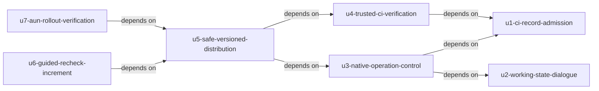

# Shirube — 単位の依存DAG

## Dependency DAG

このYAMLを単位名/kind/直接依存の唯一の正規edge blockとする。[unit-of-work.md](unit-of-work.md)の安定ID/Directory、[確認済み計画](units-generation-questions.md)と一致する。`A depends on B` はAがBの成果を必要とする意味であり、経済的な推奨実装順やcritical pathではない。

```yaml
units:
  - name: u1-ci-record-admission
    kind: service
    depends_on: []
  - name: u2-working-state-dialogue
    kind: service
    depends_on: []
  - name: u3-native-operation-control
    kind: service
    depends_on: [u1-ci-record-admission, u2-working-state-dialogue]
  - name: u4-trusted-ci-verification
    kind: service
    depends_on: [u1-ci-record-admission]
  - name: u5-safe-versioned-distribution
    kind: service
    depends_on: [u3-native-operation-control, u4-trusted-ci-verification]
  - name: u6-guided-recheck-increment
    kind: service
    depends_on: [u5-safe-versioned-distribution]
  - name: u7-aun-rollout-verification
    kind: packaging
    depends_on: [u5-safe-versioned-distribution]
```

## Dependency Diagram



文章での説明: U1のCI門とU2の読取/対話は成果依存の無い根。U3はU1の必要条件とU2の現在対象/明示開始入口を必要とする。U4はU1の原本由来PR記録と同じ門へ2センサー実結果を結ぶ。U5はU3の正規接続/停止/照会とU4の検査/設定を使って実導入する。U6とU7はU5までの成果を使い、それぞれ実追加とAUN実証を届ける。7ノード/7辺で循環は無い。

| Unit ID | Directory | Direct Dependencies | 成果として必要な理由 |
|---|---|---|---|
| U1 | u1-ci-record-admission | なし | 実PR/原本の読取と3条件のCI判定/停止を単位内で実行 |
| U2 | u2-working-state-dialogue | なし | 読取専用の実状態/設定案内はPR門や開始接続の成功を必要としない |
| U3 | u3-native-operation-control | U1; U2 | 原本に基づく現在の必要条件と明示開始入口を正規操作へ接続 |
| U4 | u4-trusted-ci-verification | U1 | 原本由来PR記録と同じ核へ第4項目の実検査を結ぶ |
| U5 | u5-safe-versioned-distribution | U3; U4 | 正規操作/停止/照会と信頼版CI/設定を安全な固定版実適用へ結ぶ |
| U6 | u6-guided-recheck-increment | U5 | 初回機能と実ゴールを保って新要求の実追加を行う |
| U7 | u7-aun-rollout-verification | U5 | 固定版と4項目の門/設定を実AUNへ適用/検証する |

## First Resolved Unit and Integrated Slice

Owner指定は「最初にCIの最小門を置き、対話を待たずに動かす」である。この実施上の条件のためだけに、U1→U2やU2→U1という偽のruntime依存を追加しない。U1とU2の各読取は異なる対象を同じEvidenceCollection等の所有境界へ実装し、共通の形式は事前Contract Designで確定する。読取専用の対話は門の成功を要求せず、開始や適用の権限を発行しない。

現在の[.codex/tools/aidlc-lib.ts](../../../../../../../.codex/tools/aidlc-lib.ts)のcomputeBatches/parseBoltDagは、充足済み依存の階層ごとに名前順へ並べる。[.codex/tools/aidlc-unit.ts](../../../../../../../.codex/tools/aidlc-unit.ts)のopeningStatusFromは `batches[0][0]` をskeletonとして扱う。上の実edge blockの期待される解決は次のとおり。

| DAG階層 | 解決される単位名 |
|---|---|
| 1 | u1-ci-record-admission; u2-working-state-dialogue |
| 2 | u3-native-operation-control; u4-trusted-ci-verification |
| 3 | u5-safe-versioned-distribution |
| 4 | u6-guided-recheck-increment; u7-aun-rollout-verification |

最初のresolved unitはu1-ci-record-admissionとなる。これは現在の実装を根拠とするDAG解決の確認であり、残りの経済的なBolt順の推薦ではない。将来engine版で規則が変われば再確認し、Owner指定と異なる場合は進めず具体差を戻す。engine変更やstate/cacheの直接編集は行わない。

生成後の構造確認では、Bunから現engineのexport `parseBoltDag` を呼び、この実ファイルを `readFileSync` で読んで解析した。結果はok=true、7単位/7辺、batchesは上表と一致し、`batches[0][0]` は `u1-ci-record-admission` だった。正式CLIの段/state更新関数は呼んでいない。このread-only確認はDAGの構造検証であり、U1の製品実PR/CI試験や次段の原本真正性の実物試験ではない。

U1の統合sliceは実PRの原本由来記録を実CIから読み、正式READY、設計先行監査、必要な単位PR記録の3条件を現在の実発行元/対象/内容/試行へ照合し、不成立をCI門の停止へ反映する。後続対話/開始/配布をmockで代用しない。設計文書だけ、JSON構文だけ、任意JSONの再生成一致だけではU1完了としない。

U4は4項目目であるtraceability/upstream-coverageの信頼版CI実再検査として分ける。U1の3条件判定が通ってもU4や他の必須条件を免除しない。U1は初回実ゴールUS3.2でも全Must完了でもない。初回にはU1〜U5と実開発/試験/CI/監査/承認/別担当統合の結果が必要であり、U6はその実ゴール完了と後の新要求受付を前提とする。

## Integration Points and Contracts

以下は単位間で必要な情報と失敗の境界であり、詳細API/コマンド/保存方式の採択ではない。部品所有は[components.md](../domain-design/components.md)のまま、呼出しに合わせて判定を複製しない。

| 接続 | 共有/受渡しする情報 | 必要な対応と失敗時の条件 |
|---|---|---|
| 外部原本/実PR→U1→CI門 | 正式AI-DLC原本、実発行元、現対象/成果物/試行、掲載用記録、実PR/head、3条件の実結果 | 真正な原本を取得できず独立確認不能なら止める。設計だけのheadと監査の独立性/先行順、設計変更の失効を確認 |
| U1/U2→U3 | 必要条件と実観測/対象/版/有効回答、正規選択肢、明示開始 | 操作前に再確認し、別対象へ自動切替せず停止。古い門結果や設定回答を許可へ流用しない |
| U1→U4 | 原本由来単位PR記録と同じ照合意味、信頼版checker/必須条件、実CI入力/結果 | checker/必須集合/severity/pathをPRから弱められない。片方未実行/旧head/不能では停止 |
| U3/U4→U5 | 正規接続/停止/照会、CI/配布設定の版、許可差分/必要判断/監査/受領、実設定 | 同一要求/競合/途中失敗/復旧を検証し、半分の適用を成功にしない。配布後に実物を再読 |
| U5→U6 | 初回実ゴールの根拠、新要求受付、現候補/前提/選択後の実観測、回答の保持と前後比較 | 初回未達なら開始しない。選択だけで操作せず、実差が無ければ題材の判断を戻す |
| U5→U7 | 固定版/差分/確認/戻し方、AUN現担当/受領/権限/保留、公開可能な受入結果 | 受け手の実適用/実PR正負/実driftを観測する。非公開原本は元で照合し、不能を成功にしない |

### Contract Designの方式採択前の実物試験

U1の必須原本/発行元接続は未検証であり、次段で実物を試して観測証拠を得る前に方式を決めない。正式AI-DLCが実生成した承認/見直し原本と認可された取得経路/実行元を使い、内部audit/.aidlc-engineのlogや秘密を公開せず、実CIから真正性と現対象/成果物/試行を独立確認する。

正例だけでなく作者偽造/改変/旧対象/旧内容/旧試行/失効/発行元不明/取得不能を実物で拒否し、実CI環境との版/認可/公開境界の適合と停止結果を証拠にする。ローカルmockや任意JSONの再生成一致、identityCheck:noneで採択しない。成立不能なら採択と依存操作を止め、具体的な試験案と必要判断へ戻す。

新trust source/署名者/台帳/DB/サービス/資格情報/保護workflow/本番等の変更を暗黙追加しない。必要なら後続で範囲と判断を具体化する。この段で実験や方式選定、保護対象変更を行わない。

## Parallel Development Opportunities and Execution Constraints

成果依存上は次の独立集合がある。複数のtopological orderingが可能であることを示すだけで、実装並列の承認ではない。

| 独立集合 | 成果上の前提 | 実行上の扱い |
|---|---|---|
| U1; U2 | 各自の外部読取を使い相互の成果を必要としない | Owner指定で最初はU1。現在の直列checkpointを維持 |
| U3; U4 | U3はU1/U2、U4はU1を必要とする | 独立性で並列実装や次単位Code Generationを解禁しない |
| U6; U7 | U5までの成果を必要とする | 新要求と受け手条件をそれぞれ確認し、残りの経済的な選択はDelivery Planningへ渡す |

U6の案内機能はAUNの4項目検査の技術的前提ではないため、U7→U6の偽の辺を置かない。両方の受入は全体完了に必要であり、後から配布/検査へ影響する版が変われば受け手の実版と影響範囲を再検証する。旧AUN結果を無条件に流用しない。最終実証対象版と再検証条件はDelivery Planning/後続設計で具体化する。

全単位で1単位1PR、該当4分類の同PR設計head独立監査→実装→新head確認、作者受領と作者以外の統合を保持する。前単位の統合後に次単位のCode Generationへ進む。親の管理/品質と承認済み正規役の成果物作成を分け、共有規則・門・保護設定・既存担当/保留をこのDAGで変更しない。
