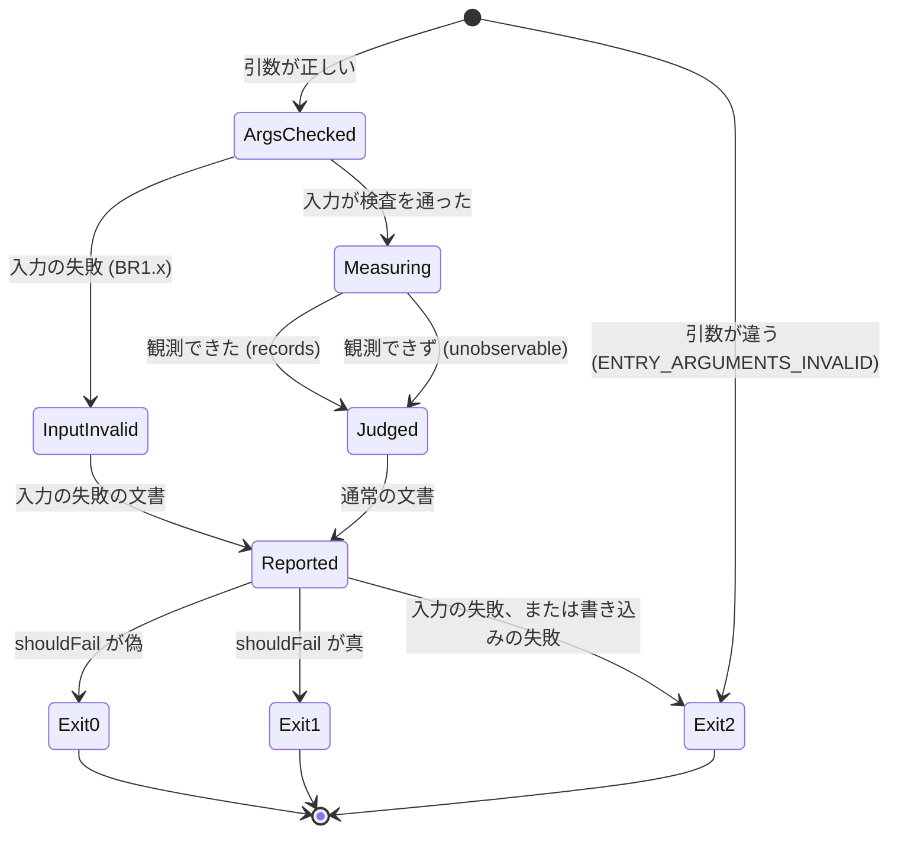
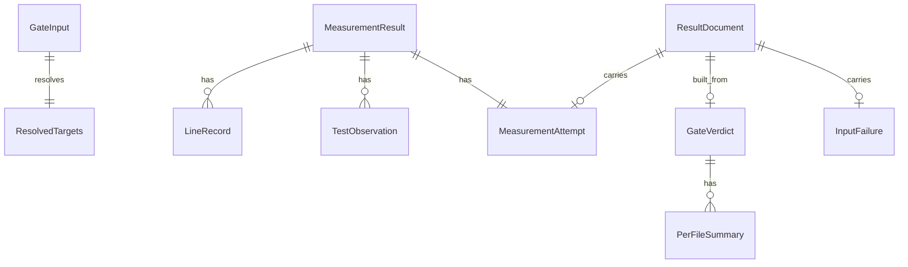

# U3 u3-node-gate-slice — 機能の設計（functional-spec）

## Sources

- [desc] Initial description: 共有の網羅率の門を新しい AI-DLC の取り組みとして始める（Owner の指示 https://github.com/watchout/iyasaka-arc/issues/49#issuecomment-6759071065、本文 SHA-256 `c5d9ccc3510ff46e5d6661bc8c528cafb7e08d4ce2c86f39f049782eaf7e524b`）。
- [scope] Workflow-selected scope: feature
- 単位: [unit-of-work.md](../../../inception/units-generation/unit-of-work.md) の U3、対応: [unit-of-work-story-map.md](../../../inception/units-generation/unit-of-work-story-map.md)。ストーリー: [stories.md](../../../inception/user-stories/stories.md)（US1.1、US1.3、US1.4、US2.1〜US2.4、US4.1、US6.1、US6.3、US10.1、US10.2）。
- 要件: [requirements.md](../../../inception/requirements-analysis/requirements.md)（FR1.1・FR1.3・FR1.4、FR2.1〜FR2.3、FR3.1、FR4.1〜FR4.4、FR8.1〜FR8.4、NFR1〜NFR4、NFR7、NFR9）。契約: [contract-summary.md](../../../inception/contract-design/contract-summary.md)（契約 2〜8）。部品と判断: [components.md](../../../inception/domain-design/components.md)、[decisions.md](../../../inception/domain-design/decisions.md)（ADR-001〜006）。
- [Q1]〜[Q4]: [functional-design-questions.md](./functional-design-questions.md)（arc の答え。Owner の委任 iyasaka-arc#49 6762288830。Owner の言葉ではない）。
- 実体: [entities.md](./entities.md)。規則: [rules.md](./rules.md)。追跡表: [traceability.json](./traceability.json)。
- 既存部品の現状の突き合わせ（作業場の木は古いことがあるので、clone の実物と照らした）: `scripts/hygiene/lib.mjs` は origin/main `0f9ea89175ece32604e0dcfde9db28462f0d2f35` の blob `90195d5ec2510c32ba726c9c831a0c84a3849fa9`、file の SHA-256 `294ca623c2a002aafe1940544ec178b27f07085528e6192b14c1edf2a51117c4`。公開される関数 `resolveTargets`・`trackedFiles`・`EXIT` を読んだ。この単位は変更しない（ADR-003）。
- 実測（作った側の観測。公開に載る架空の小さな例で、この環境の Node 22.23.4・24.22.1・26.12.1 で流した。例は 1 つで、すべての組み合わせの保証ではない）は rules.md の Sources に書いた。

## この単位が受け持つ範囲

- 受け持つ物語（story map の U3 の 12 行）と受入条件 39 件: 追跡表（[traceability.json](./traceability.json)）が受入条件ごとに規則を結ぶ。
- 複数の単位にまたがる物語の、U3 が受ける部分（story map の「横断」と、Open Question 1 の答え）:
  - US1.3（子プロセスの行）: U3 は Node 組込みの形で受ける。TypeScript の形は U6。
  - US2.3・US2.4（文面と出力値）: U3 の入口が、結果の文書、job summary、出力値、notice を作って書く（契約 2）。それを workflow の job の出力と成果物として返す配線は U7。
  - US6.3（測定の定義・除外・動作）: U3 は測定の定義を文書に入れ、除外と動作と閾値の例外は固定の値の項目だけを置く（空の除外、動作 enforce、例外 null）。U4・U5 が値を持たせる。
  - AC10.1.3（workflow の定義に `|| true` などが無い）は workflow の定義の話で、U7 が受ける。

## 部品と責務の分け方

| 部品 | この単位での大きさ | 受け持つ規則 | 置き場所（案。コード生成で確定） |
|---|---|---|---|
| CoverageJudge | 最小 | BR3.1〜BR3.8 | `scripts/coverage-gate/judge.mjs` |
| CoverageInputContract | 最小 | BR1.1〜BR1.8 | `scripts/coverage-gate/input.mjs` |
| MeasurementRunner | 完全 | BR2.3、BR2.7、BR2.8 | `scripts/coverage-gate/runner.mjs` |
| NodeBuiltinMeasurer（lcov の変換、出来事の報告係を含む） | 完全 | BR2.1、BR2.2、BR2.4〜BR2.6 | `scripts/coverage-gate/measure-node.mjs`、`scripts/coverage-gate/events-reporter.mjs` |
| ResultReporter | 最小 | BR4.1〜BR4.7 | `scripts/coverage-gate/report.mjs` |
| CoverageGateCli（入口） | 完全 | BR5.1〜BR5.5 | `scripts/coverage-gate/cli.mjs`（`node scripts/coverage-gate/cli.mjs --input <path> --result <path>`） |

- 判定の核（judge）と文書の組み立てには、時計・乱数・識別子・環境変数・file の読み書きを置かない（BR3.8）。入口と測定の部品が、その境目の外で読み書きする。
- 値の置き場所は GateConstants（entities.md）。理由コード・結果の区分・既定の閾値は判定の核が、入力の既定と試験 file の名前の型は入力の検査が、Node の保証する版は測定の部品が持つ。ほかは参照するだけ（NFR3、S3）。
- 入口の置き場所と名前（契約 2 の未決の項目）を、上の案で決めた。実際の file 名はコード生成で確定する。

## 手順（ワークフロー）

### W1 入口の 1 回の実行（CoverageGateCli）

1. 引数を確かめる（BR5.1）。形が違えば ENTRY_ARGUMENTS_INVALID を標準エラーに書いて終了コード 2。
2. `--result` の path に既存の file があれば消す（BR5.2）。
3. 環境から実行の識別子を 1 回だけ読む（BR5.4）。形が違えば ENTRY_ENVIRONMENT_INVALID で終了コード 2。
4. W2（入力の検査）を行う。入力の失敗なら W5 の入力の失敗の文書を作って 8 へ。
5. W3（測定）を行う。
6. W4（判定）を行う。
7. W5（出力）で文書を作る。
8. 結果の file を一時の file 経由で書き（BR5.3）、job summary と出力値を書き、notice を標準出力に書く。
9. 終了コードを返す: shouldFail が偽なら 0、真なら 1、入力の失敗なら 2。いずれかの書き込みの失敗と予期しない例外は 2（BR5.3）。

### W2 入力の検査（CoverageInputContract）

1. 入力の file を読む。読めない、JSON でない、object でない（BR1.1）。
2. schemaVersion が 1 か確かめる（BR1.2）。
3. 項目の集合を確かめる。集合に無いキーは失敗（BR1.3）。
4. shape を確かめる（BR1.4）。
5. 分母の宣言を確かめ、追跡されている file に解決する。解決できなければ失敗、0 件でも失敗（BR1.5、BR1.6）。
6. testTargets を確かめ、必須の試験を解決する（BR1.7）。
7. 期限と総予算を確かめ、省略は既定を入れる（BR1.8）。
8. 検査済みの入力（GateInput と ResolvedTargets）を返す。失敗は最初に見つけた 1 件（InputFailure）を返す。検査の順は上の番号の順で固定する。

### W3 測定（MeasurementRunner、NodeBuiltinMeasurer）

1. 実行中の Node の major を確かめる。保証する版より古ければ、走らせずに観測できず（CHILD_PROCESS_NOT_COUNTABLE）を返す（BR2.2）。
2. 観測の file を置く一時 directory を作る（BR2.8）。
3. command を組む: node、`--test`、`--experimental-test-coverage`、lcov の報告係とその出力先、出来事の報告係とその出力先、必須の試験 file の一覧（BR2.1）。cwd は利用先の repo の root。
4. 子プロセスを、許可した名前の一覧（childEnvAllowlist）だけを門が置いた値で持つ環境で、自分の process group で起動する。期限と総予算の小さい方を上限として待つ（BR2.3、BR2.8）。
5. 上限を超えたら process group 全体を止め、timed_out か budget_exceeded の観測できずを返す。
6. 終わったら、終了の観測と観測の file の有無で終わり方を決める（BR2.7）。
7. 出来事の file を読んで、試験 file ごとに数える。失敗が 1 つでもあれば test_failed の観測できずを返す（BR2.4）。
8. lcov を読んで行ごとの記録に変換する。壊れていれば failed、DA が無ければ no_records（BR2.5）。
9. measuredPaths、testFilesRun、testFailurePaths を観測から作って MeasurementResult を返す（BR2.6）。一時 directory を片付ける。

### W4 判定（CoverageJudge）

1. MeasurementResult が観測できずなら、原因を理由コード 1 つに写し、値と一覧を null にして終わる（BR3.5）。
2. 対象の記録から行の数を数える。0 件なら NO_RECORDS の観測できず（BR3.4）。
3. 行の割合を再計算し、perFile と recordsSha256 を作る（BR3.1）。
4. 未計測の file を数える（BR3.2）。流れていない必須の試験を数える（BR3.3）。閾値と比べる（BR3.6）。
5. 区分と shouldFail を決める（BR3.7）。

### W5 出力（ResultReporter）

1. 判定の結果、または入力の失敗から、結果の文書を作る（BR4.1〜BR4.3）。
2. 同じ文書から job summary、notice、出力値を作る（BR4.4〜BR4.7）。notice は一致なら notice、一致でなければ error の注釈にする。

## 状態の遷移

### 入口の 1 回の実行

- 戻る遷移は無い。測定は 1 回で、再試行しない。

### 測定 1 回（MeasurementAttempt の endState）

| 今 | きっかけ | 次 | 結果の MeasurementResult |
|---|---|---|---|
| 実行中 | 上限内に終了コード 0 で終わり、観測の file が読めた | completed | records（BR2.4 で失敗が無い時）または unobservable test_failed |
| 実行中 | 終了コードが 0 でない（失敗した試験が無い）、signal、起動の失敗、出来事の file が壊れている | failed | unobservable failed |
| 実行中 | 期限を超えた（期限 ≤ 残りの総予算） | timed_out | unobservable timed_out |
| 実行中 | 総予算を超えた（総予算が期限より小さい） | budget_exceeded | unobservable budget_exceeded |
| 実行中 | 終了コード 0 で記録が空または無い | completed | unobservable no_records |

- completed でも、結果が観測できずになることがある（test_failed、no_records）。endState は「子プロセスがどう終わったか」の観測で、成功を意味しない。

## 判定の表（判定の核）

| 条件（上から順に評価） | 区分 | 理由コード | 落とす（動作 enforce） |
|---|---|---|---|
| 測定が観測できなかった | unobservable | 原因に対応する 1 つ（BR3.5） | はい |
| 数えられた行が 0 件 | unobservable | NO_RECORDS | はい |
| 未計測あり OR 必須の試験が流れていない OR 閾値未満 | mismatch | 当てはまる物を UNMEASURED_FILES、TESTS_NOT_RUN、BELOW_THRESHOLD の順に | はい |
| 上のどれでもない | match | なし | いいえ |

## 境界の例（正例と負例の見本。公開の試験は架空の repo と値だけ）

- 一致: 3 file・全 120 行が数えられ、試験 file 2 本が流れた → match、割合 100.00、終了コード 0。
- 不一致（足りない）: 20,000 行のうち 19,999 行 → mismatch、BELOW_THRESHOLD、割合 99.99（100.00 と表示しない）。
- 不一致（未計測）: 宣言した 3 file のうち 1 file が子プロセスでも読み込まれない → mismatch、UNMEASURED_FILES、その file の名前を出す。
- 不一致（NOT_RUN）: 追跡された試験 file が 1 本増えて、全部が skip → mismatch、TESTS_NOT_RUN。
- 観測できず（失敗した試験）: 試験が 1 つ失敗 → unobservable、TEST_FAILED、割合は null。
- 観測できず（上限）: 遅い試験が総予算を使い切る → unobservable、MEASUREMENT_BUDGET_EXCEEDED か MEASUREMENT_TIMED_OUT、孫の process が残らない。
- 観測できず（壊れた記録）: lcov の LF/LH が DA と合わない、または DA が空 → MEASUREMENT_FAILED か NO_RECORDS。
- 入力の失敗: 未知のキー、版が無い、分母の宣言が無い → 終了コード 2、結果の文書に inputFailure。
- 決定性: 同じ入力で 2 回判定と整形を行うと、文書の文字列がバイトまで一致する。入力の 1 要素を変えると変わる。

## 派生の図（entities.md の yaml が source of truth）

## 派生の規則の要約（rules.md が source of truth）

- 入力: 読めない・版・未知のキー・shape・分母の宣言・解決・必須の試験・期限と総予算（BR1.1〜BR1.8）。
- 測定: Node 組込みだけ、Node 22 保証、1 回・上限、試験の失敗は観測できず、壊れた記録は失敗、終わり方の決め方、資格情報（BR2.1〜BR2.8）。
- 判定: 再計算、未計測、NOT_RUN、行 0 件、原因の写像、既定の閾値 100%、3 値、決定性（BR3.1〜BR3.8）。
- 出力: 文書、固定の項目、観測だけ、summary、1 つの整形、出力値、無害化（BR4.1〜BR4.7）。
- 入口: 引数、古い結果を消す、終了コード、環境の読み方、順（BR5.1〜BR5.5）。

## 対象外（この単位で決めない物）

- 閾値の例外・動作の切り替え・除外（U4・U5）。TypeScript と vitest の形（U6）。workflow の定義、権限、出力値の配線、DB の job（U7）。手引きと全体の検証（U8）。
- 結果の JSON を sds-gate や監査の入力に組み込むこと（範囲外。読める形で出すところまで）。

## Assumptions & Open Questions

### Assumptions

- [assumption] 試験 file の名前の型は `*.test.js`・`*.test.mjs`・`*.test.cjs`（basename）の 1 つ（GateConstants.testFilePattern）。Node 自身の発見の規則を写さないために、門の側で 1 か所に決めた。別の名前の型を使う利用先は、型を足す単位（またはこの定数の変更）が要る。
- [assumption] 入力の検査の失敗でも、結果の文書を書き、outcome は unobservable（3 値の中で「観測できなかった」）、終了コードは 2 とする。第 4 の区分を足さない（FR4.2）。
- [assumption] 通知・summary・エラーの文面は英語の固定の文型にする（既存の衛生の検査の出力と同じ公開の面）。固定の文型は ResultReporter の 1 か所に置く。
- [assumption] 契約 7 の「現在時刻」の入力は、この単位では取らない。出力に時刻に依る項目が無いので、読み捨てる入力を作らない（BR3.8）。実測の経過秒（spentSeconds）は測定の部品が時計から作る観測で、判定の核への入力の一部である。そのため「同じ入力」は、固定した MeasurementResult（経過秒を含む）を指す。実際の 2 回の実行の経過秒は、事実として異なりうる。
- [assumption] lcov の LF/LH と DA の件数の一致を、記録の整合の確かめ（BR2.5）に使う。この環境の小さな例では一致した。コード生成で、より大きな例で一致を確かめる。合わない正当な場合が見つかれば、この確かめは外し、その旨を設計の記録に書いて直す。
- [assumption] 行が 0 件の file（コメントだけの file など）が記録に SF として現れるかは未測定。現れない場合は未計測として報告される（失敗側）。利用先は、その file を分母の宣言から外す（除外は U5）。コード生成で測って記録する。
- [assumption] 試験の結果の `details.type` による suite と試験の区別は Node 22 で確かめた。24・26 では保証しない（Q4）。
- [assumption] 子に渡す環境は許可した 5 つの名前の一覧（GateConstants.childEnvAllowlist: PATH, HOME, LANG, LC_ALL, TZ）だけで、値は門が置く（arc の答え。Owner の委任 iyasaka-arc#49 6762288830。Owner の言葉ではない）。利用先の試験が親の環境変数（例: CI）を必要とすると、その試験は失敗し、観測できずになる（成功には倒れない）。要る名前の追加は入力の項目を足す別の単位で扱う。Node の試験の実行器が自分で置く変数（NODE_V8_COVERAGE など）は一覧に入れない。実装の最初の実測で、一覧だけでは測れないと分かった時だけ、その名前を一覧に足す（設計に戻して記録する）。
- [assumption] 質問 Q1〜Q4 の答えは arc の答え（Owner の委任）で、Owner の言葉ではない。

### Open Questions

1. 大きな実在に近い例で、子プロセスの行・LF/LH の一致・コメントだけの file の扱いを確かめる（コード生成の中の試験で。設計に反する結果が出たら、設計を先に直す）。
2. 試験 file の名前の型を、利用先が追加できるようにするか（この単位は固定。要望が出たら別の単位）。
3. process group 全体を止める実装が、利用先の実行環境（GitHub Actions の Linux）で確実に孫まで止めるか。コード生成で架空の遅い試験を使って確かめる。
