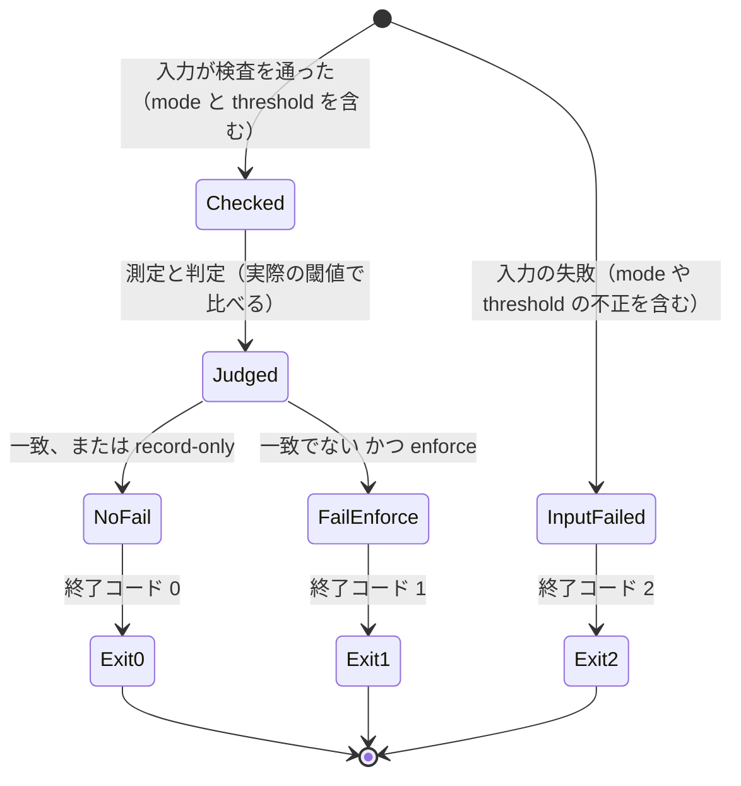
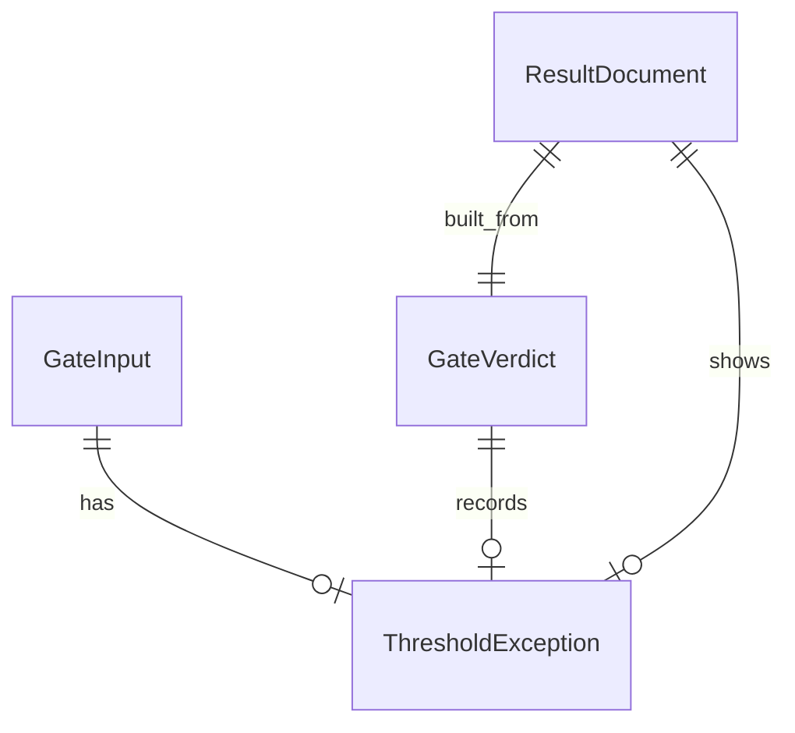

# U4 u4-thresholds-and-modes — 機能の設計（functional-spec）

## Sources

- [desc] Initial description: 共有の網羅率の門を新しい AI-DLC の取り組みとして始める（Owner の指示 https://github.com/watchout/iyasaka-arc/issues/49#issuecomment-6759071065、本文 SHA-256 `c5d9ccc3510ff46e5d6661bc8c528cafb7e08d4ce2c86f39f049782eaf7e524b`）。
- [scope] Workflow-selected scope: feature
- 単位: [unit-of-work.md](../../../inception/units-generation/unit-of-work.md) の U4、対応: [unit-of-work-story-map.md](../../../inception/units-generation/unit-of-work-story-map.md)。ストーリー: [stories.md](../../../inception/user-stories/stories.md)（US4.2、US4.3、US5.1、US5.2、US6.2、US6.3 の U4 が受ける部分）。
- 要件: [requirements.md](../../../inception/requirements-analysis/requirements.md)（FR3.2〜FR3.5、FR6.1〜FR6.4、FR8.4、NFR2〜NFR4、NFR7、NFR9）。契約: [contract-summary.md](../../../inception/contract-design/contract-summary.md)（契約 2・3・4・7）。部品と判断: [components.md](../../../inception/domain-design/components.md)、[decisions.md](../../../inception/domain-design/decisions.md)（ADR-001、ADR-004）。
- 土台: U3 の機能の設計 [functional-spec.md](../../u3-node-gate-slice/functional-design/functional-spec.md)。U3 の PR（#104）は統合前で、この単位のコード生成は U3 の統合後の `main` を土台にする。
- 実体: [entities.md](./entities.md)。規則: [rules.md](./rules.md)。追跡表: [traceability.json](./traceability.json)。
- 現状の突き合わせ: U3 の実装（PR #104 の head `48024643e63c70fa5df62714a129972457181406`）の `scripts/coverage-gate/{input,judge,report,cli}.mjs` を読み、既存の関数の入出力の形（`checkInput(text)`、`judge({denominatorPaths, requiredTestPaths, measurement})`、`buildDocument`、`renderSummary`・`renderNotice`・`renderOutputs`、`runCli`）に合わせて設計した。作業場の木は使っていない。

## この単位が受け持つ範囲

- 受け持つ物語（story map の U4 の 6 行）と受入条件 20 件: 追跡表（[traceability.json](./traceability.json)）が受入条件ごとに規則を結ぶ。
- 複数の単位にまたがる US6.3（story map の Open Question の答え）: U4 が受ける部分は「動作」と「閾値の例外」を結果の JSON に含めること（AC6.3.1 のうち mode と thresholdException）、値を観測した記録だけから作ること（AC6.3.2）、監査や sds-gate の入力に組み込まないこと（AC6.3.3）。測定の定義は U3、除外の一覧と理由は U5 が受ける。
- 受け持たない物: 除外（U5）、TypeScript の形（U6）、workflow の定義・権限・出力値の配線・DB の job（U7）、手引きと全体の検証（U8）。

## 部品と責務の分け方

| 部品 | この単位での大きさ | 受け持つ規則 | 置き場所（案。コード生成で確定） |
|---|---|---|---|
| CoverageInputContract | 足す | BR6.1〜BR6.6、BR7.1 | `scripts/coverage-gate/input.mjs`。膨らむ場合は例外の検査を別 file に分ける（file 300 行、関数 50 行・複雑さ 10 の予算を守る） |
| CoverageJudge | 足す | BR7.2、BR7.4〜BR7.6 | `scripts/coverage-gate/judge.mjs` |
| ResultReporter | 足す | BR8.1〜BR8.5 | `scripts/coverage-gate/report.mjs`。膨らむ場合は表示の文型を別 file に分ける |
| CoverageGateCli（入口） | 最小 | BR7.3、BR8.6 | `scripts/coverage-gate/cli.mjs`。検査済みの mode と threshold を判定へ渡す 1 行を足すだけ。終了コードの写し方は U3 のまま |

- 動作に応じた分岐は判定の核だけに置く。入口は shouldFail を終了コードに写すだけ（ADR-004）。入力の検査は動作の集合と既定を判定の核から参照し、値を写して持たない（NFR3、S3）。
- 判定の核・出力の組み立てに、時計・乱数・識別子・環境変数・file の読み書きを置かない（U3 の BR3.8 のまま）。

## 手順（ワークフロー）

U3 の W1〜W5 の順は変えない（検査 → 測定 → 判定 → 出力）。変わる所だけを書く。

### W2' 入力の検査（足す）

1. U3 の検査（読めるか、版、未知のキー、shape、分母の宣言、必須の試験、期限と総予算）を、U3 の順で行う。未知のキーの集合に threshold と mode を足す（BR6.1）。
2. 動作を確かめる。省略は enforce。値が許されない物なら失敗（BR7.1）。
3. 閾値の例外を確かめる。無ければ例外なし。有れば、object か、3 つそろっているか（BR6.2）、値（BR6.3）、URL の形（BR6.4）、根拠（BR6.5）の順に確かめる。最初に見つけた 1 件の失敗を返す。
4. 検査済みの入力に mode（必ず値あり）と threshold（例外か null）を足して返す。

### W4' 判定（足す）

1. U3 の W4 の 1〜3（観測できずの扱い、行の数え方、再計算）は変えない。
2. 実際の閾値を決める: 例外があればその値、無ければ既定の 100%（BR7.4）。観測できずの判定でも、実際の閾値と例外は入力から決まるので verdict に載せる（BR7.5）。
3. 未計測・NOT_RUN・閾値との比較を U3 のとおり行い、区分を決める。
4. shouldFail を決める: 一致でなく、かつ動作が enforce のときだけ真（BR7.2）。

### W5' 出力（足す）

1. 文書を作る: mode、thresholdException、effectiveThresholdPercent に値を持たせる（BR8.1）。
2. job summary を作る: 例外があれば最初の行に下げた事実、表と節に URL・値・根拠（BR8.2）。record-only なら落とさない旨と、計測不能の見出し（BR8.4）。
3. notice を作る: 注釈の種類を表で決め、実際の閾値を書く（BR8.3）。
4. 出力値は名前を増やさず、同じ文書から作る（BR8.5、BR8.6）。

## 動作と結果の表

### shouldFail と終了コード

| 結果の区分 | 動作 enforce | 動作 record-only |
|---|---|---|
| match | 落とさない（終了コード 0） | 落とさない（0） |
| mismatch（未計測・NOT_RUN・閾値未満） | 落とす（1） | 落とさない（0）。値と不足は書く |
| unobservable（測定の失敗・予算超過・行 0 件・後始末の失敗など） | 落とす（1） | 落とさない（0）。「計測不能」と書く |
| 入力の失敗（入口は測定しない） | 落とす（2） | 落とす（2）。動作を信じられないので隠さない |
| 入口の失敗（書き込み失敗など） | 落とす（2） | 落とす（2） |

### 注釈の種類（BR8.3）

| 結果 | 例外なし | 例外あり |
|---|---|---|
| match | notice | warning |
| 一致でなく、enforce | error | error（例外の一言を足す） |
| 一致でなく、record-only | warning | warning（例外の一言を足す） |
| 入力の失敗 | error | （例外は読み取れていない） |

## 状態の遷移

動作と閾値の例外は入力で固定され、1 回の実行の中で変わらない。状態の遷移は U3 の入口の 1 回の実行のとおりで、この単位は遷移を足さない。違いは判定の最後の分岐だけである。

## 境界の例（正例と負例の見本。公開の試験は架空の repo と値だけ）

- 例外あり・一致: 閾値 95 を、架空の決定の URL と根拠で宣言。割合 96.00% → match、effectiveThresholdPercent 95.00、thresholdException に URL・95.00・根拠、summary の最初の行に下げた事実、notice は warning。
- 例外あり・不足: 閾値 95、割合 94.99% → mismatch、BELOW_THRESHOLD、enforce なら終了コード 1。
- 例外あり・割合が 100%: 例外を宣言したが割合は 100% → match。例外を使った事実は消えない（thresholdException も最初の行も出る）。
- 失敗（URL が無い）: threshold に percent と rationale だけ → INPUT_FIELD_MISSING、field threshold.decisionUrl、終了コード 2。
- 失敗（値）: percent が "95"（文字列）、100、100.5、-1、95.123 → すべて INPUT_FIELD_INVALID、field threshold.percent。95、95.5、95.07、0 は受け付ける。
- 失敗（URL の形）: http、別の host、query つき、fragment が違う、資格情報つき（user@host）、前後に空白 → INPUT_FIELD_INVALID、field threshold.decisionUrl。
- 失敗（根拠）: 空、空白だけ、改行を含む、301 文字 → INPUT_FIELD_INVALID、field threshold.rationale。
- 失敗（未知のキー）: threshold の中に note を足す → INPUT_FIELD_UNKNOWN、field threshold.note。
- 動作の既定: mode を書かない呼び出しで一致でない結果 → 落とす（終了コード 1）。
- 記録だけ・不足: mode が record-only で割合が閾値未満 → mismatch、BELOW_THRESHOLD、終了コード 0、値と不足が書かれ、見出しは Mismatch。
- 記録だけ・未計測と NOT_RUN: 同じく終了コード 0、unmeasuredPaths と notRunPaths の名前が書かれる。
- 記録だけ・計測不能: 測定の道具が失敗 → unobservable、終了コード 0、notice と summary に「計測不能」、成功とは書かれない。
- 動作の値の失敗: mode が "fail"、"Enforce"、"record"、null → INPUT_FIELD_INVALID、field mode、終了コード 2（record-only の入力でも隠さない）。
- 動作の切り替え: 同じ結果を record-only から enforce に変えると、終了コードだけが 0 から 1 に変わり、区分と理由は変わらない。
- 後ろ向きの互換: mode も threshold も無い入力は、U3 の出力とバイトまで一致する。
- 決定性: 同じ入力（固定した MeasurementResult と runId を含む）で 2 回判定と整形を行うと文字列がバイトまで一致する。mode か threshold の 1 要素を変えると出力が変わる。

## 派生の図（entities.md の yaml が source of truth）

## 派生の規則の要約（rules.md が source of truth）

- 入力: 閾値の例外は 3 つそろい（値、URL の形、根拠）、動作は 2 つの値だけ（BR6.1〜BR6.5、BR7.1）。実在は確かめず資格情報を持たない（BR6.6）。
- 判定: 実際の閾値、主張された値の保持、落とすかの意味、区分と理由は動作で変えない（BR7.2〜BR7.6）。
- 出力: 例外の事実は最初の行と表と節、record-only は落とさないと書き計測不能と書く、例外も動作も無ければ U3 と一致（BR8.1〜BR8.6）。

## 対象外（この単位で決めない物）

- 除外（U5）、TypeScript と vitest の形（U6）、workflow の定義と出力値の配線（U7）、手引きと全体の検証（U8）。
- 決定の実在・書き手・本文の確認（独立の監査が行う）。結果の JSON を sds-gate や監査の入力に組み込むこと（範囲外）。
- 出力値の名前の追加。例外を使った事実は effective-threshold-percent が 100.00 未満であること、と成果物の JSON で読める。

## Assumptions & Open Questions

### Assumptions

- [assumption] 決定の URL の形は、GitHub の issue または pull request の**コメント**（`#issuecomment-` つき）に限る。Owner の決定は issue・PR のコメントとして公開され、引用は `#issuecomment-<id>` まで特定する決まり（権限の置き場の規則）に合わせた。レビューのコメントや discussion の URL は受け付けない。要望が出れば形の集合を足す別の変更になる。
- [assumption] 下げる値は JSON の数に限り、文字列の "95" は受け付けない。「数として読めない値は失敗」（AC4.2.3）を、曖昧さを残さない側に倒した。小数は第 2 位までで、結果の割合の書式（NN.NN）と揃える。
- [assumption] 根拠は 1 行・300 文字以内・制御文字なし。長い説明は決定の本文にあり、門の出力は URL で結び付ける。上限の 300 は読める長さの目安で、変える場合は GateConstants の 1 か所を変える。
- [assumption] 注釈の種類（notice・warning・error）は、例外を使った成功と、record-only の一致でない結果を warning にする。成功の表示に隠れない（FR3.5）ことと、落とさない結果を error（赤）に見せないことを両立するため。GitHub Actions の画面での見え方は利用先の環境次第なので、試験は文面と種類の行を確かめ、画面の見え方は確かめない。
- [assumption] 「計測不能」の文字列は、record-only で結果が unobservable のときの notice と summary の見出しにだけ足す。受入条件（AC5.1.2）が「計測不能」と明記するよう求めているのは record-only のときで、enforce の文面は U3 のまま保つ（後ろ向きの互換）。ほかの文面は U3 に合わせた英語の固定の文型。
- [assumption] 入力の失敗は record-only でも終了コード 2 で、文書の mode は null。契約の Q2 の答え（入力不正と入口の失敗は別に伝える）に沿う。動作の値そのものが不正な入力で、どちらの動作を採るかを決められないため。
- [assumption] 閾値の例外は、既定より厳しい値を許さない（100 未満だけ）。厳しくする要望は例外ではなく通常の設定で、この取り組みの範囲に無い。
- [assumption] 例外を宣言したが割合が 100% だった場合も、例外を使った事実を表示する。「例外が要らなかったかどうか」の判断は、読む側（監査）が割合と閾値から行える。
- [assumption] 出力値の名前を足さない。公開の面（契約 1）の変更になるため、この単位では行わない。必要なら U7 の設計で扱う。
- [assumption] 質問は無い。上の仮定は、U4 の範囲の設計判断で、決定済みの契約・要件の枠を超えない。

### Open Questions

1. この単位は、契約 2 と契約 3 に、契約が予定した項目（threshold、mode、thresholdException）の値を持たせる。「契約に触れる単位」として、設計記録だけの PR と設計監査を先に出すか（team.md の守る物の扱い）は、arc の判断に委ねる。
2. 例外の URL の形の集合（コメントの種類）を広げる要望の有無。要望が出るまで広げない。
3. 画面での注釈の見え方の確認は、U7 の workflow が実際に呼ばれた後の観測になる。
