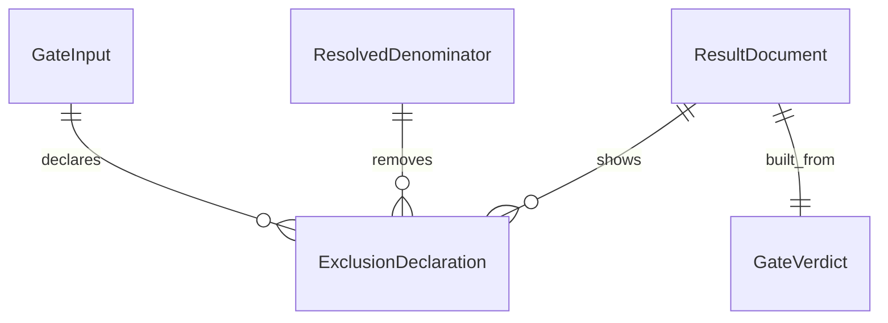

# U5 u5-exclusions — 実体（entities）

## Sources

- [desc] Initial description: 共有の網羅率の門を新しい AI-DLC の取り組みとして始める（Owner の指示 https://github.com/watchout/iyasaka-arc/issues/49#issuecomment-6759071065、本文 SHA-256 `c5d9ccc3510ff46e5d6661bc8c528cafb7e08d4ce2c86f39f049782eaf7e524b`）。
- [scope] Workflow-selected scope: feature
- 契約 2・3: [contract-summary.md](../../../inception/contract-design/contract-summary.md)（入力の `exclusions` と結果の `exclusions`・`exclusionCount`）。部品: [components.md](../../../inception/domain-design/components.md)。単位: [unit-of-work.md](../../../inception/units-generation/unit-of-work.md) の U5。要件: [requirements.md](../../../inception/requirements-analysis/requirements.md)（FR5.1〜FR5.4、FR8.4、NFR2〜NFR4、NFR8、NFR9）。
- 土台: U3 の実体 [entities.md](../../u3-node-gate-slice/functional-design/entities.md) と U4 の実体 [entities.md](../../u4-thresholds-and-modes/functional-design/entities.md)。この単位は両方に**項目を足す**だけで、既存の項目の意味を変えない。
- 判断の記録: [decisions.md](../../../inception/domain-design/decisions.md) の ADR-001（意味の核は 1 か所）。
- 現状の突き合わせ: 統合済みの `origin/main`（`7fa98d1c713e5757387d0ecbaa9e4c1ebca9896e`、U3・U4 の実装を含む）の `scripts/coverage-gate/{input,resolve,report,report-exception,judge,order,sanitize,threshold}.mjs` を読んだ。作業場の木ではなく clone の実物を読んでいる。先頭 12 桁の SHA-256: input `02e11972e96d`、resolve `9d907d03c71f`、report `f5fbe3d7ac23`、report-exception `2416a39151f4`、judge `026c4132f504`、order `6ab85f9d6ed8`、sanitize `1d9a853e63f1`、threshold `6e4b8d70cafe`。

## 読み方

- 契約が「U5 が足す」と書いた項目（入力の `exclusions`、結果の `exclusions` と `exclusionCount` の値）を確定した。結果の文書には `exclusions: []` と `exclusionCount: 0` の項目がすでにあり（U3 が固定の項目として出している）、この単位は値を持たせる。**項目の名前は増やさない**。出力値の名前も増やさない（`exclusion-count` は U3 からある）。
- 論理の型だけを書く。実装の言語や書き方は決めない。

## 実体の定義（source of truth）

```yaml
entities:
  ExclusionDeclaration:
    description: 入力の exclusions の 1 件。呼ぶ側が 1 本ずつ名指しして理由を添える宣言。
    attributes:
      - { name: path, type: string, required: true, constraints: "空でない文字列。形（directory 名・wildcard）は入力の段では見ず、解決の段で分母の file の 1 つと文字列として一致することを確かめる（BR10.1）。正規化・大文字小文字の畳み込み・展開をしない" }
      - { name: reason, type: string, required: true, constraints: "U4 の根拠と同じ 1 行の文の規則（1 行、空白だけでない、制御文字なし、命令や表の区切りの並びなし、上限以内）。規則は 1 か所だけが持つ（BR9.3）" }
    constraints:
      - "持てる項目は path と reason だけ。これ以外のキーは INPUT_FIELD_UNKNOWN（field `exclusions[<i>].<キー名>`）"
      - "同じ path は 2 件以上持てない（BR9.4）"

  GateInput:
    description: 検査済みの入力。U3・U4 の項目に 1 つ足す。
    adds:
      - { name: exclusions, type: "ExclusionDeclaration[]", required: true, defaults: "[]", note: "入力で省略されるか空の配列なら 0 件。検査済みの入力では必ず配列があり、path の符号点順に並べ替えて持つ（出力の順を入力の並びに依存させない。BR11.1）" }
    constraints:
      - "最上位の既知の項目に exclusions を足す。exclusions が配列でなければ INPUT_FIELD_INVALID（field `exclusions`）。配列の要素が object でなければ INPUT_FIELD_INVALID（field `exclusions[<i>]`）"
      - "denominator の中に exclusions を置くことはできない。`denominator.exclusions` は未知のキーで INPUT_FIELD_UNKNOWN（denominator の既知は targets だけ、U3 のまま）"
      - "検査の順は U3・U4 の順（最上位の未知のキー → shape → 分母の宣言と必須の試験 → 期限 → 総予算 → 動作 → 閾値の例外）のあとに exclusions。既存の入力の失敗の先着は変わらない"

  ResolvedDenominator:
    description: 解決した分母。宣言を既存の解決で追跡されている file の集合にしたあと、除外した file を引いた物。
    attributes:
      - { name: denominatorPaths, type: "string[]", required: true, constraints: "解決した file から除外した file を引いた物。符号点順。判定の核が受ける分母はこの集合だけ（BR10.6）" }
      - { name: excludedPaths, type: "string[]", required: true, constraints: "分母から外した file。入力の exclusions の path と過不足なく一致する（BR10.4）。denominatorPaths と交わらない" }
    invariants:
      - "解決した file の数 = denominatorPaths の数 + excludedPaths の数"
      - "excludedPaths の各要素は、除外を引く前の解決した分母の file の 1 つと文字列として一致する（BR10.1）。一致しない要素が 1 つでもあれば分母を作らず失敗にする（無視しない）"
      - "denominatorPaths が空になる除外は失敗（BR10.2）。必須の試験（requiredTestPaths）は除外で変わらない（BR10.3）"

  GateVerdict:
    description: 判定の結果。この単位は項目を足さず、値の出どころも変えない。
    unchanged:
      - "判定の核は除外を知らない。受ける分母が小さくなるだけで、未計測・NOT_RUN・割合・区分・理由コードの決め方は U3・U4 のまま（BR10.6）"

  ResultDocument:
    description: 結果の文書。U3 が固定の項目として出している exclusions・exclusionCount に値を持たせ、denominator の件数の意味を 1 つ決める。名前は増やさない。
    changes:
      - { name: exclusions, type: "{path, reason}[]", constraints: "ExclusionDeclaration の写し（宣言そのもの）。path の符号点順。除外が無いとき空の配列。入力の失敗のとき空の配列（除外は適用していない）" }
      - { name: exclusionCount, type: integer, constraints: "exclusions の長さ。入力の失敗のとき 0" }
      - { name: "denominator.resolvedFileCount", type: integer, constraints: "除外を引いたあとの分母の件数（denominatorPaths の数）。除外が無いとき U3 と同じ値。宣言から解決した file の総数は resolvedFileCount + exclusionCount で読める" }
      - { name: "denominator.measuredFileCount", type: "integer|null", constraints: "U3 のまま（resolvedFileCount − 未計測の件数。観測できずは null）。除外した file は数えない" }
    invariants:
      - "exclusions と exclusionCount は、入力の exclusions だけから作る。環境・引数・既定の一覧・前回の値から足さない（BR10.4）"
      - "exclusions の各 path は、unmeasuredPaths・notRunPaths・perFile のどれにも現れない（分母に無い file は判定の対象外）"
      - "除外が 0 件の実行の文書は、U4 の出力とバイトまで一致する（BR11.4）"

  ReasonCode:
    description: 理由コードの集合は増やさない。除外の入力の失敗は U3 の入力の理由コード、分母に無い path と全部除外は U3 の解決の理由コードで返す。
    reuses: [INPUT_FIELD_UNKNOWN, INPUT_FIELD_MISSING, INPUT_FIELD_INVALID, TARGET_UNRESOLVED, TARGET_EMPTY]
```

## 実体の関係（派生。上の yaml が source of truth）


