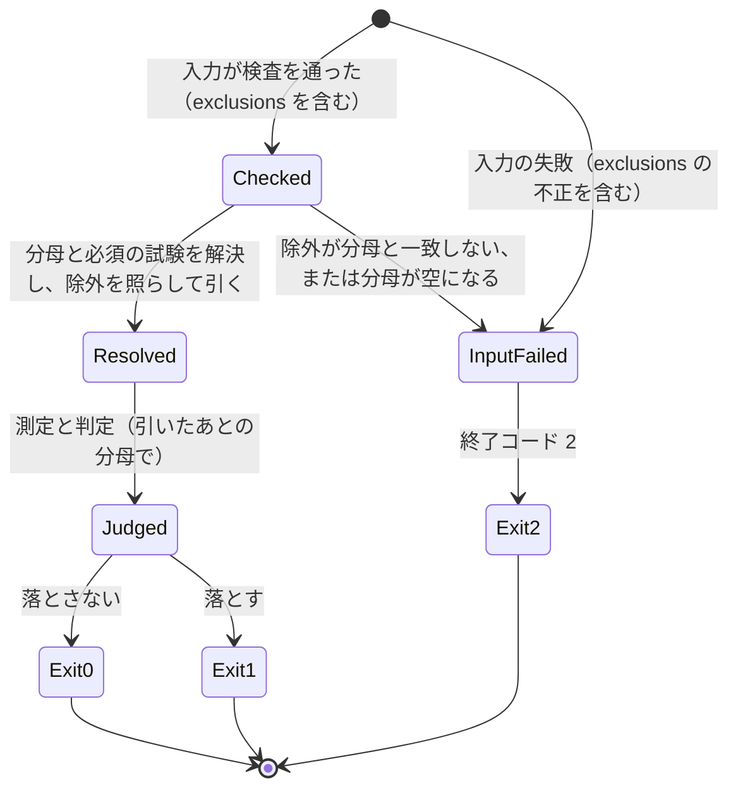
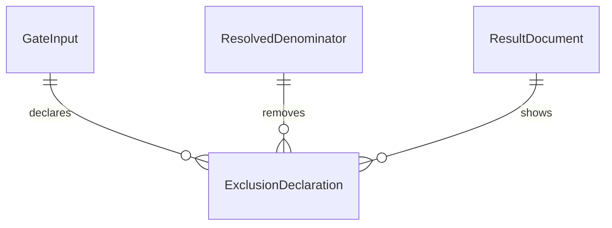

# U5 u5-exclusions — 機能の設計（functional-spec）

## Sources

- [desc] Initial description: 共有の網羅率の門を新しい AI-DLC の取り組みとして始める（Owner の指示 https://github.com/watchout/iyasaka-arc/issues/49#issuecomment-6759071065、本文 SHA-256 `c5d9ccc3510ff46e5d6661bc8c528cafb7e08d4ce2c86f39f049782eaf7e524b`）。
- [scope] Workflow-selected scope: feature
- 単位: [unit-of-work.md](../../../inception/units-generation/unit-of-work.md) の U5、対応: [unit-of-work-story-map.md](../../../inception/units-generation/unit-of-work-story-map.md)。ストーリー: [stories.md](../../../inception/user-stories/stories.md)（US3.1、US3.2、US3.3、US6.3 の U5 が受ける部分）。
- 要件: [requirements.md](../../../inception/requirements-analysis/requirements.md)（FR5.1〜FR5.4、FR8.4、NFR2〜NFR4、NFR8、NFR9）。契約: [contract-summary.md](../../../inception/contract-design/contract-summary.md)（契約 2・3）。部品と判断: [components.md](../../../inception/domain-design/components.md)、[decisions.md](../../../inception/domain-design/decisions.md)。
- 土台: U3 の機能の設計 [functional-spec.md](../../u3-node-gate-slice/functional-design/functional-spec.md) と U4 の [functional-spec.md](../../u4-thresholds-and-modes/functional-design/functional-spec.md)。U3・U4 の実装は統合済みで、この単位のコード生成は統合済みの `main` を土台にする。
- 実体: [entities.md](./entities.md)。規則: [rules.md](./rules.md)。追跡表: [traceability.json](./traceability.json)。
- 現状の突き合わせ: 統合済みの `origin/main`（`7fa98d1c713e5757387d0ecbaa9e4c1ebca9896e`）の `scripts/coverage-gate/{input,resolve,report,report-exception,judge,order,sanitize,threshold,cli}.mjs` を、作業場の木ではなく clone の実物から読んだ（SHA-256 の先頭は entities.md の Sources）。読んだ形: `checkInput(text)` は `{ok, input}` か `{ok:false, failure}`（`input` は declaredTargets・testTargets・期限・総予算・mode・threshold を持つ）、`resolveInput(cwd, input)` は `{ok, denominatorPaths, requiredTestPaths}` か `{ok:false, failure}`、`judge({denominatorPaths, requiredTestPaths, measurement, mode, threshold})`、`buildDocument({runId, declaredTargets, denominatorPaths, measurement, verdict})` が `exclusions: []` と `exclusionCount: 0` を固定で出している、`renderSummary` は Exclusions の行に件数を書いている。

## この単位が受け持つ範囲

- 受け持つ物語（story map の U5 の 4 行）と受入条件 12 件: 追跡表（[traceability.json](./traceability.json)）が受入条件ごとに規則か引き継ぎ先を結ぶ。
- 複数の単位にまたがる US3.1: U5 が受ける部分は「分母に含めるか理由つきで除外か」の選び方（FR5.1）と、除外しても必須の試験が減らないこと（AC3.1.3）。DB の job の起動と PostgreSQL の版・指紋の固定（FR5.5、AC3.1.2）は U7（と手引きの検証の U8）が受ける。
- 複数の単位にまたがる US6.3: U5 が受ける部分は「除外の一覧と理由」を結果の JSON に含めること（AC6.3.1 のうち除外）、値を観測した記録と宣言だけから作ること（AC6.3.2）、監査や sds-gate の入力に組み込まないこと（AC6.3.3）。測定の定義は U3、動作と閾値の例外は U4 が受けた。
- 受け持たない物: TypeScript の形（U6）、workflow の定義・権限・出力値の配線・DB の job（U7）、手引きと全体の検証（U8）。呼ぶ側の workflow の入力で除外を足せる口を作らないことは、U7 が守る制約として追跡表に引き継ぐ。

## 部品と責務の分け方

| 部品 | この単位での大きさ | 受け持つ規則 | 置き場所（案。コード生成で確定） |
|---|---|---|---|
| CoverageInputContract（入力の検査） | 足す | BR9.1〜BR9.5 | `scripts/coverage-gate/exclusions.mjs`（新しい file。除外の宣言の形の検査だけの純粋な関数）。`input.mjs` は既知の項目に exclusions を足し、検査を呼ぶだけ。1 行の文の規則と決定の URL の形の規則は、閾値の例外の側にある関数を 1 つの共有の場所に出して両方から呼ぶ（BR9.3、BR9.5、S3）。file 300 行、関数 50 行・複雑さ 10 の予算を守る |
| CoverageInputContract（分母の解決） | 足す | BR10.1〜BR10.5 | `scripts/coverage-gate/resolve.mjs`。解決した分母と除外の宣言を照らして引く（既存の `resolveInput` に足す）。分母を決める場所はここ 1 か所 |
| CoverageJudge | 変えない | BR10.6 | `scripts/coverage-gate/judge.mjs`。入力の形も判定の決め方も変えない。受ける分母が小さくなるだけ |
| ResultReporter | 足す | BR11.1〜BR11.6 | `scripts/coverage-gate/report.mjs`。膨らむ場合は除外の表示の文型を `report-exception.mjs` の側（または新しい小さな file）に分ける。summary の一覧の上限（`report.mjs` の `SUMMARY_LIST_LIMIT`）は、`report.mjs` が一覧の組み立ての呼び出しに引数として渡し、新しい部品は値を持たず import もしない（循環を作らない） |
| CoverageGateCli（入口） | 最小 | BR10.4、BR11.4 | `scripts/coverage-gate/cli.mjs`。解決が返した除外を文書の組み立てへ渡す 1 行を足すだけ。引数と環境の扱いは U3 のまま |

- 部品の持ち主は components.md の「Exclusion = CoverageInputContract」のとおり。unit-of-work の責務の行は「CoverageJudge（除外の扱い）」と書いているが、除外を引く操作は分母の解決（CoverageInputContract）で行い、判定の核に分岐を足さない。理由と別の案は Assumptions に書く。
- 判定の核・出力の組み立てに、時計・乱数・識別子・環境変数・file の読み書きを置かない（U3 の BR3.8 のまま）。除外のための環境変数は読まない（BR10.4）。

## 手順（ワークフロー）

U3 の W1〜W5 の順は変えない（検査 → 測定 → 判定 → 出力）。変わる所だけを書く。

### W2'' 入力の検査（足す）

1. U3・U4 の検査（読めるか、版、未知のキー、shape、分母の宣言と必須の試験、期限と総予算、動作、閾値の例外）を、U3・U4 の順で行う。未知のキーの集合に exclusions を足す（BR9.1）。
2. 除外を検査する。無い、または空なら 0 件。有れば配列か、要素が object か、path と reason がそろっているか（BR9.1、BR9.2）、reason の文の規則（BR9.3）、path の重複（BR9.4）、reason に決定の URL が含まれるか（BR9.5）の順で、要素の添字の昇順に確かめる。最初に見つけた 1 件の失敗を返す。
3. 検査済みの入力に exclusions（path の符号点順）を足して返す。

### W2a 分母の解決（足す）

1. U3 の解決（宣言した分母を追跡されている file にする、必須の試験を決める）を、U3 の順で行う。ここまでの失敗は U3 のまま先に出る。
2. 除外の path を、解決した分母のソースの file と必須の試験の file と文字列として照らし、種別（source・test・both）を決める。どちらにも一致しない path が 1 件でもあれば失敗（BR10.1）。
3. 除外を種別に応じて引く。分母のソースが空、または必須の試験が空になれば失敗（BR10.2）。名指さない試験は引かない（BR10.3）。
4. 判定の核へ渡すのは、除外を引いたあとの分母と、除外を引いたあとの必須の試験。除外の一覧（path・種別）は文書の組み立てへ別に渡す。

### W4 判定

U3・U4 のまま。判定の核は除外を知らない（BR10.6）。

### W5'' 出力（足す）

1. 文書を作る: exclusions（path・理由・種別）と exclusionCount に値を持たせ、denominator.resolvedFileCount は除外を引いたあとの分母の件数にする（BR11.1）。
2. job summary を作る: 除外があれば最初の行に件数と種別ごとの件数を毎回出し（BR11.6）、表のあとに名前つきの一覧の節を置く（BR11.2）。
3. notice を作る: 除外があれば件数の 1 文を添える。種類は変えない（BR11.3）。
4. 出力値は名前を増やさず、同じ文書から作る（BR11.3、BR11.5）。

## 除外の扱いの表

| 入力の除外 | 結果 | 失敗の時の理由コードと field |
|---|---|---|
| 無い、または空の配列 | 0 件。分母は宣言された全 file | なし |
| path と理由（決定の URL を含む）がそろい、path が分母のソースまたは必須の試験の file と一致 | 種別に応じて分母または必須の試験の集合から外れ、path・理由・種別・件数が出力に残り、summary の最初の行に件数が出る | なし |
| 配列でない、要素が object でない | 失敗（終了コード 2） | INPUT_FIELD_INVALID（`exclusions`、`exclusions[i]`） |
| 要素に path・reason 以外のキー | 失敗 | INPUT_FIELD_UNKNOWN（`exclusions[i].<キー>`） |
| path または reason が無い | 失敗 | INPUT_FIELD_MISSING（`exclusions[i].path`、`exclusions[i].reason`） |
| path が空、reason が規則に合わない、reason に決定の URL が無い | 失敗 | INPUT_FIELD_INVALID（`exclusions[i].path`、`exclusions[i].reason`） |
| 同じ path が 2 件 | 失敗 | INPUT_FIELD_INVALID（`exclusions[i].path`、2 件目の添字） |
| path が directory 名、wildcard、分母のソースにも必須の試験にも無い file | 失敗 | TARGET_UNRESOLVED（`exclusions[i].path`） |
| 除外で分母のソースが空、または必須の試験が空 | 失敗 | TARGET_EMPTY（`exclusions`） |

## 状態の遷移

除外は入力で固定され、1 回の実行の中で変わらない。状態の遷移は U3 の入口の 1 回の実行のとおりで、この単位は遷移を足さない。違いは、解決の段に「除外を照らして引く」1 手が入ることだけである。

## 境界の例（正例と負例の見本。公開の試験は架空の repo と値だけ）

- 除外あり・一致: 分母が a.mjs・b.mjs・c.mjs の 3 本、b.mjs を決定の URL を含む理由で除外し、a・c の行が 100% → match、denominator.resolvedFileCount 2、exclusions に b.mjs・理由・kind source、exclusionCount 1、summary の最初の行に「Excluded from the gate: 1 (source 1, test 0, both 0)」、Excluded files の節、notice に「Exclusions: 1.」。
- 除外が割合を隠さない: b.mjs を除外しても、a.mjs の行が足りなければ mismatch（BELOW_THRESHOLD）。除外していない file の未計測は UNMEASURED_FILES のまま。
- 除外した file の記録: 測定の記録に b.mjs の行があっても分母に無いので数えない。b.mjs は unmeasuredPaths にも perFile にも現れない。
- 名指さない試験の未実行は隠れない: 試験 file が unit.test.mjs と db.test.mjs の 2 本で db.test.mjs を除外せず流しもしなければ NOT_RUN（TESTS_NOT_RUN）、notRunPaths に db.test.mjs。ソースの除外（kind source）は試験の除外を意味しない。
- 試験の理由つき除外（DB を要する試験）: db.test.mjs と、その対象の db-only.mjs を、決定の URL を含む理由で 1 本ずつ除外し（kind は test と source）、流さない → 分母は db-only.mjs を引いた集合、必須の試験は db.test.mjs を引いた集合。notRunPaths に db.test.mjs は現れず、exclusions に path・理由・kind が残り、summary の最初の行に件数が出る。同じ呼び出しで testTargets を狭めただけ（除外を書かない）なら、exclusions は 0 件で、門は何も記録しない（入力の差分として見える変更。除外ではない）。
- 重なりの形: 分母のソースにも必須の試験にも入る file（試験の名前の型が分母に入っている形）を除外すると kind は both、分母と必須の試験の両方から外れ、exclusionCount は 1。分母のソースの db-only.mjs だけを除外し、db.test.mjs を除外せず流さない → db.test.mjs は必須のまま NOT_RUN で notRunPaths に出る（F02 の重なりの反例。1 つの結合試験で確かめる）。
- 全部除外: 必須の試験の全部を除外 → TARGET_EMPTY（field exclusions）。
- 除外 0 件: exclusions を書かない呼び出しと空の配列の呼び出しは、どちらも U4 の出力とバイトまで一致する。
- 失敗（directory 名）: `src/db`（directory）または `src/db/`（末尾の `/`）→ TARGET_UNRESOLVED、field exclusions[0].path、終了コード 2。
- 失敗（wildcard）: `src/*.mjs` → TARGET_UNRESOLVED。展開されず、一致する file があっても受け付けない。
- 失敗（分母に無い）: 追跡されているが宣言した分母の外の file、追跡されていない file、`./src/b.mjs`、`src/../src/b.mjs`、大文字小文字だけ違う綴り → すべて TARGET_UNRESOLVED。
- 失敗（理由）: reason が無い → INPUT_FIELD_MISSING。空・空白だけ・改行を含む・`::`、`%0A`、バッククォート、縦線を含む・301 文字・決定の URL が 1 つも無い（形に合わない、前後が空白でなく日本語の文とつながっている、http、query つきなど）→ INPUT_FIELD_INVALID（field exclusions[0].reason）。
- 失敗（未知のキー）: 要素に note や kind を足す → INPUT_FIELD_UNKNOWN（exclusions[0].note）。最上位に `exclusion` や `excludes`、`denominator` の中に `exclusions` → INPUT_FIELD_UNKNOWN。
- 失敗（重複）: 同じ path を 2 件 → INPUT_FIELD_INVALID、2 件目の添字。
- 失敗（全部除外）: 分母の 3 本すべてを除外 → TARGET_EMPTY。
- 毎回見える: 除外が 1 件以上なら、結果が match でも mismatch でも unobservable でも、enforce でも record-only でも、summary の最初の行（閾値の例外の行があればその次）に件数と種別ごとの件数が出る。0 件では出ず、U4 の出力とバイトまで一致する。
- 呼ぶ側の上書き: 環境変数（架空の名前でも、実在しそうな名前でも）に除外を入れても、結果の exclusions と分母は入力の宣言のとおり。別の引数で除外を足そうとすれば ENTRY_ARGUMENTS_INVALID（標準エラー、終了コード 2）。
- 並びの独立: exclusions の 2 件の並びを入れ替えても出力は同じ。1 件足す・消すと exclusions・exclusionCount・summary・notice が変わる。
- 決定性: 同じ入力（固定した測定の結果と runId を含む）で 2 回判定と整形を行うと、文字列がバイトまで一致する。

## 派生の図（entities.md の yaml が source of truth）

## 派生の規則の要約（rules.md が source of truth）

- 入力: 除外は path と reason の 2 つだけで、理由は 1 行の文の規則 1 つで確かめ、同じ path は 2 件持てない（BR9.1〜BR9.4）。
- 適用: path は分母の file と文字列で一致しなければ失敗（directory・wildcard・分母に無い file を含む）。除外は分母のソースだけを外し、必須の試験は減らさない。足せる道は入力の exclusions だけで、宣言が無ければ 0 件。判定の核は変えない（BR10.1〜BR10.6）。
- 出力: path と理由を符号点順で文書と summary に残し、notice は件数を添える。除外が無い実行は U4 とバイトまで一致し、数値は記録から作り、監査の入力には組み込まない（BR11.1〜BR11.5）。

## 対象外（この単位で決めない物）

- TypeScript と vitest の形（U6）、workflow の定義と出力値の配線と DB の job（U7）、手引きと全体の検証（U8）。
- 除外の理由が正しいか、除外が割合を不当に上げていないかの確認（独立の監査が行う）。結果の JSON を sds-gate や監査の入力に組み込むこと（範囲外）。
- 出力値の名前の追加。除外の件数は exclusion-count（U3 からある名前）で読める。

## Assumptions & Open Questions

### Assumptions

- [assumption] 除外の path は、解決した分母の file と**文字列として完全に一致**する物だけを受け付ける。directory や wildcard を見分ける別の規則は持たず、展開も正規化もしない。「1 本ずつ名指し」（FR5.2）を、規則を増やさずに満たす一番単純な形で、`src/*.mjs` という名前の file が実在しない限り wildcard は受け付けられない。`[id].mjs` のような記号を含む実在の file は、書けばそのまま除外できる。別の案（記号を含む path を入力の段で拒む）は、実在する file の名前を除外できなくなるので採らなかった。
- [assumption] 分母に無い path（追跡されていない file、宣言した分母の外の file、綴りの違い）を、**無視せず失敗**にする。宣言した除外が効いていないのに成功する形は、綴りの誤りが穴を隠すので、S8 に合わせて失敗側に倒した。理由コードは新しく作らず、U3 の TARGET_UNRESOLVED（field で除外の位置を示す）を使う。文言は U3 の「宣言が追跡された file でない」と近いが、detail が path を名指す。
- [assumption] 除外を引いて分母が 0 本になる呼び出しは TARGET_EMPTY で失敗にする（U3 の BR3.4 の「0 件を 100% と読まない」と同じ考え）。
- [assumption] 除外は、**名指した file だけ**を、種別に応じて分母（source）または必須の試験の集合（test）から外す（BR10.1〜BR10.3）。DB を要する試験を流さない呼び出しは、その試験 file を決定の URL を含む理由で 1 本ずつ除外する（FR4.3）。testTargets を狭めるだけの形は除外とみなさず、記録も残らない。名指さない試験の未実行は NOT_RUN のまま。試験を流す・流さないを除外の一覧で決めない（流れた試験の記録は U3 のとおり測定が決める）。
- [assumption] 除外した source の行の記録が測定に出ても数えない。分母の判断は 1 か所（解決）に置くので、判定の核・出力の側でも引き直さない。
- [assumption] 理由の文の規則は、U4 の閾値の例外の根拠（1 行、空白だけでない、制御文字なし、`::`・`%0A`・`%0D`・バッククォート・縦線を含まない、300 文字以内）と**同じ 1 つの規則**を使う。値を写して持たず、関数と定数を 1 か所に置いて両方から呼ぶ（S3）。名前（`RATIONALE_*`）は U4 の実装にあるので、中立の名前への付け替えをコード生成で行うかは、U4 の試験を変えない範囲で決める。
- [assumption] 結果の exclusions の並びは path の符号点順にし、入力の並びに依存させない。差分の読みやすさと決定性のため。入力の file の並びは呼ぶ側の自由とし、並び順を検査しない。
- [assumption] 除外の件数に上限は置かない。要件に無い上限を黙って足さない。summary の一覧だけ SUMMARY_LIST_LIMIT 件までで、全体は結果の file にある（U3 の名前つきの一覧と同じ）。
- [assumption] notice は除外があるとき件数の 1 文を添えるが、注釈の種類は変えない。除外は FR5.1 で許された選択で、閾値の例外（U4 は warning にした）のように「基準を下げた」事実ではなく、分母を狭めた宣言だから。ただし件数と一覧は出し、成功の表示に隠れない。
- [assumption] 入力の失敗の文書では exclusions を空の配列・件数 0 のままにする（U3 の入力の失敗の形）。入力が信じられない以上、除外は適用していない。
- [assumption] CoverageJudge に除外の分岐を足さない。unit-of-work の責務の行は「CoverageJudge（除外の扱い）」と書くが、除外を分母から引く操作は集合の差で、分母を決める場所を解決の 1 か所にすると、除外の意味を持つ場所が 1 つになる（ADR-001）。別の案（judge に exclusions を渡して判定の中で引く）は、分母を引く場所が解決と判定の 2 か所になり、片方だけ直す事故が起きるので採らなかった。
- [assumption] 質問は無い。上の仮定は、U5 の範囲の設計判断で、決定済みの契約・要件の枠を超えない。

### Open Questions

1. （答え済み。arc の答え。Owner の委任 iyasaka-arc#49 6762288830。Owner の言葉ではない。設計監査で確かめる）AC3.3.1「別の入力や環境で除外を追加しようとする、追加は反映されず、拒否が出力に書かれる」のうち、**環境変数**に対しては、門が読まない（反映されない）ことで満たす。
   - 採った判断: 環境変数を読まない。環境の名前の集合を門が持たないので書く対象を決められず、報告に「除外 0 件」が出るので黙って効いたようには見えない。入力の file の未知のキーと別の引数には拒否が書かれる（結果の file と標準エラー）。
   - 採らなかった代替: 環境に除外らしい名前があれば拒否の文を出す（名前の集合を門が持つことになり、規則が増え、名前の漏れが穴になる）。
   - 代わりに置く確かめ: 構造の試験（除外を決める code に環境変数の読みが 0 件）と負例（環境変数を置いても門の結果と記録が変わらない）。追跡表の AC3.3.1 と NFR に結ぶ。
2. （答え済み。arc の答え。同じ委任。Owner の言葉ではない）この単位は契約 2・3 の `exclusions` に値を持たせる単位なので、設計の記録だけの PR を先に出し、設計監査を通してから code を書く（R3）。
3. （答え済み。arc の答え。Owner の委任 iyasaka-arc#49 6762288830 と決定 95 iyasaka-arc#49 6934340758。Owner の言葉ではない。設計監査 1 回目の F01 の直し）試験 file の理由つき除外を、契約の形（path・理由の組）を変えずに、exclusions で名指せるようにする。採った判断: 試験 file も分母のソースと同じく exclusions の path で名指し、必須の試験の集合から外し、path・理由・種別・件数を結果に残す。採らなかった代替: 上流の FR4.3・FR5.1・U3 の BR1.7 を先に改訂して試験は除外できないとする（正本が変わるので Owner に回る）。理由に決定の URL を含めることを必須にする（U4 の例外の道と同じ。形だけで実在は監査）。結果の要素に kind を足す（契約の要約も同じ版で直す。.v2 には当たらない）。
4. （答え済み。同じ委任。Owner の言葉ではない）除外した file を、summary の最初の行に件数と種別ごとの件数で毎回出す。Owner の関心は「網羅率の基準を都合で変えないか」で、除外は隠れず毎回見える形にする。受入の基準に入れた（AC-U5-VIS-1、追跡表）。
5. 呼ぶ側の workflow（U7）が、利用先の入力として除外を足せる口（workflow の input で exclusions を受けて足す形）を作ってはならない（FR5.4）。U7 の設計で守る制約として追跡表に引き継いだ。
