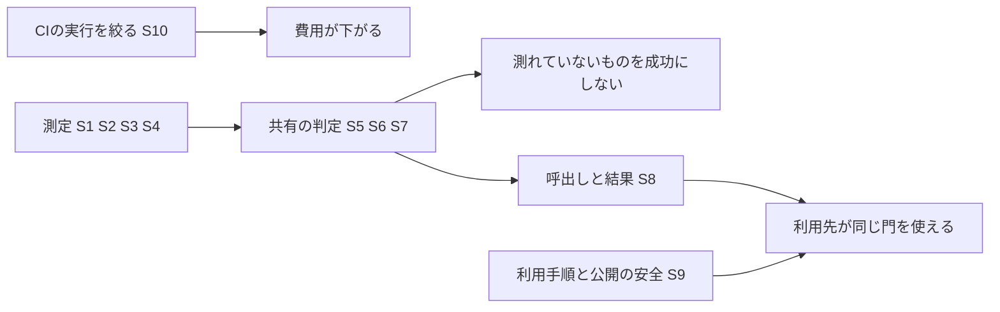

# 共有の網羅率の門 — 範囲の文書

## Sources

- 承認済みの目的: [intent-statement.md](../intent-capture/intent-statement.md)（指定9項目、初回は架空の利用例、初版の対象外）。
- 承認済みの実現性: [feasibility-assessment.md](../feasibility/feasibility-assessment.md)（結論は「条件付きで実現できる」）。制約: [constraint-register.md](../feasibility/constraint-register.md)。
- この段の回答: [scope-definition-questions.md](./scope-definition-questions.md)の[Q1]〜[Q6]。回答はarcが、Ownerの委任（iyasaka-arc#49 6762288830）の下で答えた。**Ownerの言葉ではない。**
- 追加の依頼の根拠: Ownerの決定 [OD-COMPANY-CI-REDUCE-UNNEEDED-RUNS-20261111-001](https://github.com/watchout/iyasaka-arc/issues/49#issuecomment-6787499810)（本文を確認済み）と、arcの接続の記録 [iyasaka-arc#24](https://github.com/watchout/iyasaka-arc/issues/24#issuecomment-6791240627)。[Q2]
- 手元の観測（読み取りのみ）: `kit/sds-gate-caller.yml`の起動の種類、`scripts/sds/gate.mjs`のrisk:R0〜R4ラベルの判定、`.github/workflows/ci.yml`にconcurrencyが無いこと。

## 範囲の要約

共有の網羅率の門を、Shirube内の架空の利用例で作り、検証する。これに加えて、同じkitの門のCI実行を減らす直し（門の起動の絞りと、Shirube自身のciのconcurrency）を、別の単位として同じ取り組みに入れる。[Q1] [Q2]

最低限の範囲（Must）は、指定9項目すべてと、追加の1単位である。すべてがMustなのは、承認済みの目的が9項目すべてを対象にし、完成の条件も9項目の正例・負例としたためである。優先は、Mustの区分ではなく**順序**で付ける（下の「順序」）。[Q1] [Q4]

## 範囲の中（In）

| ID | 内容 | 区分 | 根拠 |
|---|---|---|---|
| S1 | 二つの試験方式（Node組込み試験、TypeScript・vitest）の測定と判定 | Must | [Q1] |
| S2 | 子プロセスを含む測定（既製の道具。独自の計測器は作らない） | Must | [Q1] |
| S3 | TypeScriptの測定対象の定義と、定義変更の記録 | Must | [Q1] |
| S4 | DBの試験（DB別jobの呼び方、または名指し・理由出力・呼出側から拡大不能な除外） | Must | [Q1] |
| S5 | 閾値（行100%が既定。下げる例外はOwner決定URL・値・根拠が揃う入力だけ） | Must | [Q1] |
| S6 | 未計測src・必須試験のNOT_RUN・計測不能を成功にしない | Must | [Q1] |
| S7 | 段階的な導入（記録のみ／失敗させる、を入力一つで切替） | Must | [Q1] |
| S8 | 呼出しと結果（commit固定。通常CIとDBのjobから呼べ、noticeとjob summaryに出す） | Must | [Q1] |
| S9 | 非公開の土台の一般化した書き直しと、公開の試験データを架空だけにすること | Must | [Q1] |
| S10 | CIの実行の絞り: (a) kitの門の起動を、監査に関わるcomment（`sds-audit-request/1`・`sds-audit-review/1`・作者の受領）の時だけにする。(b) Shirube自身のciに、同じPRの前の実行を取り消すconcurrencyを入れる（既定のbranchへのpushは取り消さない）。 | Must（別の単位。最初に置く） | [Q2] [Q4] |

S10の注意:

- `pull_request_target`の起動の種類から`labeled`・`unlabeled`を外すかは、**範囲では決めない。** 手元の`scripts/sds/gate.mjs`はrisk:R0〜R4のラベルを判定に使っている。設計の段で、実読と負例（ラベルを付け替えた後に古い判定が残らないか）で確かめ、ラベルが判定に効くと確かめられたら外さない。決定の「必須の検査の中身を弱めない」と「判定に効かない物を外す」の条件に従い、決定の括弧書きの`labeled`・`unlabeled`は記録した事実の誤りとして扱う。結果はarcに知らせ、arcがOwnerに伝える。[Q3]
- S10はworkflowの変更で、保護対象である。段の承認は変更の実行許可ではなく、PRは統合の前にOwnerの対象headの承認が要る。[Q5]

## 範囲の外（Won't）

目的の対象外に、追加の決定の「含まないもの」を加える。[Q6]

- 全repoへの一括導入。実製品への適用（別の判断と承認で扱う）。
- 社内の網羅率基準や既存の80%の扱いの変更。
- 独自の計測器。
- 既存U1への取り込み（既存U1の作業を止めず、変更しない）。
- 必須の検査の名前・数・branch protectionの変更。試験の中身を減らすこと。repoの公開・非公開の変更。
- 予算の額の変更。

## 順序

優先は次の順に置く。確かめた結果で、順を変えてよい。[Q4]

1. **S10（CIの実行の絞り）を最初に置く。** 小さく、CIの費用をすぐ減らせるため。
2. その後は、**リスクの高いものを先に**確かめる。新依存のarc-sec確認とOwner決定の依頼を早く出す（S1のTypeScript・vitest）。子プロセスの実測（S2）。
3. 判定と出力の中心（S5・S6・S7）、DBの扱い（S4）、呼出しと結果（S8）、利用手順と公開の安全（S9）は、依存の順に続ける。具体の分け方と順は、Units Generationの段で決める。

## 外から決まった完了の条件

記録済みの3つだけで、ほかにはない。[Q5]

1. 新依存は、導入前にarc-secの安全確認とOwnerの決定を通す。
2. 共有workflowの追加・変更などの保護対象は、別のOwner承認を得る。workflowの変更のPRは、統合の前にOwnerの対象headの承認が要る。
3. 利用先でのkitの版上げ・導入は、別の判断で扱う。

## 完了の条件（自社で観測できるもの）

実現性の評価の指標に、S10の確認を加える。いずれも自社で観測でき、利用先の製品の結果は使わない。

| 指標 | 目標 | 測り方 |
|---|---|---|
| 指定9項目の正例・負例 | 各項目に正例1件以上と負例1件以上（9/9） | 試験の一覧と追跡表 |
| 負例の検出 | 未計測src、NOT_RUN、計測不能、不正な閾値、除外の拡大がすべて不合格になる | 試験の実行結果（skip・todoを合格に数えない） |
| commit固定の呼出し | 利用手順の呼出し例が40桁のcommitで固定されている | 利用手順と呼出し例の試験 |
| 公開の安全 | 非公開の土台の転載0件、公開の試験データは架空のみ | 独立監査と既存の機械検査 |
| 門の起動の絞り（S10 a） | 起動の種類が、監査に関わるcommentの時だけに絞られている。`labeled`・`unlabeled`は、ラベルが判定に効かないと確かめられた時だけ外れている | 起動の定義の試験と、ラベルを付け替える負例 |
| ciのconcurrency（S10 b） | 同じPRの前の実行が取り消され、既定のbranchへのpushは取り消されない | workflowの定義の試験 |
| 必須の検査 | 必須の検査の名前・数・内容が弱まっていない | 差分と既存の検査の結果 |

## 価値の流れ

テキストの代替: S10は単独で「CIの費用が下がる」に至る。S1〜S4の測定がS5〜S7の判定を支え、判定がS8の呼出しと結果に出る。S8とS9がそろうと、利用先が同じ門を使える。

## Assumptions & Open Questions

- [assumption] S10の(a)と(b)は、それぞれ小さな変更で、独立した単位にできる。分け方は、Units Generationの段で決める。
- [assumption] kitの変更を利用先へ配るには、利用先でのpinの版上げが別に要る。これは範囲の外（別の判断）で、本取り組みでは行わない。[Q5]
- Open: ラベルがsds-gateの判定に効くかは、設計の段の実読と負例で確かめる。結果はarcに知らせ、arcがOwnerに伝える。[Q3]
- Open: 新依存の候補と、arc-secの確認・Ownerの決定。承認が得られない場合は、S1のTypeScript・vitestを検証できず、Mustが欠ける。この場合の扱いはOwnerに諮る。
