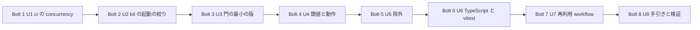

# 共有の網羅率の門 — 作る順の計画（Bolt の計画）

Bolt とは、作る作業の 1 まとまりのことで、1 回の作る工程で 1 つ以上の単位を通し、動く物を 1 つ作って終わる。この取り組みでは 1 つの Bolt = 1 つの単位 = 1 つの PR で、順番に作る。

## Sources

- [desc] Initial description: 共有の網羅率の門を新しい AI-DLC の取り組みとして始める（Owner の指示 https://github.com/watchout/iyasaka-arc/issues/49#issuecomment-6759071065、本文 SHA-256 `c5d9ccc3510ff46e5d6661bc8c528cafb7e08d4ce2c86f39f049782eaf7e524b`）。
- [scope] Workflow-selected scope: feature
- 単位: [unit-of-work.md](../units-generation/unit-of-work.md)、依存: [unit-of-work-dependency.md](../units-generation/unit-of-work-dependency.md)、ストーリーとの対応: [unit-of-work-story-map.md](../units-generation/unit-of-work-story-map.md)。
- 要件: [requirements.md](../requirements-analysis/requirements.md)、ストーリー: [stories.md](../user-stories/stories.md)、部品: [components.md](../domain-design/components.md)、契約: [contract-summary.md](../contract-design/contract-summary.md)、作業場の決まり: [team-practices.md](../practices-discovery/team-practices.md)。
- 順の答え: [delivery-planning-questions.md](./delivery-planning-questions.md) の [Q1]〜[Q3]（すべて arc の答え。Owner の委任 iyasaka-arc#49 6762288830。Owner の言葉ではない）。
- 範囲の順序: [scope-document.md](../../ideation/scope-definition/scope-document.md)。

## 順番

U1 → U2 → U3 → U4 → U5 → U6 → U7 → U8。8 つの Bolt を、前の PR が統合されてから次に入る形で順に作る。

文章での説明: 矢印は作る順。依存の記録（unit-of-work-dependency.md）の辺はすべてこの順に沿っている（U4・U5・U6 は U3 の後、U7 は U3・U4・U5 の後、U8 は U4〜U7 の後）。依存の順に反する並べ方は無い。

## 端から端まで動く最小の版（walking skeleton）の扱い

walking skeleton とは、最初に作る、端から端まで動く最小の版のこと。AI-DLC は単位の一覧の先頭の単位をこの最小の版として扱い、終わるときに実物の確かめと人の確認を求める。

- 先頭は U1。最小の版の確認は U1 に付く。確かめは Shirube 自身の CI の実行（`npm test` と、PR の CI の実行で同じ PR の古い実行が取り消されること）。[Q1] の A（arc の答え）。
- 網羅率の門が端から端まで動くことの確かめは、Bolt 3（U3）の完了の確認として、U3 の設計で定める。AI-DLC の最小の版の確認とは別の確認で、U3 の設計の記録に「何を実際に動かし、何を見て合格とするか」を書く。
- 最小の版の成功と、取り組み全体の完了は別。U1 の確認が通ったことを、網羅率の門ができたこととは書かない。

## Bolt の一覧

| Bolt | 単位 | 最小の版の印 | 保護対象 | 前に要る物 |
|---|---|---|---|---|
| 1 | U1 u1-ci-concurrency | 先頭（AI-DLC の最小の版の確認） | あり（workflow） | なし |
| 2 | U2 u2-gate-trigger-narrowing | | あり（workflow の定義） | なし |
| 3 | U3 u3-node-gate-slice | 門の端から端までの確かめは U3 の完了の確認で行う | なし（設計の段で再判定） | なし |
| 4 | U4 u4-thresholds-and-modes | | なし（設計の段で再判定） | U3 の統合 |
| 5 | U5 u5-exclusions | | なし（設計の段で再判定） | U3 の統合 |
| 6 | U6 u6-typescript-vitest | | あり（新しい外の依存を採る場合） | U3 の統合、新しい依存の arc-sec の確認と Owner の決定 |
| 7 | U7 u7-gate-workflow-entry | | あり（workflow） | U3・U4・U5 の統合 |
| 8 | U8 u8-guide-and-verification | | なし | U4・U5・U6・U7 の統合（U6 が止まった場合は下の注意） |

保護対象の Bolt（1・2・7、6 は新依存を採る場合）の進め方は、すべて unit-of-work.md の「保護対象の単位の進め方」のとおり。設計の記録だけの PR を先に出して独立の設計監査（devauditor）を 1 回受け、code は設計監査の PASS の後に書く。実装は同じ PR に足して実装監査を受ける。統合の前に Owner の対象 head の承認が要る。

## Bolt ごとの内容

### Bolt 1 — U1 ci の concurrency

- **単位**: U1。FR10.3、FR10.4、US7.3、US7.4、US8.1。
- **完了の条件（Definition of Done）**: Shirube の `ci.yml` に、同じ PR の古い実行を取り消す仕組みが入っている。既定の branch への push は取り消されない。必須の検査の名前・数・内容は変わっていない。workflow の定義の試験が、取り消しの正例と、既定の branch の push が取り消されない負例を持つ。独立監査と作者の受領、必須の検査を通り、Owner の対象 head の承認があり、作者以外の統合担当が統合している。
- **確かめること（confidence hypothesis）**: 同じ PR に続けて push すると、古い CI の実行が取り消され、既定の branch への push の実行は残る。
- **見せる物（expected demo）**: Shirube の PR で、続けて push した古い実行が取り消されている CI の画面と、`npm test` の結果。
- **担当**: `adf-lead`。

### Bolt 2 — U2 kit の門の起動の絞り

- **単位**: U2。FR10.1、FR10.2、FR10.4、US7.1、US7.2、US7.4、US8.1。
- **完了の条件**: `kit/sds-gate-caller.yml` の起動が、監査に関わるコメント（`sds-audit-request/1`、`sds-audit-review/1`、作者の受領）に絞られている。`labeled`・`unlabeled` を外すかは、U2 の設計で `scripts/sds/gate.mjs` を実読し、risk ラベルが判定に効くかを確かめてから決め、結果を arc に伝える。ラベルを付け替える負例の試験が通る。必須の検査の中身は弱まっていない。独立監査と作者の受領、必須の検査を通り、Owner の対象 head の承認があり、作者以外の統合担当が統合している。
- **確かめること**: 監査に関わらないコメントや、判定に効かない種類の起動では、門の実行が起きない。ラベルが判定に効く場合は、効く起動が残る。
- **見せる物**: 起動の定義の試験の結果と、ラベルを付け替える負例の結果。
- **担当**: `adf-lead`。kit の版を出したら arc に知らせる（external-dependency-map.md）。

### Bolt 3 — U3 門の最小の版

- **単位**: U3。FR1.1、FR1.3、FR1.4、FR2.1〜FR2.3、FR3.1、FR4.1〜FR4.4、FR8.1〜FR8.4（最小）、NFR2〜NFR4、NFR7、NFR9。US1.1、US1.3、US1.4、US2.1〜US2.4、US4.1、US6.1、US10.1、US10.2。
- **完了の条件**: Node 組込みの形で、分母の宣言 → 測定 → 判定 → 出力が、command として端から端まで動く。結果は一致・不一致・観測できずの 3 値で、未計測・必須の試験の NOT_RUN・計測不能・閾値に満たないの各負例が不合格になる。期限と総予算を超えた入力が観測できずになる。入力の JSON と結果の JSON が contract-summary.md の契約 2・3 の形に合う。子プロセスの行を数えられるかを実測し、数えられない組み合わせは使わない。行の網羅率 100%（team.md）。独立監査と作者の受領、必須の検査を通り、作者以外の統合担当が統合している。
- **確かめること**: 子プロセスを含む Node の試験の行を、既製の道具で数えられるか（R1）。数えられない場合は、数えられないと返す組み合わせが決まる。
- **見せる物**: 架空の小さな利用例に対して、command を実際に動かした結果（一致・不一致・観測できずの 3 つ）。U3 の完了の確認の中身は U3 の設計で定める。
- **担当**: `adf-lead`。

### Bolt 4 — U4 閾値の例外と動作

- **単位**: U4。FR3.2〜FR3.5、FR6.1〜FR6.4、FR8.4。US4.2、US4.3、US5.1、US5.2、US6.2、US6.3（一部）。
- **完了の条件**: 閾値の例外は、決定の URL の形・下げる値・根拠がそろった入力だけが受け付けられる。100% より低く使った事実が出力で目立つ位置に出る。動作（落とす・記録だけ）が入力 1 つで切り替わり、何も指定しなければ「落とす」。「記録だけ」でも結果の区分と理由は成功と書かずに残る。各負例（不正な閾値、下げる値だけの入力、根拠の欠落）が不合格になる。行の網羅率 100%。独立監査と作者の受領、必須の検査を通り、作者以外の統合担当が統合している。
- **確かめること**: 呼ぶ側の入力で閾値を黙って下げる経路が無い（R4）。
- **見せる物**: 例外つきの入力と動作の切り替えを、command で動かした結果。
- **担当**: `adf-lead`。

### Bolt 5 — U5 除外

- **単位**: U5。FR5.1〜FR5.4、FR8.4。US3.1（一部）、US3.2、US3.3、US6.3（一部）。
- **完了の条件**: 理由つきで 1 本ずつ名指しした除外だけが受け付けられる。ディレクトリ名・ワイルドカード・理由の無い除外・呼ぶ側の上書きによる拡大は不合格になる。除外した file、理由、件数が出力に残る。DB を要する試験とその対象は、「DB の job で測る」か「理由つきで除外」のどちらかを選べる。新しい試験 file が除外にも流れた試験にも無ければ NOT_RUN になる。行の網羅率 100%。独立監査と作者の受領、必須の検査を通り、作者以外の統合担当が統合している。
- **確かめること**: 除外を足すと差分で見え、黙って広げられない。
- **見せる物**: 除外を足した入力の結果と、除外を広げようとした負例の結果。
- **担当**: `adf-lead`。

### Bolt 6 — U6 TypeScript と vitest の形

- **単位**: U6。FR1.2、FR1.3、FR1.4、FR1.5、FR1.6。US1.2、US1.3（TypeScript の形の分）、US8.2。
- **完了の条件**: TypeScript の ESM と vitest の形の測定が、何を測るか（ビルド後の JS か、source map 越しの TS か）の定義を決めて動く。定義が出力に書かれ、読み込まれない TS file が分母から落ちる負例と、定義の変更が記録なしで通らない負例が不合格になる。測定の道具が新しい依存になる場合は、arc-sec の確認と Owner の決定を得てから採る。行の網羅率 100%。独立監査と作者の受領、必須の検査を通り、作者以外の統合担当が統合している。
- **前に要る物**: 新しい依存の承認（external-dependency-map.md）。承認が来ていなければ、この Bolt を脇へ置く印をつけて Bolt 7 へ進む（`aidlc engine state unit pause --set-aside-for`）。承認が来たら戻す。承認が得られない場合は Owner に伺う。
- **確かめること**: 「TypeScript の行 100%」の意味が定義と出力で一致する（R3）。
- **見せる物**: 架空の小さな TypeScript の利用例に対して、command を実際に動かした結果。
- **担当**: `adf-lead`。

### Bolt 7 — U7 再利用 workflow

- **単位**: U7。FR5.5、FR7.1〜FR7.5、FR8.2、NFR5、NFR8。US1.5、US2.3（GitHub への出力）、US2.4（出力値）、US3.1（DB の job）、US8.1、US10.3。
- **完了の条件**: 利用先が 40 桁の commit を固定して呼べる再利用 workflow が、契約 1 の入力と出力値の形で動く。job の権限は最小で、資格情報を受け取らない。通常の job と、版または指紋を固定した PostgreSQL の job の両方から、同じ入力・出力で呼べる。既存の呼び出し側を壊さない。必須の step に失敗を隠す書き方（`continue-on-error`、`|| true`）が無い。呼び出しが 40 桁で固定されているかを、門の側で確かめられるかを設計で決める。独立監査と作者の受領、必須の検査を通り、Owner の対象 head の承認があり、作者以外の統合担当が統合している。
- **確かめること**: 他の repo の workflow から呼べる形で、結果が notice・job summary・出力値・成果物として返る。
- **見せる物**: Shirube 内の架空の利用例で、通常の job と DB の job から workflow を呼んだ CI の実行。
- **担当**: `adf-lead`。実際の配布前に、対象の版・差分・必要な判断・確認方法・戻し方を具体化する（team.md の Deployment）。

### Bolt 8 — U8 手引きと検証

- **単位**: U8。FR9.1、FR9.2、FR11.1〜FR11.3、NFR10。US9.1〜US9.4。
- **完了の条件**: 利用の手引きが、commit を固定した呼び出しの例、「記録だけ」から「落とす」への切り替え、除外と閾値の例外の書き方、TypeScript の測定の定義の切り替えの意味を含む。指定 9 項目それぞれに、架空の利用例での正例と負例がある（中身を変えた入力が不一致または観測できずになる、予算超過が観測できずになる）。公開に載る物は架空の例だけで、非公開の土台を写していない。導入件数は成功の数に入れない。独立監査と作者の受領、必須の検査を通り、作者以外の統合担当が統合している。
- **確かめること**: 9 項目すべてで、正例と負例が実際に流れる。
- **見せる物**: 9 項目の正例・負例の実行結果の一覧と、手引き。
- **担当**: `adf-lead`。U6 が脇へ置かれたままなら、TypeScript の分を除いて書き、その事実を手引きに明記する（成功とは書かない）。

## 取り組み全体の完了の条件

scope-document.md の「完了の条件」の表のとおり（指定 9 項目の正例・負例が 9/9、負例の検出、commit 固定の呼び出し、公開の安全、門の起動の絞り、ci の concurrency、必須の検査の維持）。いずれも自社で観測できる物で、利用先の製品の結果は使わない。

## Assumptions & Open Questions

### Assumptions

- [assumption] 1 つの Bolt = 1 つの単位。U3 は大きさ L だが、1 単位 = 1 PR の決まりに従い分けない。
- [assumption] 保護対象かどうかは、U3・U4・U5・U8 は各単位の設計の段で再判定する（DB の構造・権限・契約・セキュリティに触れる場合は、設計の記録だけの PR を先に出す）。U6 は新しい外の依存を採る場合に保護対象になる。
- [assumption] kit の版を出したときの arc への知らせは、Bolt 2 の統合の後に行う。利用先への pin の版上げは、この取り組みの範囲外。

### Open Questions

1. 新しい依存の承認が来ないまま Bolt 7 まで進んだ場合、Bolt 8 で TypeScript の分を除くかどうかは Owner の判断が残る（RAID の R2）。
2. 呼び出しが 40 桁の commit で固定されているかを、門の側で確かめられるか（U7 の設計）。
3. 子プロセスの行を Node 組込みの網羅率が数えられるか（U3 の実測）。
