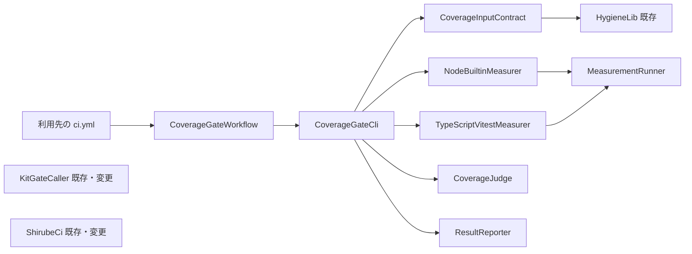

# 共有の網羅率の門 — 部品の一覧

## Sources

- [desc] Initial description: 共有の網羅率の門を新しい AI-DLC の取り組みとして始める（Owner の指示 https://github.com/watchout/iyasaka-arc/issues/49#issuecomment-6759071065、本文 SHA-256 `c5d9ccc3510ff46e5d6661bc8c528cafb7e08d4ce2c86f39f049782eaf7e524b`）。
- [scope] Workflow-selected scope: feature
- 要件: [requirements.md](../requirements-analysis/requirements.md)。ストーリー: [stories.md](../user-stories/stories.md)。
- 現状: [architecture.md](../../../codekb/shirube/architecture.md)、[component-inventory.md](../../../codekb/shirube/component-inventory.md)（既存の部品名は変えない）。
- 実践: [team-practices.md](../practices-discovery/team-practices.md)。設計・実装の標準 S2・S3・S4・S5・S8。
- この段の回答: [domain-design-questions.md](./domain-design-questions.md) の [Q1]〜[Q3]（arc の答え。Owner の委任 iyasaka-arc#49 6762288830。Owner の言葉ではない）。判断の記録: [decisions.md](./decisions.md)。

## 範囲の注意

- 部品は「書く code」だけ。試験の道具、GitHub Actions、PostgreSQL は部品が使う外の依存で、部品に数えない。
- 配置（1つの塊か複数の塊か）、file の置き場所、関数の名前は、この段では決めない（Units Generation 以降）。
- 試験の道具の新しい依存（c8、vitest、TypeScript の道具など）は**候補であり、採用していない**。arc-sec の確認と Owner の決定が要る（FR1.6、NFR6）。
- 作業場の手元だけにある `ci-record-*` などは部品に数えない（統合されるまで）。

## 部品の一覧（機械が読む形）

```yaml
components:
  - name: CoverageGateWorkflow
    summary: 利用先が commit を固定して呼ぶ再利用 workflow（呼び出し口）
    behaviour: >
      workflow_call として入力を受け、ジョブの権限を最小にして門の入口を実行し、結果の出力値と成果物を呼び出し元へ返す。
      通常の job からも、DB を起動する job からも同じ入力と出力で呼べる。失敗の判断は持たず、
      入口が返した終了コードをそのまま job の成否にする。必須の step に continue-on-error、|| true、--if-present を使わない。
      保護対象（workflow）なので、追加と変更に Owner の対象 head の承認が要る。
    responsibilities:
      - 入力（形、分母、除外、閾値の例外、動作、期限と総予算）を入口へ渡す
      - job ごとの権限を最小にする（書ける資格情報を試験の実行に渡さない）
      - 結果の区分、値、閾値、動作を出力値として返し、JSON を成果物に残す
    depends_on:
      - component: CoverageGateCli
        interaction: 入力を渡して判定を実行し、終了コードと出力を受け取る
        style: sync
    dependents: []
    external_dependencies:
      - name: GitHub Actions
        kind: other
        purpose: workflow_call、job の権限、成果物、出力値、PostgreSQL を起動する呼び出し側の job
    entities: []

  - name: CoverageGateCli
    summary: 入力の検査・測定・判定・出力を順に呼ぶ入口（組み立てだけを持つ）
    behaviour: >
      環境から現在時刻と実行の識別子を読み、明示の入力として核へ渡す（核は時計も乱数も読まない）。
      入力の検査 → 形に合う測定 → 判定 → 結果の出力、の順に呼ぶ。判定の意味（閾値、理由コード、3値、
      動作の意味、CI を落とすか）は持たず、判定の部品が返した「落とすか」をそのまま終了コードにする。
      どの段階で失敗しても、成功とは書かず、観測できないことを出力へ残す。
    responsibilities:
      - 時刻と識別子を環境から読み、核へ明示入力として渡す
      - 部品を決まった順に呼び、各段階の失敗を判定の部品へ渡す
      - 判定の部品が返した値を終了コードに写す
    depends_on:
      - component: CoverageInputContract
        interaction: 呼び出しの入力を検査し、受け付けた入力か失敗を受け取る
        style: sync
      - component: NodeBuiltinMeasurer
        interaction: Node 組込みの試験の形のとき、行ごとの記録を受け取る
        style: sync
      - component: TypeScriptVitestMeasurer
        interaction: TypeScript と vitest の形のとき、行ごとの記録を受け取る
        style: sync
      - component: CoverageJudge
        interaction: 入力と行ごとの記録から結果（3値、落とすか、理由コード）を受け取る
        style: sync
      - component: ResultReporter
        interaction: 結果から notice、job summary、JSON、出力値を作らせる
        style: sync
    dependents:
      - component: CoverageGateWorkflow
        interaction: 入力を渡して実行する
    external_dependencies:
      - name: 実行環境の時計と環境変数
        kind: other
        purpose: 現在時刻と実行の識別子の取得（核の外でだけ読む）
    entities: []

  - name: CoverageInputContract
    summary: 呼び出しの入力の形の検査と、分母・除外・例外の保持
    behaviour: >
      呼ぶ側が渡した入力が、決まった形かどうかだけを確かめる。分母は呼ぶ側が宣言した file の集合で、
      対象の解決は衛生の共通部品に任せる。除外は file を1本ずつ名指しし、理由があるものだけを受け付け、
      ディレクトリ名とワイルドカードは受け付けない。閾値を下げるときは、決定の URL の形、下げる値、根拠が
      そろっていることだけを確かめる（実在の確認はしない。GitHub を読む資格情報を持たない）。
      動作の値は「落とす」「記録だけ」のどちらかで、指定が無ければ「落とす」。
      呼ぶ側の上書きで除外を広げさせない。形の失敗は、判定の部品が持つ理由コードの集合の1つとして返す
      （理由コードの意味はここで定義しない）。
    responsibilities:
      - 分母の宣言を受け取り、衛生の共通部品で file の集合に解決する
      - 除外の形（1本ずつ・理由つき）を検査する
      - 閾値の例外の形（URL の形・値・根拠）を検査する
      - 動作の値と、使う測定の定義の値を検査する
    depends_on:
      - component: HygieneLib
        interaction: 宣言された対象を、追跡されている file の集合へ解決する
        style: sync
    dependents:
      - component: CoverageGateCli
        interaction: 入力の検査を依頼する
    external_dependencies: []
    entities:
      - name: Denominator
        identifier: declaredPathsDigest
        attributes: [declaredPaths, resolvedPaths]
      - name: Exclusion
        identifier: path
        attributes: [path, reason]
      - name: ThresholdException
        identifier: decisionUrl
        attributes: [decisionUrl, claimedValue, rationale]
      - name: MeasurementDefinition
        identifier: definitionName
        attributes: [form, measuredTarget, toolName]

  - name: CoverageJudge
    summary: 判定の核。閾値・理由コード・3値・動作の意味を1か所で持つ純粋な部品
    behaviour: >
      入力が正しい前提で、分母と行ごとの記録と閾値と動作から、結果（一致・不一致・観測できず）、
      CI を落とすか、理由コードを決める。時刻・乱数・識別子・ファイルを自分では取得せず、
      受け取った入力だけから決める。同じ入力で同じ出力になる。
      行の割合は、行ごとの記録から再計算する（申告された割合や道具が最後に出した数字は信じない）。
      成功にならないのは、未計測がある、必須の試験が流れていない（NOT_RUN）、計測できなかった、
      行の割合が閾値に満たない、入力の形の失敗、のどれか。観測できずを一致に読み替えない。
      既定の閾値は行100%。動作が「記録だけ」のときは、落とすかを偽にするが、結果の区分と理由は
      成功とは書かず残す。動作を指定しない場合は「落とす」。理由コードの集合と閾値の既定は、ここだけに置く。
    responsibilities:
      - 結果の3値と理由コードの集合を持つ
      - 閾値の既定（行100%）と、閾値の例外が効いたかを決める
      - 動作（落とす・記録だけ）の意味を決める
      - 行ごとの記録の形（LineRecord）を決め、測定の部品がそれに合わせる
    depends_on: []
    dependents:
      - component: CoverageGateCli
        interaction: 入力と記録を渡して結果を受け取る
    external_dependencies: []
    entities:
      - name: LineRecord
        identifier: path_lineNumber
        attributes: [path, lineNumber, hitCount]
      - name: GateVerdict
        identifier: runId
        attributes: [outcome, lineRatio, effectiveThreshold, mode, shouldFail, reasonCodes, unmeasuredPaths, notRunPaths]
        references:
          - entity: Denominator
            owned_by: CoverageInputContract
            relationship: 各 GateVerdict は、1つの Denominator に対する判定である
          - entity: ThresholdException
            owned_by: CoverageInputContract
            relationship: 閾値を下げたときだけ、1つの ThresholdException を指す
      - name: ReasonCode
        identifier: code
        attributes: [code, meaning, outcomeClass]

  - name: NodeBuiltinMeasurer
    summary: Node 組込みの試験（node --test）の形の測定の変換
    behaviour: >
      測定の実行を MeasurementRunner に依頼し、得られた記録を LineRecord の形に変換する。
      変換だけをして、判定・閾値・理由の意味を定義しない（S2）。子プロセスの行が記録に入らない道具の組み合わせは
      この形の測定に使わず、数えられないことを出力へ残せる形で返す。測定の道具は既存の物だけで、自前の計測の仕組みを作らない。
    responsibilities:
      - 形に合う測定の実行を依頼し、行ごとの記録を LineRecord へ変換する
      - 子プロセスの行が数えられない組み合わせを検出して返す
    depends_on:
      - component: MeasurementRunner
        interaction: 測定の実行（子プロセス）を期限と総予算つきで頼む
        style: sync
    dependents:
      - component: CoverageGateCli
        interaction: 形が Node 組込みのとき、行ごとの記録を頼む
    external_dependencies:
      - name: Node 組込みの試験の網羅率
        kind: other
        purpose: 試験が実行した行の記録の取得（Node 26.7 以降。それより古い版は条件を設計の段で決める）
    entities: []

  - name: TypeScriptVitestMeasurer
    summary: TypeScript の ESM と vitest（vitest run、tsc でビルド）の形の測定の変換
    behaviour: >
      測定の実行を MeasurementRunner に依頼し、得られた記録を LineRecord の形に変換する。何を測ったか
      （ビルド後の JS か、source map 越しの TS か）の定義を MeasurementDefinition として返す。定義を切り替えると
      値の意味が変わることを出力に残せる形にする。測定の道具が新しい依存になる場合は、arc-sec の確認と
      Owner の決定が得られるまで採用しない。得られなければこの形は検証できず、Owner に伺う。
    responsibilities:
      - 測定の実行を依頼し、行ごとの記録を LineRecord へ変換する
      - 測定の定義を示す
    depends_on:
      - component: MeasurementRunner
        interaction: 測定の実行（子プロセス）を期限と総予算つきで頼む
        style: sync
    dependents:
      - component: CoverageGateCli
        interaction: 形が TypeScript と vitest のとき、行ごとの記録を頼む
    external_dependencies:
      - name: 測定の道具の候補（未決）
        kind: other
        purpose: vitest の網羅率、c8、TypeScript の道具など。採用は arc-sec の確認と Owner の決定の後
    entities: []

  - name: MeasurementRunner
    summary: 測定の実行（子プロセス）に期限と総予算をつけて実行し、終わり方を観測する
    behaviour: >
      測定の実行を子プロセスとして起こし、期限と総予算を超えたら止めて「観測できず」の原因として返す。
      道具の失敗・時間切れ・測定の記録が出ない、のどれでも、成功と数えず、終わり方（完了・失敗・時間切れ・予算超過）を
      そのまま返す。起動した子プロセスの標準出力の文面を根拠にしない。
    responsibilities:
      - 子プロセスの実行と、期限・総予算の強制
      - 終わり方の観測（完了・失敗・時間切れ・予算超過）
    depends_on: []
    dependents:
      - component: NodeBuiltinMeasurer
        interaction: 測定の実行を頼む
      - component: TypeScriptVitestMeasurer
        interaction: 測定の実行を頼む
    external_dependencies:
      - name: 子プロセスの実行（OS）
        kind: other
        purpose: 測定の道具の起動と終了の観測
    entities:
      - name: MeasurementAttempt
        identifier: attemptId
        attributes: [toolName, deadline, totalBudget, spentBudget, endState]

  - name: ResultReporter
    summary: 結果を notice、job summary、決まった形の JSON、出力値に変換する
    behaviour: >
      判定の結果と入力から、読む人向けの文（notice、job summary）と、機械が読む JSON、呼んだ workflow が受け取る出力値を作る。
      値は観測した記録から作った判定の結果だけから作り、申告値を写さない。閾値を100%より低く使った事実は、
      成功の表示より前または同じ強さで目立つ位置に書く。「記録だけ」では、計測できなかった場合に「計測不能」と書き、
      成功とは書かない。JSON には、測定の定義、除外の一覧と理由と件数、閾値の例外（URL・主張された値・根拠・実際の閾値）、
      動作を含める。出力の項目と版の識別は設計の段で決める。
    responsibilities:
      - notice と job summary の文を作る
      - 決まった形の JSON と出力値を作る
      - 閾値の例外と「記録だけ」を成功の表示に隠さない
    depends_on: []
    dependents:
      - component: CoverageGateCli
        interaction: 結果から出力を作らせる
    external_dependencies:
      - name: GitHub Actions の出力機構
        kind: other
        purpose: notice、job summary、出力値、成果物への書き出し
    entities:
      - name: ResultDocument
        identifier: runId
        attributes: [schemaVersion, outcome, lineRatio, effectiveThreshold, mode, measurementDefinition, exclusions, thresholdException]
        references:
          - entity: GateVerdict
            owned_by: CoverageJudge
            relationship: 各 ResultDocument は、1つの GateVerdict から作られる
          - entity: Exclusion
            owned_by: CoverageInputContract
            relationship: 除外した file と理由を、0 件以上まとめて載せる
          - entity: ThresholdException
            owned_by: CoverageInputContract
            relationship: 閾値を下げたときだけ、その例外を載せる
          - entity: MeasurementDefinition
            owned_by: CoverageInputContract
            relationship: 使った測定の定義を1つ載せる
          - entity: MeasurementAttempt
            owned_by: MeasurementRunner
            relationship: 測定の終わり方を載せる

  - name: HygieneLib
    summary: （既存）衛生の検査の共通部品。追跡されている file と対象の解決を持つ
    behaviour: >
      既存の部品。profile、対象集合、Git の読み取りを Node 組込みだけで行う。この取り組みでは変更せず、
      分母の解決に再利用する。実行時の npm 依存を足さない（NFR6）。
    responsibilities:
      - 追跡されている file と宣言された対象の解決
    depends_on: []
    dependents:
      - component: CoverageInputContract
        interaction: 分母の宣言を file の集合へ解決する
    external_dependencies: []
    entities: []

  - name: KitGateCaller
    summary: （既存・変更）kit の門の呼び出し口。起動を監査に関わるコメントに絞る（S10 の a）
    behaviour: >
      既存の kit の部品（kit/sds-gate-caller.yml）。起動の種類を、監査に関わるコメント
      （sds-audit-request/1、sds-audit-review/1、作者の受領）に絞る。labeled と unlabeled を外すかは、
      sds-gate が risk ラベルを判定に使うかを読んで確かめてから決める。必須の検査の名前・数・branch protection は変えない。
      workflow の変更は保護対象で、Owner の対象 head の承認が要る。
    responsibilities:
      - 門を起動する条件を絞る
    depends_on: []
    dependents: []
    external_dependencies: []
    entities: []

  - name: ShirubeCi
    summary: （既存・変更）Shirube 自身の ci.yml。同じ PR の古い実行を取り消す（S10 の b）
    behaviour: >
      既存の workflow（.github/workflows/ci.yml）。同じ PR の古い実行を取り消す仕組みを置く。既定の branch への push は
      取り消さない。必須の検査の名前・数・内容と branch protection は変えない。workflow の変更は保護対象で、
      Owner の対象 head の承認が要る。
    responsibilities:
      - 同じ PR の古い実行の取り消し
    depends_on: []
    dependents: []
    external_dependencies: []
    entities: []
```

## 部品の図



文章での説明: 利用先の `ci.yml` が再利用 workflow を呼び、入口が入力の検査、形に合う測定、判定、出力を順に呼ぶ。判定の部品は何も呼ばず、受け取った値だけから決める。測定の2つの部品は、共通の実行の部品を通して子プロセスを起こし、同じ形の「行ごとの記録」に変換する。S10 の2つは新しい部品ではなく、既存の部品の変更で、図の上の流れとはつながらない。

## 部品の要約

| Component | Purpose | Depends On | Dependents | Entities Owned |
|---|---|---|---|---|
| CoverageGateWorkflow | 再利用 workflow（呼び出し口） | CoverageGateCli | （利用先の ci.yml） | なし |
| CoverageGateCli | 入口。部品を順に呼ぶ | CoverageInputContract, NodeBuiltinMeasurer, TypeScriptVitestMeasurer, CoverageJudge, ResultReporter | CoverageGateWorkflow | なし |
| CoverageInputContract | 入力の形の検査と保持 | HygieneLib | CoverageGateCli | Denominator, Exclusion, ThresholdException, MeasurementDefinition |
| CoverageJudge | 判定の核 | なし | CoverageGateCli | LineRecord, GateVerdict, ReasonCode |
| NodeBuiltinMeasurer | Node 組込みの形の測定の変換 | MeasurementRunner | CoverageGateCli | なし |
| TypeScriptVitestMeasurer | TypeScript と vitest の形の測定の変換 | MeasurementRunner | CoverageGateCli | なし |
| MeasurementRunner | 子プロセスの実行と期限・予算 | なし | NodeBuiltinMeasurer, TypeScriptVitestMeasurer | MeasurementAttempt |
| ResultReporter | 出力の作成 | なし | CoverageGateCli | ResultDocument |
| HygieneLib（既存） | 対象の解決 | なし | CoverageInputContract | なし |
| KitGateCaller（既存・変更） | 門の起動の絞り | なし | なし | なし |
| ShirubeCi（既存・変更） | 古い実行の取り消し | なし | なし | なし |

## 実体の所有

| Entity | Owning Component | Identifier | Attributes | References |
|---|---|---|---|---|
| Denominator | CoverageInputContract | declaredPathsDigest | declaredPaths, resolvedPaths | なし |
| Exclusion | CoverageInputContract | path | path, reason | なし |
| ThresholdException | CoverageInputContract | decisionUrl | decisionUrl, claimedValue, rationale | なし |
| MeasurementDefinition | CoverageInputContract | definitionName | form, measuredTarget, toolName | なし |
| LineRecord | CoverageJudge | path_lineNumber | path, lineNumber, hitCount | なし |
| GateVerdict | CoverageJudge | runId | outcome, lineRatio, effectiveThreshold, mode, shouldFail, reasonCodes, unmeasuredPaths, notRunPaths | Denominator, ThresholdException |
| ReasonCode | CoverageJudge | code | code, meaning, outcomeClass | なし |
| MeasurementAttempt | MeasurementRunner | attemptId | toolName, deadline, totalBudget, spentBudget, endState | なし |
| ResultDocument | ResultReporter | runId | schemaVersion, outcome, lineRatio, effectiveThreshold, mode, measurementDefinition, exclusions, thresholdException | GateVerdict, Exclusion, ThresholdException, MeasurementDefinition, MeasurementAttempt |

LineRecord は、判定の核が読む形なので判定の部品が所有する。測定の部品はその形に合わせて変換するだけで、形を決めない（S2、[Q2]）。

## 外の依存

| Component | Dependency | Kind | Purpose |
|---|---|---|---|
| CoverageGateWorkflow | GitHub Actions | other | workflow_call、権限、成果物、出力値、呼び出し側の DB の job |
| CoverageGateCli | 実行環境の時計と環境変数 | other | 現在時刻と実行の識別子（核の外でだけ読む） |
| NodeBuiltinMeasurer | Node 組込みの試験の網羅率 | other | 行の記録の取得 |
| TypeScriptVitestMeasurer | 測定の道具の候補（未決） | other | 採用は arc-sec の確認と Owner の決定の後 |
| MeasurementRunner | 子プロセスの実行（OS） | other | 測定の道具の起動と終了の観測 |
| ResultReporter | GitHub Actions の出力機構 | other | notice、job summary、出力値、成果物 |

DB の job の PostgreSQL は、呼び出し側の job が起動する外の依存で、この門の部品は直接使わない。この取り組みは DB の構造を変えない（前提）。

## 判断の理由

| Component | なぜ別の部品か |
|---|---|
| CoverageGateWorkflow | 保護対象で、権限の宣言と呼び出しの契約が変わる速さが入口とは違う。判断を持たない薄い層にして、失敗の判断を workflow に散らさない（S3・S8） |
| CoverageGateCli | 時計と識別子の取得と、部品の順序だけを持つ。核を純粋に保つための境目（S4） |
| CoverageInputContract | 入力の形の検査は、判定の意味とは変わる理由が違う（呼び出しの書式の変更 対 判定の規則の変更）。[Q1] の A |
| CoverageJudge | 閾値、理由コード、3値、動作の意味の唯一の置き場（NFR3、S3）。純粋にして、同じ入力で同じ出力を試験できる（NFR2） |
| NodeBuiltinMeasurer / TypeScriptVitestMeasurer | 道具と記録の出方が違う。判定の意味を持たず、同じ形の記録に変換するだけ（S2、[Q2] の A） |
| MeasurementRunner | 子プロセスと期限・総予算の強制は、両方の形に共通する別の関心（FR4.4）。測定の変換ごとに時間切れの扱いを書くと、知識が重複する（S3） |
| ResultReporter | 出力の形は読む側（人、監査、機械）の都合で変わる。判定の意味から切り離す |
| HygieneLib（既存） | 対象の解決は既存の判断。2か所で下さない（S3、[Q3] の A） |
| KitGateCaller / ShirubeCi（既存・変更） | S10 は新しい構造を作らず、既存の workflow の変更 |

### 退けた分け方（Alternatives Rejected）

- 入力の検査を判定の核に入れる（[Q1] の B）: 呼び出しの書式の変更が判定の核を触り、純粋さを保つ試験が広がる。退けた。
- 測定を1つの部品にして2つの形を持たせる（[Q2] の B）: 形が増えるたびに部品の中が分岐で膨らむ。今は2つなので、早すぎる抽象化は避けつつ、記録の形は判定の部品が1つだけ決める。退けた。
- 分母の解決を自前で書く（[Q3] の B）: 同じ判断が2か所に分かれる（S3）。退けた。
- 動作（落とす・記録だけ）の意味を workflow の step に持たせる: `continue-on-error` などの失敗を隠す書き方を誘う（S8）。退けた。詳細は [decisions.md](./decisions.md) の ADR-004。

循環する依存はない。

## Assumptions & Open Questions

### Assumptions

- [assumption] 入口の部品（CoverageGateCli）は、判定の部品を呼ぶ側であり、意味を持たない。この境目は S2・S4 と ADR-004 に従う。
- [assumption] 部品の置き場所と、1つの配布の塊か複数かは、Units Generation で決める。
- [assumption] この取り組みは DB の構造を変えない。DB の job の PostgreSQL は、呼び出し側が起動する外の依存。
- [assumption] 手引き（FR11.2）、項目ごとの試験の一覧（FR11.1）、Owner の承認の手順（FR7.5、FR10.5）は、部品ではなく文書・試験資産・運用の手順である。対応表では N/A にして理由を書いた。

### Open Questions

1. 子プロセスの行を Node 組込みの網羅率が数えられるか。実測は設計の段（NodeBuiltinMeasurer）。
2. TypeScript の測定の定義（TypeScriptVitestMeasurer、MeasurementDefinition）。設計の段で決める。
3. 測定の道具の新しい依存は、arc-sec の確認と Owner の決定が要る。得られなければ TypeScriptVitestMeasurer は検証できず、Owner に伺う。
4. 出力の JSON の項目と版の識別（ResultDocument）。設計の段で決める。
5. 呼び出しが40桁の commit で固定されているかを、門の側（CoverageGateWorkflow か CoverageInputContract）で確かめられるか。設計の段で決める。
6. `labeled` と `unlabeled` を外すか（KitGateCaller）。`scripts/sds/gate.mjs` を読んで、risk ラベルが判定に効くか確かめてから決める。
7. Node 22 より新しい版を保証するか（NodeBuiltinMeasurer の条件）。設計の段で実測する。
