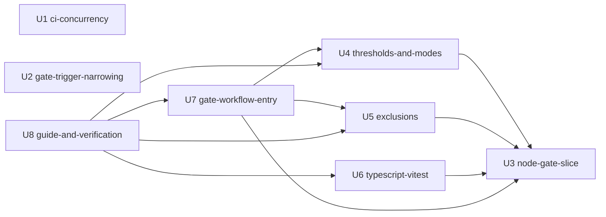

# 共有の網羅率の門 — 単位の依存

## Sources

- [desc] Initial description: 共有の網羅率の門を新しい AI-DLC の取り組みとして始める（Owner の指示 https://github.com/watchout/iyasaka-arc/issues/49#issuecomment-6759071065、本文 SHA-256 `c5d9ccc3510ff46e5d6661bc8c528cafb7e08d4ce2c86f39f049782eaf7e524b`）。
- [scope] Workflow-selected scope: feature
- 単位: [unit-of-work.md](./unit-of-work.md)。部品: [components.md](../domain-design/components.md)。回答: [units-generation-questions.md](./units-generation-questions.md)。

この文書は、何が何に依存するか（形）だけを書く。作る順や最短の道筋は決めない。それは Delivery Planning が、この図を入力として決める。

## 依存の図



矢印は「左が右に依存する」。U1・U2 は他のどの単位とも辺でつながらない。

文章での説明: U1・U2・U3 は依存が無い。U4・U5・U6 は U3 に依存する。U7 は U3・U4・U5 に依存する。U8 は U4・U5・U6・U7 に依存する。循環は無い。

## 辺（機械が読む形）

```yaml
units:
  - name: u1-ci-concurrency
    kind: packaging
    depends_on: []
  - name: u2-gate-trigger-narrowing
    kind: packaging
    depends_on: []
  - name: u3-node-gate-slice
    kind: service
    depends_on: []
  - name: u4-thresholds-and-modes
    kind: service
    depends_on: [u3-node-gate-slice]
  - name: u5-exclusions
    kind: service
    depends_on: [u3-node-gate-slice]
  - name: u6-typescript-vitest
    kind: library
    depends_on: [u3-node-gate-slice]
  - name: u7-gate-workflow-entry
    kind: packaging
    depends_on: [u3-node-gate-slice, u4-thresholds-and-modes, u5-exclusions]
  - name: u8-guide-and-verification
    kind: spec
    depends_on: [u4-thresholds-and-modes, u5-exclusions, u6-typescript-vitest, u7-gate-workflow-entry]
```

## 単位の間の接点

| 接点 | 提供する単位 | 使う単位 | 形 |
|---|---|---|---|
| 行ごとの記録（LineRecord）の形 | U3（CoverageJudge） | U6（TypeScriptVitestMeasurer が変換して渡す） | 共有の型（同じ repo の中の契約） |
| 理由コードの集合、結果の3値、閾値の既定 | U3（CoverageJudge） | U4・U5・U7・U8 | 1か所の定義を参照する（複製しない。NFR3） |
| 入力の検査の入口（CoverageInputContract） | U3（最小） | U4（例外・動作）、U5（除外）、U7（workflow からの入力） | 入力の項目を足す形。既存の入力を壊さない |
| 結果の JSON（ResultDocument） | U3（最小） | U4・U5（項目を足す）、U7（出力値）、U8（検証） | 項目と版の識別は U3 の機能の設計で決める |
| 測定の定義（MeasurementDefinition） | U6 | U7（入力を通す）、U8（手引き） | workflow は値を通すだけ（ADR-006） |
| 呼び出し口（command） | U3（CoverageGateCli） | U7（workflow が command を呼ぶ） | 入力の渡し方と終了コードの写し方 |
| 衛生の共通部品（既存） | HygieneLib | U3（分母の解決） | 変更しない（ADR-003） |

## 並行して開発できる単位の組

互いに依存しない単位の組。複数の正しい並べ方がある。実際には 1 単位 = 1 PR で serial に作る（team.md）ので、これは依存が無いという記録であり、並行して作るという計画ではない。

- {U1, U2, U3}: 互いに独立。
- {U4, U5, U6}: U3 の後、互いに独立。
- U7 は U3・U4・U5 の後、U6 とは独立。U6 が Owner の決定で止まっていても U7 は進められる。

## 最初の本体の単位（walking skeleton）

U3 が、網羅率の門の本体で端から端まで動く最小の版（Node 組込みの形、既定の閾値、3値の結果、JSON と文面、command として動く）。他の単位が機能を足す土台でもある。U3 は他の単位に依存しないので、U1・U2 と並べ替えても動く。S10（U1・U2）は、それぞれ workflow が CI で動く小さな変更で、U3 とは辺でつながらない。順は Delivery Planning が決める。

## 保護対象と依存の関係

U1・U2・U7 は保護対象（workflow の変更）。U7 以外は他の単位に依存しない。U7 は U3・U4・U5 が統合された後でないと、実際に呼ぶ command が無い。U6 の依存の確認（arc-sec と Owner の決定）は U6 の中の条件で、U6 以外の単位に辺を足さない。

## Assumptions & Open Questions

### Assumptions

- [assumption] U7 が U6 に依存しないのは、workflow が測定の形の値を通すだけで、検査は CoverageInputContract（U3）が行う設計（ADR-006）だから。設計の段で、TypeScript の形を追加する時に workflow の変更が要らないことを確かめる。要る場合は、U7 の辺を U6 にも張る。
- [assumption] U8 が U4〜U7 に依存するのは、手引きと検証が出そろった機能に対して書かれるから。U6 が止まっている間は、U8 は TypeScript の分を除いて書く（手引きに明記する）。

### Open Questions

1. U7 で TypeScript の形を後から足すとき、workflow の変更が本当に要らないか（設計の段で確かめる）。
2. 単位の並べ方（S10 を最初にする順を含む）。Delivery Planning が、範囲の文書の順序と arc の答えを入力として決める。
