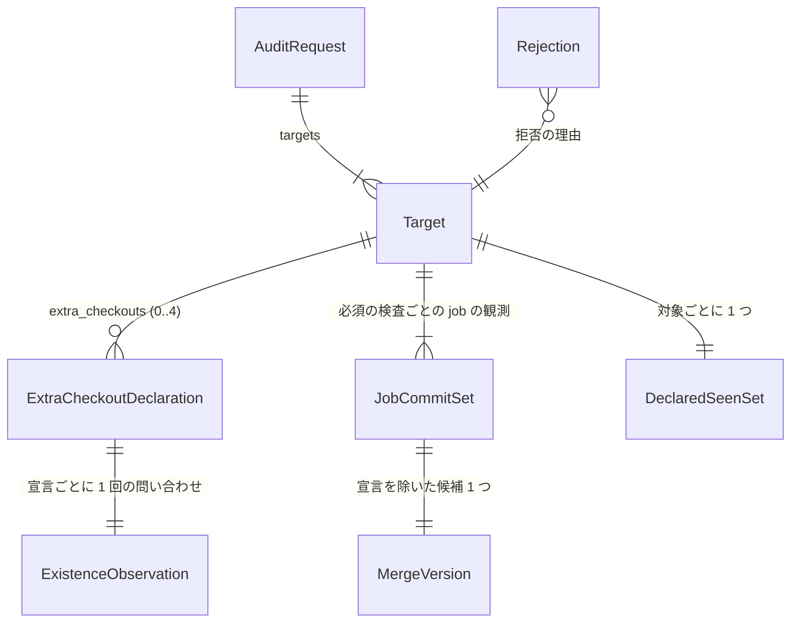

**Collaborator:** aidlc-architect-agent

# 機能仕様（audit-intake-extra）

> 単位 = この取り組みの全体 1 つ、components = 今の checker の受付の file。この取り組みは refactor の scope で、units-generation・domain-design の記録は作られない（仕様どおり）。事実の基準は公開 main `1dd43e457361d9650153578baa71120788285e98` の `scripts/hygiene/audit-admission.mjs`（180 行）。この文書は、ふるまいの順序と状態の移りを定める正本で、実体は `entities.md`、規則は `rules.md` を正とする。

上流: requirements（`aidlc/spaces/default/intents/261113-audit-intake-extra/inception/requirements-analysis/requirements.md`）の FR1〜FR4 と NFR1〜NFR9。

## 1. 決めたこと（設計の判断）

| # | 判断 | 理由 | 採らなかった代替 |
|---|---|---|---|
| D1 | 宣言の欄の名前は `extra_checkouts`。要素は `{ "repo": "<owner>/<name>", "commit": "<40 桁の小文字 16 進>" }`。対象（`targets` の要素）の任意の欄 | 既存の欄（`checks`・`base_moved`）と同じく対象に置く。名前は内容をそのまま言う。名前を決めるのは設計で、arc の委任の範囲の技術判断（Owner の言葉ではない）。設計監査が見る | 依頼の最上位に置く（要件の Q1 の答えは対象ごと）、`additional_checkouts`・`pinned_checkouts`（既存の語彙に無く、足す理由が無い） |
| D2 | 実装は `scripts/hygiene/audit-admission.mjs` の中だけに足す。新しい file を作らない | 依頼の `verifier_sha256` はこの 1 file の bytes に結ばれ、中継は固定した 1 file を実行する。判定の一部を別の file に出すと、結ばれた bytes の外で判定が動く（S5 の「宣言は証拠でない」の逆: 照らされていない code が判定する）。180 行 + 追加で 300 行以内に収める | 宣言の検査を別の module に出す（file の構造は整うが、固定した digest が判定の全部を覆わない） |
| D3 | 欄の名前と上限（4）は、実装の先頭の定数 1 か所が持ち主 | S3。文書はそれを書き写し、試験が 3 か所を照らす（BR4.1） | 文書側に書いた値を実装が読む（判定が文書の編集に左右される） |
| D4 | 宣言は、その対象の「どれかの job の記録」に出ればよい（問い Q1 の答え B。arc の答え） | 追加の checkout を持つのが片方の検査の job だけの PR を受けるため。どの job にも出ない宣言は拒否するので、観測されない宣言を成功に数えない | A（全部の job に求める）、C（宣言に検査の名前を結ぶ） |
| D5 | 宣言の commit の重複は commit だけで判定する | job の記録は commit しか見えず、repo を見分けられない | repo と commit の組で判定 |
| D6 | 既存の 3 つの拒否の文（`Missing or ambiguous checkout commit`・`Tested merge parents differ from requested base/head`・ほか）は変えない。宣言を持つ対象にだけ新しい固定の文を足す | NFR2 の後方互換。古い checker が理由を読む側の script を壊さない | 全部の拒否の文を新しくする |
| D7 | 受付の出力（receipt）は変えない。受け入れた追加の checkout を出力に載せない | 要件の対象外（出力の利用側の読み方を確かめてから別に決める） | 出力に `extra_checkouts_observed` を足す |

## 2. 依頼の形（追加の欄）

```json
{
  "id": "t1",
  "repo": "watchout/example-product",
  "pr": 12,
  "head": "<40 桁>",
  "base": "<40 桁>",
  "checks": ["test", "hygiene / hygiene"],
  "workflow": ".github/workflows/ci.yml",
  "extra_checkouts": [
    { "repo": "watchout/example-common", "commit": "<40 桁の小文字 16 進>" }
  ]
}
```

- `extra_checkouts` は任意。無い・空の配列は同じ（宣言なし）。schema は `sds-audit-request/1` のまま。例の repo 名・commit は架空。
- `watchout/` 以外の owner を宣言してよいか: 今の対象の repo の検査は `watchout/` だけを受ける。宣言の repo の形（BR1.3）は `owner/name` の一般形とし、`watchout/` に絞らない（宣言の repo は「PR 自身の repo 以外」で、固定の許可の一覧は要件の対象外）。

## 3. ふるまいの流れ（workflow）

### W1 依頼を読む（GitHub への問い合わせの前）

1. 既存: 依頼の comment・digest・payload・`requestChecks` を通す。
2. 追加: `requestChecks` の中（または直後）で、全部の対象の `extra_checkouts` を BR1.1〜BR1.8 で検査する。1 件でも不正なら、問い合わせを 1 回もせずに拒否する。
3. 検査を通った宣言だけを、後の判定に渡す。

### W2 対象ごとの判定（`targetCheck`）

1. 既存の検査（PR の状態・head・base・`base_moved`・必須の検査の一覧・check-run の取得）を、今の順のまま行う。
2. 対象ごとに `seen`（DeclaredSeenSet）を空で作る。
3. 必須の検査ごとに、成功した run を探し、workflow・PR の結びを確かめ、`checkoutProof` を呼ぶ（W3）。`checkoutProof` は対象の `seen` を受け取り、見えた宣言の commit を足す。
4. 必須の検査を全部通した後、宣言を持つ対象だけ W4 を行う。宣言を持たない対象は、ここで終わる（今と同じ）。

### W3 job ごとの checkout の判定（`checkoutProof`）

1. 既存: job と run の結びを確かめ、job の記録を取り、`git log -1 --format=%H` の出力から 40 桁の commit を集める（重複は 1 件）。
2. 宣言を持たない対象: 集めた commit がちょうど 1 つでなければ `Missing or ambiguous checkout commit`。両親の検査は今と同じ（BR2.1）。
3. 宣言を持つ対象:
   1. 候補 = 集めた commit のうち、宣言のどの commit とも一致しないもの。
   2. 候補が 0 件なら `Missing or ambiguous checkout commit`、2 件以上なら `Undeclared extra checkout commit`（BR2.2）。
   3. 候補 1 件について、対象の repo の `git/commits/<候補>` を問い合わせ、返った sha が全桁一致し、両親が `[base, head]`（並びを問わない）であることを確かめる。違えば `Tested merge parents differ from requested base/head`（BR2.3）。
   4. 集めた commit のうち宣言の commit に一致したものを `seen` に足す（BR2.6）。
4. 統合の版の sha を返す（`tested_merge`、今と同じ）。

### W4 対象ごとの宣言の確認（宣言を持つ対象だけ）

1. 宣言の commit のどれかが `seen` に無ければ `Declared extra checkout not in CI log`（BR3.1）。
2. 宣言を並びの順に 1 件ずつ、宣言の repo の `git/commits/<commit>` を 1 回だけ問い合わせる。応答が取れない・読めない・期限切れ・sha が全桁一致しないなら `Declared extra checkout not found in declared repo`（BR3.2）。再試行しない。
3. 全部が一致すれば、その対象の判定を終える。

### W5 全体の流れの中での位置

`verifyAudit` は、受付の最初の観測（`targetCheck`）と、review を受けた時の再観測（`targetCheck` をもう一度）を行う。宣言の確認（W4）はどちらの観測にも含まれるので、1 回の review の確かめで宣言 1 件あたりの問い合わせは最大 2 回になる。再観測の結果と最初の結果が食い違えば、今の `base_moved` の確かめと同じく拒否する（宣言の確認は拒否か通過しかなく、出力に載せないため、食い違いは例外として現れる）。問い合わせの総数の予算は nfr-requirements で明示する。

## 4. 状態の移り（対象 1 件の判定）

```text
START
  ├─ 宣言の欄が無い／空 ──────────────→ LEGACY（W3 の 2。今の判定）──→ ACCEPTED / REJECTED
  └─ 宣言あり
       ├─ 形・件数・重複・自 repo・必須の検査なし ──→ REJECTED（問い合わせ前）
       └─ 形を通過
            └─ job ごとに CLASSIFY（W3 の 3）
                 ├─ 候補 0 件／2 件以上 ──→ REJECTED
                 ├─ 候補 1 件で両親が違う ──→ REJECTED
                 └─ 候補 1 件で両親が一致 ──→ seen を更新して次の job へ
            └─ 全部の job を通過
                 ├─ seen に無い宣言あり ──→ REJECTED
                 └─ 全部 seen
                      └─ 宣言ごとに EXISTENCE（W4 の 2）
                           ├─ 1 件でも不一致／取得不能 ──→ REJECTED
                           └─ 全部一致 ──→ ACCEPTED
```

- REJECTED は終端で、依頼全体の拒否になる（BR3.4）。部分的な受け入れを作らない。
- 「観測できず」（取得不能・期限切れ・読めない形）は、拒否と同じ経路に入り、成功に数えない（S5・S8）。

## 5. 実体の関係（derived view）



テキストでの代替: AuditRequest は Target を 1 つ以上持つ。Target は宣言を 0〜4 件持ち、必須の検査ごとの job の観測（JobCommitSet）から統合の版（MergeVersion）を 1 つ決め、対象ごとに 1 つの DeclaredSeenSet を持つ。宣言ごとに 1 回の実在の観測（ExistenceObservation）があり、どこかで失敗すれば Rejection になる。

## 6. 規則の要約（derived view。正本は `rules.md`）

| 規則 | 場所 | 要点 |
|---|---|---|
| BR1.1〜BR1.8 | W1 | 欄は任意・対象ごと・4 件まで・形・commit の書式・重複なし・自 repo と同じは不可・必須の検査なしは不可・問い合わせ前に全部検査 |
| BR2.1〜BR2.6 | W3 | 宣言なしは今と同じ・候補はちょうど 1・両親は base と head・全桁一致・名前と順序を読まない・見えた宣言を `seen` に足す |
| BR3.1〜BR3.6 | W4 | 宣言はどれかの job に出る・宣言の repo に実在（1 件 1 回）・出力は同じ形・全体を拒否・決定性・固定の理由 |
| BR4.1〜BR4.2 | 文書 | 3 か所の揃い・文書に書く内容 |

## 7. 次の段（nfr-requirements）に渡す事柄

- 問い合わせの総予算: 宣言 1 件 × 4 件 × 対象の数 × 観測 2 回（最初と review 後の再観測）。1 回の限りは今のまま（20 秒・8 MB）。
- 行の網羅率: 対象は `scripts/hygiene/audit-admission.mjs` と新しい試験 file。分母・コマンド・対象 0 件を成功に数えない形を、nfr-requirements で特定する。
- 構造の上限: `audit-admission.mjs` は 180 行から 300 行以内。関数は 50 行・複雑さ 10 以下。宣言の検査と commit の分類は、複雑さの上限を超えないよう小さい関数に分ける。
- 古い checker（中継が固定している版）は新しい欄を無視し、2 checkout の PR を今と同じく拒否する（安全側）。中継の版を替えるまでの間の挙動として、要件の Open questions に記録済み。
